# Лунора — архитектура системы

**Дата:** 2026-11-15 · **Версия:** 1 · **Статус:** предложение архитектора, вход для дорожной карты (G9 → G14)
**Основание:** `_SESSION.json` (решения D-001…D-084, D-G7-13…30), `data-model.md` v3 (контракт заморожен), `engine-spec.md`, `thesis-catalog.md`, `consensus-map.md`, `agreement-rules.md`, `safety-rules.md`, `calc-tables.md`, `depth-model.md`, `idempotency.md`, `spec/*`.

Метки в тексте:

| Метка | Смысл |
|---|---|
| **[ДОК]** | факт или решение взято из документов проработки, указан источник |
| **[АРХ]** | архитектурное решение этого документа |
| **[ПРОВЕРИТЬ]** | утверждение, которое нельзя принять без spike или сверки; до проверки считается гипотезой |
| **[ОТКРЫТО]** | вопрос оператору или юристу, сведён в §13 |

---

## 0. Резюме на одну страницу

Лунора — модульный монолит на Python, в котором **расчёт, решение «что сказать» и формулировка — три разных слоя с односторонней зависимостью**. Языковая модель стоит в самом конце цепочки и получает не карту, а готовый план рассказа.

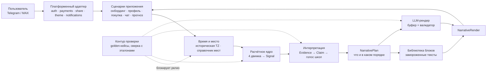

### Десять ключевых решений

| # | Решение | Почему | Опора |
|---|---|---|---|
| 1 | **Три слоя: Клиенты → API → Движок** (см. ADR-002). Движок не знает о платформе, БД и LLM; клиенты (Telegram, MAX, веб, мобильные) тонкие и ходят через версионируемый публичный API; школы — сменные модули за общим контрактом сигналов | добавление клиента не переписывает движок; добавление школы не ломает остальные; один разработчик | D-037, D-113, ADR-002 |
| 2 | **Расчётное ядро — чистые функции** `InputSnapshot → ChartSnapshot`, результат неизменяем и адресуется хешем входа и версий | воспроизводимость жалобы через год, кэш без инвалидации, golden-тесты | `thesis-catalog.md` §5, `data-model.md` |
| 3 | **Эфемеридный рантайм — Skyfield + JPL DE440** (MIT + public domain NASA); свои реализации ведического и Ба-Цзы движков поверх него. Swiss Ephemeris, cnlunar, lunar-python, PyJHora — только оракулы в тестах | ADR-001 (B23): снимает лицензию 700 CHF и AGPL-риск; в рантайме только разрешительные лицензии | ADR-001, D-104 |
| 4 | **Время рождения → UTC — отдельный модуль** с собственной исторической базой, собственными golden-кейсами и правом вернуть «неоднозначно» | R-41: час ошибки сдвигает карту у всей ЦА; это самый дорогой возможный баг | R-41 (`06_ux.md` §9), R-52 |
| 5 | **Неопределённость — интервал, а не ступень.** Движки считают карту на интервале времени и возвращают для каждого сигнала «устойчив / диапазон / не определён» | D-046, D-G7-19; деградация без времени становится частным случаем, а не веткой кода | D-028, D-046 |
| 6 | **Голос школ считает код** по каталогу тезисов; три исхода: подтверждает, спорит, молчит. Усреднения и «трое против одного» нет | модель тянет к «согласны все четыре» | `thesis-catalog.md` §1, `agreement-rules.md` §7 |
| 7 | **Два рендера одного плана.** Бесплатный слой собирается из замороженной библиотеки без LLM; платный синтез и чат пишет LLM по тому же `NarrativePlan` | R-05: бесплатный слой на LLM превышает бюджет в 9 раз | D-031, R-05 |
| 8 | **Шов «правда → проза»:** LLM получает только выводы и разрешённые формулировки, ответ буферизуется, проходит четыре проверки и только потом показывается | архитектура, безопасность и юридическая защита одним механизмом | `data-model.md` §9, `safety-rules.md` |
| 9 | **Golden-контур — часть сборки.** Эталонные кейсы лежат в репозитории как данные, падение блокирует релиз; смена tzdata, эфемерид или правил требует отчёта «сколько карт изменится» | ручная сверка не масштабируется и не переживает обновления зависимостей | требование брифа, `thesis-catalog.md` §6 |
| 10 | **ПДн шифруются ключом пользователя** (AES-256-GCM, ключ данных обёрнут мастер-ключом); удаление аккаунта = уничтожение ключа | удаление доходит и до резервных копий; tombstone остаётся без ПДн | D-056, 152-ФЗ |

### Что в документах расходится с брифом на архитектуру

Источником правды приняты документы проработки (более поздние записи отменяют ранние). Расхождения не решаю за оператора: архитектура выдерживает оба варианта, решение вынесено в §13.

| Тема | Бриф | Документы | Как учтено |
|---|---|---|---|
| «Профиль из 6 шкал» | бесплатный слой — 6 шкал качеств | механика «профиль в цифрах» **снята целиком** 2026-08-11 (`04_product.md` §2.2); согласие школ живёт в тексте и карточках, шкалы остались внутри школ в родных единицах | проектирую карточки утверждений с голосом школ; числовых сводных шкал нет |
| Суточный доступ с таймером | 249 ₽ за сутки, таймер, пуш за час | **РЕШЕНО B16 (2026-11-16): модель доступа — пакеты запросов, не время** | `time_window` из модели убран; остаются `quota` и `unlock`; задача «пуш за час» не создаётся |
| Цена суток | 249 ₽ | расхождение 249/349 | **РЕШЕНО B16: единый прайс в одном источнике; разбивка цен по школам убрана** |
| Канал оплаты | Bot Payments API + ЮKassa | `spec/payment.md`: страница оператора в браузере, факт оплаты из вебхука | порт оплаты с двумя адаптерами, основной — прямой API ЮKassa (§9) |
| Идентификатор риска | R-41 — советское время | в `RISKS.md` номер R-41 занят возвратами; советское время там же записано как **R-52** | в документе «R-41» означает риск из `06_ux.md` §9; коллизию номеров нужно снять в реестре |
| Система домов | — | ✅ РЕШЕНО (D-105, B11): цельные знаки — основная; Плацидус справочно; порог **66,56°** | применено в §3.4; `edge-cases.md`/`calc-tables.md` — привести к 66,56° (W0-3) |

---

## 1. Обзор системы и границы

### 1.1 Контекст

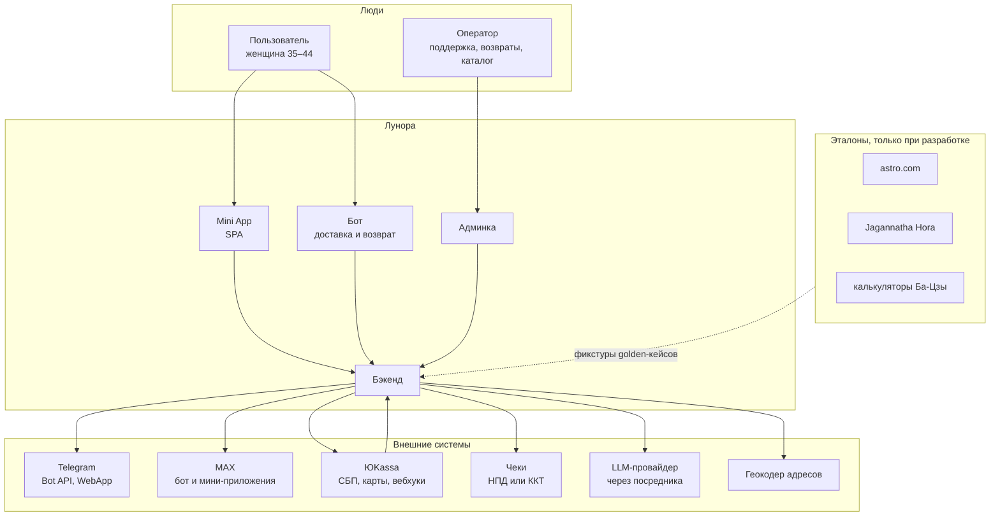

### 1.2 Внешние зависимости

| Зависимость | Зачем | Что будет при отказе | Развязка |
|---|---|---|---|
| Telegram Bot API и WebApp | вход, доставка, шеринг | продукт недоступен на площадке | `PlatformPort`; MAX — вторая реализация |
| MAX | вторая площадка (D-036) | — | **[ОТКРЫТО]** A-01, A-02: допуск ИП и политика по тематике не выяснены |
| ЮKassa | приём оплаты, возвраты | нет покупок, бесплатный слой работает | `PaymentPort` |
| LLM через посредника (R-15) | платный синтез, чат, извлечение памяти, фабрика блоков | платные генерации в очереди, бесплатный слой работает | `LLMPort`, смена модели — конфигурация; резервный провайдер |
| Skyfield + JPL DE440 | положения планет, солнечные термины; дома, айанамша, ASC/MC, узлы, Хирон — собственный код поверх (ADR-001) | критично, но это локальная библиотека и файлы ядра | единственный модуль, который её импортирует (`_ephem.py`). Swiss Ephemeris (pyswisseph) — только тестовый оракул, в рантайм не импортируется |
| База часовых поясов | историческое смещение | критично, локальные данные | собирается и версионируется внутри проекта (§4) |
| Справочник мест | координаты и пояс города | локальные данные | собирается внутри проекта (§4) |
| Геокодер адресов | координаты дома | адрес не уточняется, расчёт идёт по городу | `AddressGeocoderPort`; вклад адреса в глубину 3 из 100 (`depth-model.md`) |
| astro.com, Jagannatha Hora, калькуляторы Ба-Цзы | эталоны | — | в рантайме не участвуют, снимаются вручную в фикстуры (§6) |

### 1.3 Что система не делает

| Не делает | Источник |
|---|---|
| LLM не считает положения, периоды, числа и не решает, согласны ли школы | `thesis-catalog.md` §9, `agreement-rules.md` §7 |
| Не подбирает время рождения (ректификация) | `spec/edge-cases.md` Х-06 |
| Не даёт сводного процента совместимости и общей шкалы школ | D-020, `safety-rules.md` |
| Не хранит данные карты и не показывает страницу оплаты у себя | `spec/payment.md`, граница оператора |
| Не читает переписку и разборы в админке без обращения человека | `admin-scope.md` |

---

## 2. Компонентная архитектура

### 2.1 Варианты и выбор

| Вариант | Плюсы | Минусы | Вердикт |
|---|---|---|---|
| A. Монолит без границ (как текущий скелет `src/lunora`) | быстрее всего стартовать | платформа и LLM протекают в ядро; MAX означает переписывание | нет |
| B. Микросервисы: расчёт, интерпретация, платформа отдельно | независимое масштабирование | один человек, один сервер, сеть вместо вызова функции; расчёт занимает миллисекунды | нет |
| **C. Модульный монолит: один деплой, пакеты с проверяемым направлением импортов** | границы как у сервисов, эксплуатация как у монолита; любой пакет можно вынести позже | дисциплина держится на линтере | **да** |

**[АРХ]** Направление зависимостей проверяется в CI инструментом контроля импортов: нарушение — красная сборка.

⚠️ Вопрос «изоляции AGPL» снят решением ADR-001 (B23): эфемериды в рантайме — Skyfield+DE440 (разрешительные лицензии), AGPL-зависимости в рантайме нет, выкуп лицензии не требуется.

### 2.2 Контейнеры

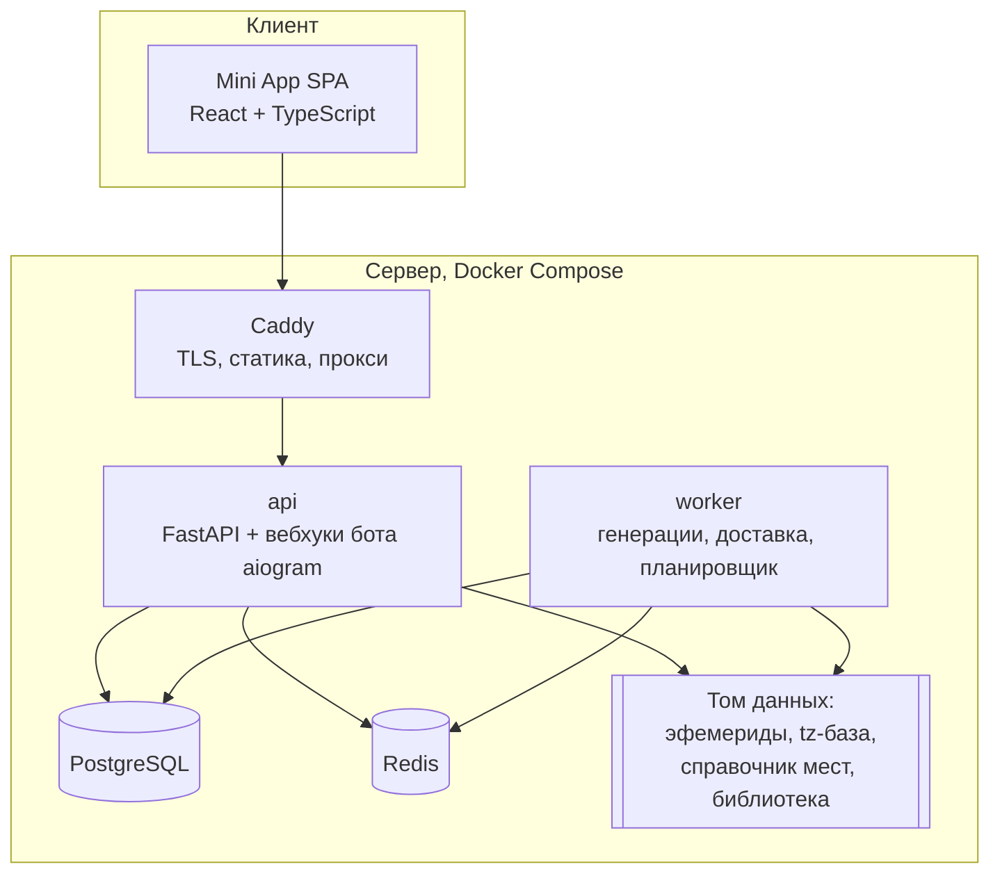

| Контейнер | Ответственность | Не делает |
|---|---|---|
| **SPA** | экраны, черновик формы до согласия, локальный поиск города, мост к площадке | не считает астрологию, не хранит ПДн на сервере до согласия |
| **Caddy** | TLS, раздача SPA и справочника мест, прокси на `api` | не пишет тело запросов в лог |
| **api** | HTTP API Mini App, вебхуки площадок и ЮKassa, админка | не выполняет долгие генерации в запросе |
| **worker** | очередь генераций LLM, сборка PDF, доставка сообщений, задачи по времени | не принимает внешние запросы |
| **PostgreSQL** | единственный источник истины: пользователи, карты, выводы, покупки, ключи идемпотентности, очередь задач по времени | — |
| **Redis** | очередь задач, сессии, лимиты, кэш производных | не хранит ничего невосстановимого |

### 2.3 Пакеты и направление зависимостей

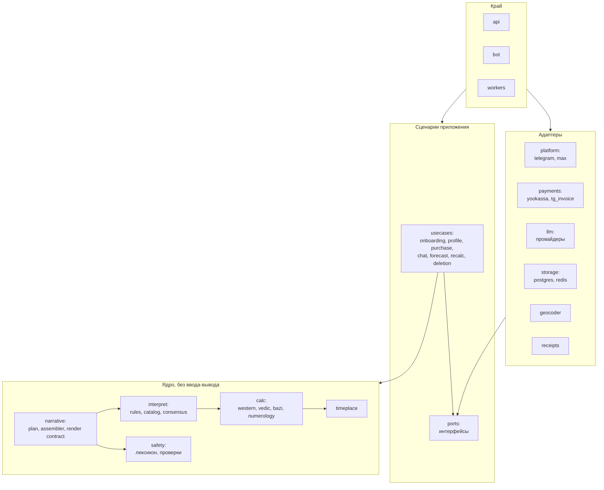

Предлагаемая структура каталогов:

```
src/lunora/
  core/
    timeplace/     историческое время, справочник мест, интервалы неопределённости
    calc/          порты движков, ChartSnapshot, Signal
      _ephem.py    эфемеридный доступ (Skyfield + JPL DE440); swisseph — только в tests/ (оракул)
      western/ vedic/ bazi/ numerology/
    interpret/     правила Signal→Evidence→Claim, каталог тезисов, голос школ, связи
    narrative/     NarrativePlan, детерминированный сборщик, контракт NarrativeRender
    safety/        запрещённый лексикон, словарь связей, проверки текста
  app/
    ports/         PlatformPort, PaymentPort, LLMPort, репозитории, Clock
    usecases/
    entitlements/  продукты, доступы, списания
    memory/        память агента
    scheduler/     задачи по времени
  adapters/
    platform/{telegram,max}/
    payments/{yookassa,telegram_invoice}/
    llm/  storage/  geocoder/  receipts/  crypto/
  api/  bot/  workers/  admin/
content/           каталог тезисов, словари значений, библиотека блоков (версионируемые данные)
data/              сборки tz-базы и справочника мест, манифест эфемерид
tests/golden/      эталонные кейсы как данные
tools/blockfactory/ офлайн-фабрика блоков (engine-spec.md)
```

🔒 **Инварианты импортов.** `core/*` не импортирует `app`, `adapters`, `api`, сетевые и ORM-библиотеки. эфемеридный доступ (Skyfield) изолирован в `core/calc/_ephem.py`; `swisseph` и пакеты-оракулы (cnlunar, lunar-python, PyJHora) импортируются только из `tests/`.

### 2.4 Существующий код

В репозитории есть скелет (`src/lunora`, около 850 строк в `calc` и `llm`). По правилу сессии он не является основой; аудит «что оставить» — отдельный финальный шаг. Два наблюдения, важных уже сейчас:

| Файл | Что делает | Почему не годится как есть |
|---|---|---|
| `calc/timezone.py` | возвращает имя зоны по координатам через `timezonefinder` | нет применения смещения по дате рождения, нет неоднозначностей и версий — ровно сценарий R-41 |
| `calc/geocode.py` | онлайн-запрос к публичному Nominatim по произвольной строке | противоречит D-052 (только справочник с историческими названиями) и D-057 (до согласия на сервер ничего не уходит) |

---

## 3. Расчётное ядро

Единственный источник фактов в системе. Всё, что ниже по цепочке, ссылается на его результат и не может его дополнить.

### 3.1 Общий контракт

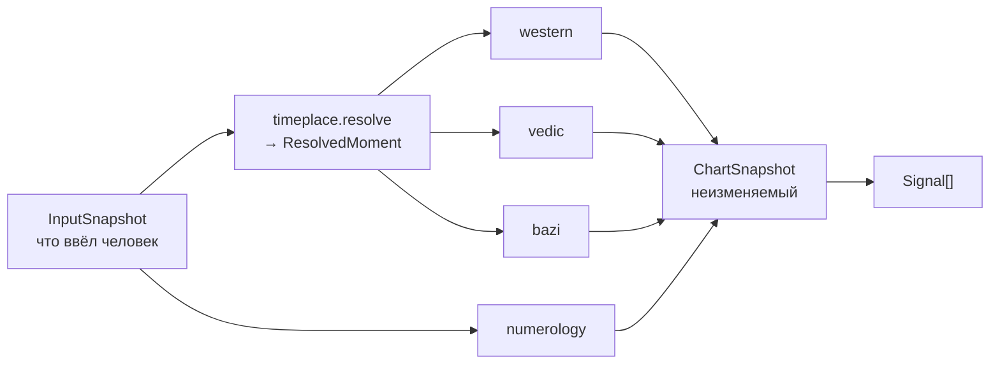

Порт движка (сигнатуры — предложение, не код):

```
class CalcEngine(Protocol):
    system_id: SystemId                 # western | vedic | bazi | numerology
    engine_version: str                 # semver, входит в ключ кэша

    def requirements(self, profile: MethodProfile) -> InputRequirements
        # какие поля обязательны, какие повышают полноту (матрица D-072)

    def compute(self, inp: EngineInput, profile: MethodProfile) -> SystemChart
        # чистая функция: тот же вход → тот же побайтно результат

    def compute_temporal(self, chart: SystemChart, at: UtcInstant) -> TemporalChart
        # периоды и транзиты на дату; натальная часть не пересчитывается

    def signals(self, chart: SystemChart) -> list[Signal]
        # разворачивает карту в сигналы по data-model.md §1
```

```
EngineInput:
  moment: ResolvedMoment | None     # None → движок работает только по дате (нумерология всегда)
  place: ResolvedPlace | None
  sex: 'f' | 'm' | None
  names: NameForms | None           # при рождении · нынешнее · планируемое (D-054)
```

`ResolvedMoment` — не точка, а интервал с гипотезами смещения (§4.5). Движок обязан вернуть для каждого сигнала устойчивость на этом интервале.

### 3.2 Представление посчитанной карты

```
ChartSnapshot:
  id = sha256(canonical(InputSnapshot) + версии)      # адресуется содержимым
  input_snapshot_id
  versions: { engine: {western, vedic, bazi, numerology},
              method_profiles: {...}, ephemeris, tz_build, gazetteer_build }
  resolved_moment, resolved_place                     # с провенансом из §4
  systems: { western: SystemChart, vedic: ..., bazi: ..., numerology: ... }
  signals[]                                           # плоский список, контракт data-model.md
  availability: { system → AVAILABLE | INSUFFICIENT_DATA | ... , причины }
```

Расширение поля `Signal.sensitivity` из `data-model.md` **[АРХ]**: вместо флагов — вычисленный результат.

```
Signal.stability:
  status: stable | range | undetermined
  values[]            # при range: все значения на интервале (Луна: «Телец или Близнецы»)
  flips_at[]          # моменты местного времени, где значение меняется
  depends_on: [birth_time, birth_place, tz_hypothesis, name_form, method_choice]
```

Контракт `data-model.md` заморожен, поэтому это уточнение оформляется как версия 3.1 с обратной совместимостью: `calculation_confidence` вычисляется из `stability`, а не задаётся.

### 3.3 Общая астрономическая основа

| Вопрос | Решение | Обоснование |
|---|---|---|
| Источник положений | **Skyfield + JPL DE440** (ADR-001); файлы ядра и их контрольные суммы записаны в `data/` и в `versions.ephemeris`. Swiss Ephemeris — тестовый оракул | лицензия MIT + public domain; точность по Луне ≤ 0,41″ |
| Шкала времени | на вход движкам — UTC; перевод в эфемеридное время делает сама библиотека | ΔT не изобретаем |
| Доступ к библиотеке | один модуль `_ephem.py` (Skyfield) с типизированными функциями: положение тела, дома, айанамша, поиск момента заданной долготы Солнца | точка замены при смене библиотеки или набора эфемерид; всё, чего нет в Skyfield (дома, айанамша, ASC/MC, узлы, Хирон), строится здесь же собственным кодом |
| Потокобезопасность | у Skyfield нет глобального состояния (сидерического режима, пути к файлам); айанамша — собственная функция | сидерические долготы = тропические минус айанамша; регрессионный тест на параллельный расчёт (T-9 вырожден) |
| Округление | внутри — числа с плавающей точкой без округления; округление только при отображении | иначе сравнение с порогами («Сатурн ≥ 4 баллов», граница знака) зависит от формата вывода |

### 3.4 Западный движок

| Что | Как | Источник |
|---|---|---|
| Зодиак | тропический | `calc-tables.md` |
| Тела | 7 классических; Уран, Нептун, Плутон — «современный слой», не управляют знаками и не входят в цепочку диспозиторов; Лилит, Хирон, Селена — справочно, оснований для выводов не дают | `calc-tables.md`, `safety-rules.md` |
| Дома | **цельные знаки — основная система** (D-105, B11); Плацидус считается справочно; выше **66,56°** (полярный предел Плацидуса) куспиды не вычисляются — явное «не применимо», не NaN | `ENGINE-SPEC-РАСЧЕТ.md` §2.5; `calc-tables.md` |
| Достоинства и «баллы планет» | таблица правил в `content/`, версия записывается в сигнал | **[ОТКРЫТО]** формальной таблицы начисления баллов в документах нет: «Марс 6 баллов» встречается как результат, а не как правило |
| Секта, жребии, альмутен, аспекты с орбисами, конфигурации | детерминированные правила; набор орбисов — параметр профиля | `calc-tables.md` |
| Периоды | годовые профекции, фирдария — через `compute_temporal` | `calc-tables.md`; для карточки периода западная школа не используется (`thesis-catalog.md` §4.1) |

### 3.5 Ведический движок

**[АРХ]** Собственная реализация поверх `_ephem.py` (Skyfield). PyJHora — оракул в тестах.

| Что | Как | Риск |
|---|---|---|
| Айанамша | Читрапакша (Лахири); конкретный вариант и значение на дату хранятся в сигнале настроек | **[ПРОВЕРИТЬ]** у «Лахири» несколько вариантов реализации; вариант должен совпасть с настройкой эталона в Jagannatha Hora, иначе golden-кейсы расходятся на угловые секунды и это всплывает на границах накшатр |
| Раши, бхавы, лагна | цельнознаковые бхавы от лагны | — |
| Накшатра и пада | деление сидерической долготы Луны на 27 и на 108 частей | пада меняется примерно раз в 6 часов: чувствительна к времени |
| Вимшоттари | от доли пройденной накшатры Луны; махадаша, антардаша, пратьянтардаша | **[ПРОВЕРИТЬ]** длина года в расчёте дат даш (варианты дают сдвиг на недели и месяцы) — параметр `MethodProfile`, фиксируется по эталону |
| Навамша D9, дашамша D10 | арифметика от долготы | — |
| Йоги с отменами | правила в `content/`, каждая йога: условие, условия отмены, источник | `spec/schools.md`: без проверки отмен объявим йогу там, где её нет |
| Шад-бала, авастхи, аштакаварга | поэтапно: в первой версии — то, на что ссылается каталог тезисов | объём большой; порядок задаёт каталог, а не таблица расчёта |
| Запрещённые техники | аюр-дайя, марака **не реализуются вовсе** | `safety-rules.md` §1: чего нет в сигналах, то не попадёт в текст |

### 3.6 Движок Ба-Цзы

Варианты:

| Вариант | Плюсы | Минусы |
|---|---|---|
| A. cnlunar в рантайме | готово, зависимость уже в `pyproject.toml` | лицензия не проверена (R-16); **[ПРОВЕРИТЬ]** точность границ солнечных терминов до минуты и поддержка истинного солнечного времени; библиотека решает и часовой пояс, а он у нас свой |
| B. lunar-python в рантайме | богаче по функциям | те же вопросы |
| **C. Своя реализация: термины из Skyfield, столпы арифметикой; A и B — оракулы** | граница ли-чунь считается тем же источником, что и вся астрономия; ноль лицензионного риска; R-16 оценивает объём в неделю | свой код нужно доказать golden-кейсами | 

**[АРХ]** Вариант C. Бриф называет cnlunar; он остаётся в проекте как дифференциальный оракул (§6.3), а при положительном аудите лицензии может использоваться и для второстепенных календарных величин.

| Что | Как | Источник |
|---|---|---|
| Граница года | момент, когда тропическая долгота Солнца равна 315° (ли-чунь), с точностью до секунд | R-53; эталонная карта стейкхолдера — за 4 ч 18 мин до ли-чунь 1984 |
| Границы месяцев | 12 «узловых» солнечных терминов тем же поиском долготы | `calc-tables.md` |
| Столп дня | 60-ричный цикл от номера юлианского дня; **смена дня — в 23:00 по истинному солнечному времени** (D-106, B13) | `ENGINE-SPEC-РАСЧЕТ.md` §5.4; альтернатива (полночь) — только как профиль |
| Столп часа | по **истинному солнечному времени**: поправка на долготу места и уравнение времени | `calc-tables.md`. Следствие: декретный час на столп часа не влияет напрямую, но ошибка в UTC влияет |
| Да-юнь | направление от пола и полярности года (D-064), возраст входа от расстояния до ближайшего термина | пол обязателен; предзаполнение «женский» (`depth-model.md`) — известный риск |
| Скрытые стволы, десять богов, сила господина дня, баланс стихий, взаимодействия | таблицы в `content/` с версиями | весовые правила («Земля ≥ 3 из 8») должны быть формализованы до каталога |
| Юншэнь | **[ОТКРЫТО]** четыре конкурирующих метода (`calc-tables.md`); климатическая потребность не расписана | выбор метода — `MethodProfile`, вывод помечается `method_consensus: contested` |

### 3.7 Нумерологический движок

Чистая арифметика, без времени и места. Сложность не в вычислениях, а в однозначности правил.

| Что | Правило | Источник |
|---|---|---|
| Числа даты и психоматрица | метод Александрова: рабочие числа, квадрат 3×3, 8 линий, единая семиуровневая шкала (уровень «три» — отдельный характер, а не середина) | `dict-numerology.md`. **[ПРОВЕРИТЬ]** по первоисточнику правило для рождённых с 2000 года — нужно для слота «ребёнок» |
| Числа имени | метод Баллиетт, применённый к кириллице буквально, все 33 буквы; таблица публикуется в интерфейсе | D-053, D-G7-14 |
| Свёртка | 8, 9, 11, 22 не сворачиваются | D-G7-13 |
| Гласные и согласные | Й, Ъ, Ь — спорная зона | **[ОТКРЫТО]** G6; хранится как параметр профиля, сигнал получает `method_consensus: contested` |
| Формы имени | три состояния: при рождении (основа), нынешнее, планируемое; «как обращаться» в расчёт не идёт | D-054, D-065 |
| Нормализация ввода | регистр, пробелы, дефис, «ё» и «е» различаются; латиница не транслитерируется молча | R-23; правило нормализации версионируется, как любое правило расчёта |
| Запретные ярлыки | «кармический долг» в сигнале называется `karmic_lesson` | `safety-rules.md` |

### 3.8 Детерминизм и кэширование

| Свойство | Механизм |
|---|---|
| Один вход — один результат | движки без часов, случайности и сети; «сегодня» передаётся параметром (`Clock`-порт) |
| Адресация | `ChartSnapshot.id` — хеш канонической формы входа и всех версий |
| Кэш натальной карты | таблица `chart_snapshot` в PostgreSQL; запись не изменяется никогда |
| Смена версии движка, правил, tz-базы | новая запись с новым id; старая остаётся, разборы ссылаются на свою версию (`thesis-catalog.md` §6: версия каталога в каждом разборе) |
| Массовый пересчёт | офлайн-задача: посчитать новую версию для всех, построить отчёт различий, показать оператору до переключения |
| Производные на дату | `compute_temporal` кэшируется в Redis по ключу (карта, местная дата) |
| Пересчёт по правке данных | блокировка на пользователе (`idempotency.md`, точка 10); пересчитываются только школы, чьи входы изменились (`recalc-flow.md`) |

---

## 4. Время и место (R-41)

### 4.1 Почему отдельный модуль

**[ДОК]** `06_ux.md` §9: с 1930 года в СССР действовало декретное время (+1 час к поясному), с 1981 года сверху накладывалось летнее. Родившаяся в Москве 15 июня 1987 года была в UTC+4. Ошибка на час смещает асцендент примерно на 15° и может перекинуть столп часа. Волгоград в феврале 1984 года — UTC+4, а не московские UTC+3 (R-52).

Три свойства делают этот риск худшим в проекте:

| Свойство | Следствие |
|---|---|
| Ошибка **тихая** | карта строится, тексты пишутся, ничего не падает |
| Ошибка **массовая** | затронут не край, а ядро ЦА |
| Ошибка **проверяемая пользователем** | достаточно открыть astro.com; расхождение прочтётся как «они считают неправильно» и обесценит весь продукт |

Поэтому преобразование «местное время на часах роддома → UTC» выделено в модуль с собственными данными, версиями, golden-кейсами и правом сказать «неоднозначно».

### 4.2 Конвейер

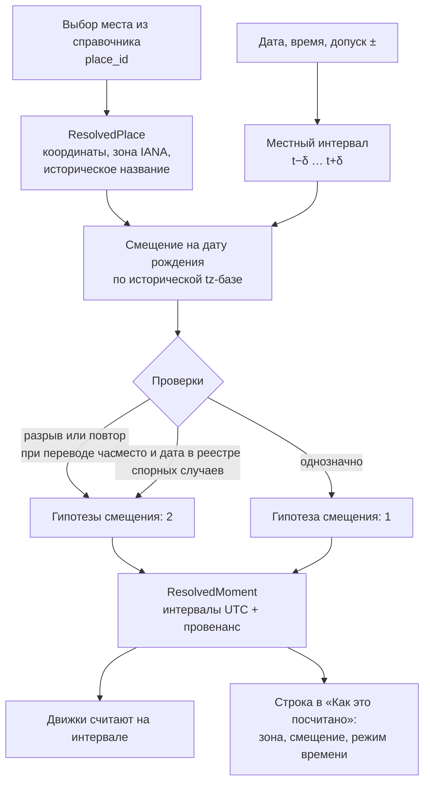

```
ResolvedMoment:
  local_date, local_time | None, tolerance_minutes | None      # None → время неизвестно
  hypotheses[]:
    utc_start, utc_end                 # интервал, не точка
    utc_offset, regime                 # 'декретное', 'декретное + летнее', 'поясное' ...
    weight: primary | alternative
    reason                             # почему появилась альтернатива
  provenance: { tz_build, zone_id, rule_ref, dispute_id | None }
```

### 4.3 Историческая база часовых поясов

| Вариант | Плюсы | Минусы | Вердикт |
|---|---|---|---|
| A. Системная tz-база через стандартную библиотеку | ничего не делать | версия зависит от образа контейнера; обновление молча меняет карты; **[ПРОВЕРИТЬ]** стандартные сборки объединяют зоны, совпадающие после 1970 года, и теряют различия до 1970-го | нет |
| B. Пакет tzdata из PyPI с закреплённой версией | версия под контролем | то же объединение зон до 1970 года **[ПРОВЕРИТЬ]** | недостаточно |
| **C. Собственная сборка из исходников IANA с полным набором исторических зон, закреплённая версия, плюс слой поправок** | контроль над данными до 1970 года; версия — часть ключа карты; поправки и спорные случаи живут рядом | нужно собрать и сопровождать | **да** |
| D. Коммерческий атлас времени | готовая экспертиза | цена, лицензия, закрытые данные в публичном репозитории | как эталон для сверки, не как рантайм |

**[АРХ]** Вариант C из трёх слоёв:

| Слой | Содержание | Кто меняет |
|---|---|---|
| 1. База IANA, полная историческая сборка | правила зон, включая декретное время, летнее время 1981–2010, переходы 1991–1992, 2011, 2014 и региональные сдвиги | обновляется только осознанно, с отчётом различий |
| 2. Реестр поправок `tz_overrides` | место или регион, интервал дат, смещение, источник (нормативный акт, атлас) | агент с проверкой; каждая запись несёт ссылку на источник |
| 3. Реестр спорных случаев `tz_disputes` | место или регион, интервал дат, два возможных смещения, причина | наполняется из расхождений между эталонами (§6.4) |

Что известно о границах применимости:

| Период рождения | Кого касается | Надёжность базы |
|---|---|---|
| с 1970 года | сама ЦА (35–44 в 2026 году — это 1982–1991) | зоны IANA определены как области с одинаковыми часами с 1970 года; региональные сдвиги СССР представлены отдельными зонами. **[ПРОВЕРИТЬ]** точность советских данных spike'ом по списку областных центров |
| 1930–1969 | родители, старшие партнёры, часть «людей» в слотах | зависит от полной исторической сборки; точность ниже, реестр спорных случаев будет плотнее |
| до 1930 | единичные случаи | местное среднее время и поясная реформа; считаем, но помечаем пониженной уверенностью |

⚠️ **Замечание к формулировке теста в `06_ux.md`.** Там сказано, что Москва летом 1987, зимой 1987, летом 2010 и летом 2012 «должна дать три разных смещения». По моим данным смещений здесь два: UTC+4 летом 1987, UTC+3 зимой 1987, UTC+4 летом 2010 (летнее время) и UTC+4 летом 2012 (постоянное). Различаются **режимы**, а не три значения. **[ПРОВЕРИТЬ]** при spike; golden-кейсы строятся от эталонов, а не от этой фразы. Отдельно обязательны кейсы на 1991–1992 годы, когда декретное время отменяли и возвращали.

### 4.4 Справочник мест

**[ДОК]** D-052, D-G7-21: место — только выбор из справочника с автодополнением; исторические названия обязательны; произвольный ввод не принимается; поля «Страна» нет.

| Вариант | Плюсы | Минусы | Вердикт |
|---|---|---|---|
| A. Онлайн-геокодер на каждый ввод | полнота | строка запроса уходит третьей стороне до согласия; исторических названий нет; пояс всё равно определять самим | нет |
| **B. Собственный справочник городов как статический файл; поиск на клиенте** | до согласия на сервер не уходит ничего (D-057); исторические названия и зона IANA — наши поля; работает без сети | сборка и поддержка справочника | **да** |
| C. Собственный справочник, поиск на сервере | меньше файл на клиенте | запрос до согласия; нужна анонимная ручка | запасной |

Состав записи справочника:

```
Place:
  place_id                       # стабильный ключ, хранится в InputSnapshot
  names: [{ name, kind: current | historical | alias, valid_from, valid_to }]
         # Ленинград, Свердловск, Горький, Куйбышев, Калинин, Фрунзе, Алма-Ата ...
  admin_path                     # для различения одноимённых городов
  lat, lon, population
  zone_id                        # зона IANA, вычислена по координатам при сборке
  zone_review: auto | verified   # проверен ли вручную (для крупных городов — обязательно)
  dispute_ids[]                  # связи с реестром спорных случаев
```

| Вопрос | Решение |
|---|---|
| Источник данных | открытый географический справочник с допустимой лицензией плюс ручной слой исторических названий. **[ПРОВЕРИТЬ]** лицензии и требование атрибуции — в общий аудит (§13) |
| Покрытие | Россия и бывший СССР до уровня небольших городов и райцентров; остальной мир — крупные города |
| Определение зоны | по координатам через полигоны зон **при сборке справочника**, не в рантайме; результат — поле записи. Населённые пункты у границ зон и все города от 100 тыс. жителей проверяются вручную |
| Села и деревни, которых нет | выбирается ближайший город или райцентр; ошибка по долготе в 30 км даёт около 0,4° асцендента (`onboarding-flow.md`) — много меньше ошибки округления времени |
| Адрес внутри города | внешний геокодер с ограничением по городу (`06_ux.md`: Яндекс или Дадата). Вызов только после согласия либо через анонимную ручку без идентификатора и журналирования — **[ОТКРЫТО]** юристу; до решения поле адреса доступно после согласия |
| Версия | `gazetteer_build` входит в версии карты; смена координат города не меняет старые карты молча |

### 4.5 Допуск времени и интервальный расчёт

**[ДОК]** D-046: неопределённость вычисляется и объясняется конкретно. D-G7-19: точность задаётся допуском. Экран О-04: «Точно · ± 30 мин · ± 3 часа · Не знаю».

| Ввод | Интервал местного времени |
|---|---|
| Точно | t ± 0; **[ОТКРЫТО]** внутренний допуск на округление записи в роддоме (предложение: ± 2 мин только для пометки сигналов «на границе», без изменения текста) |
| ± 30 мин | t − 30 … t + 30 |
| ± 3 часа | t − 180 … t + 180 |
| Не знаю | 00:00 … 24:00 местных суток; опорная точка для чертежа — полдень (`spec/edge-cases.md` Х-06) |

Алгоритм для каждого сигнала **[АРХ]**:

```
1. Посчитать значение в опорной точке.
2. Найти на интервале все моменты, где значение меняется
   (ингрессия в знак, смена знака асцендента, граница накшатры и пады,
    граница двухчасового столпа, полночь, ли-чунь и границы терминов).
   Для дискретных сигналов — поиск корня, не перебор с шагом.
3. Нет смен                  → stability = stable
   Есть смены, значений ≤ 2   → stability = range, values = [...]
   Значений больше            → stability = undetermined
4. Повторить для альтернативной гипотезы смещения, если она есть.
   Сигнал, одинаковый в обеих гипотезах, остаётся stable.
```

🔑 **Следствие: спорный часовой пояс и неточное время — одна и та же механика.** Если гипотез смещения две, большинство сигналов (знаки планет, три столпа, вся нумерология) не меняются и показываются как обычно; меняются те же, что чувствительны к времени. Пользователь видит не «мы не уверены в вашей карте», а конкретное: «асцендент — Лев или Дева: в вашем городе в этот год данные о времени расходятся».

### 4.6 Как неопределённость течёт дальше

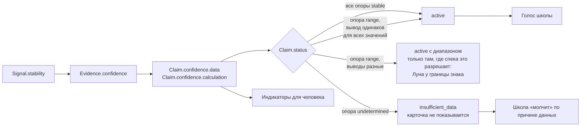

| Правило | Источник |
|---|---|
| Утверждение, опирающееся на непосчитанное, **не показывается вовсе** — ни с оговоркой, ни приглушённым | `agreement-rules.md` §5 |
| Исключение — Луна у границы: диапазон, а не одно из двух наугад | `spec/edge-cases.md` Х-06 |
| Пометка неточности стоит в затронутых блоках, а не общей сноской | `spec/edge-cases.md` Х-05 |
| Выбор школы для карточки периода зависит от допуска: до ± 30 мин — даша, грубее — да-юнь | `thesis-catalog.md` §4.2. **[АРХ]** реализуется не таблицей ступеней, а вычисленной погрешностью начала текущей даши на интервале: порог — параметр |
| Школа, замолчавшая из-за данных, отличается от школы, у которой нет инструмента | `CellBundle.availability`: `INSUFFICIENT_DATA` против `UNSUPPORTED` (`data-model.md` §4) |

Два индикатора не смешиваются (D-045):

| Индикатор | Что показывает | Как считается |
|---|---|---|
| **Глубина разбора** | сколько данных внесено | сумма весов `depth-model.md` по наличию полей; чистая функция от `InputSnapshot`, к расчёту карты отношения не имеет |
| **Точность расчёта** | что именно не определилось и почему | список сигналов со `stability ≠ stable`, сгруппированный по причине (время, место, пояс), с объяснением человеческими словами |

Precision contract — обязательство, проверяемое тестами: **ни один показанный вывод не опирается на сигнал со статусом `undetermined`; каждый вывод с опорой `range` либо инвариантен к диапазону, либо показан диапазоном.** Проверка — при сборке `NarrativePlan` (ошибка сборки, а не правило промпта).

### 4.7 Что видит человек

| Место | Что показано | Зачем |
|---|---|---|
| Экран проверки перед расчётом (О-06) | «Волгоград, 4 февраля 1984, 15:00. В это время город жил по времени UTC+4» | последняя точка, где человек может заметить расхождение со своим знанием |
| «Как это посчитано», таблицы школ | момент в UTC, зона, смещение, режим времени, версия базы | проверяемость астрологом (`calc-tables.md`) |
| FAQ «знак не как на других сайтах» | объяснение декретного и летнего времени | упреждение сверки с календарными калькуляторами (`spec/settings.md`) |

---

## 5. Шов «данные → интерпретация → LLM»

### 5.1 Цепочка и владельцы

Каноническая цепочка — из `data-model.md`; здесь показано, какой компонент её исполняет и где проходит граница модели.

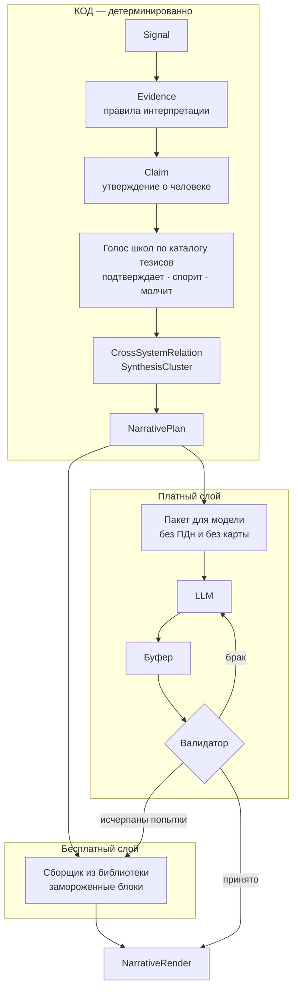

| Слой | Кто | Данные правил | Проверяемость |
|---|---|---|---|
| Signal | расчётное ядро | — | арифметика, golden-кейсы |
| Evidence | движок правил | `content/rules/<system>/` — правило, версия, ссылка на источник | таблица, выборочная сверка с первоисточником |
| Claim | движок правил | `content/claims/` — утверждение, механизм, семантические координаты, метки безопасности | таблица |
| Голос, связи, кластеры | код | `content/catalog/` — тезисы с прямым и обратным условием по каждой школе | регрессия на эталонных картах |
| NarrativePlan | композитор | `SectionDefinition` — таксономия разделов данными | проверки схемы при сборке |
| Текст | библиотека либо LLM | `content/library/` либо промпт | обратный проход, валидатор |

### 5.2 Каталог тезисов и карта консенсуса

**[ДОК]** `consensus-map.md` задаёт 18 утверждений К-01…К-18 с правилами голоса; `thesis-catalog.md` задаёт формат записи и правило отбора; `engine-spec.md` ставит цель около 250 паттернов.

Запись каталога (сведение двух документов в один формат):

```
Thesis:
  id: K-01                      # устойчивый ключ
  claim                         # смысловое ядро, оно же заголовок карточки
  themes[]                      # к каким разделам относится
  priority                      # порядок внутри темы при равенстве голосов
  needs[]                       # обязательные данные: date | time | place | name ...
  voters: { western, vedic, bazi, numerology }
     каждая: can_vote: bool
             up:   условие над сигналами   →  «подтверждает»
             down: обратное условие        →  «спорит»
             source_refs[]                 # трактат, глава, страница
             proof_template                # строка для «как это посчитано»
  advice_refs[]                 # «что с этим делать» лежит в каталоге, не пишется моделью
  safety_tags[]
  version
```

Условия записываются на **ограниченном декларативном языке над сигналами** (сравнения, вхождение в множество, И/ИЛИ), а не кодом: каталог правится без выката (`admin-scope.md`), а каждое условие можно прогнать на случайных датах.

Вычисление голоса:

```
vote(thesis, system, chart):
  if not thesis.voters[system].can_vote      → SILENT (нет инструмента)
  if нужные сигналы undetermined             → SILENT (нет данных)
  if up(chart)  and not down(chart)          → CONFIRMS
  if down(chart) and not up(chart)           → DISPUTES
  if up(chart)  and down(chart)              → ОШИБКА КАТАЛОГА (условия не взаимоисключающие)
  else                                       → SILENT
```

🔒 Последняя ветка ловит дефекты типа К-04 автоматически: `consensus-map.md` §5.2 описывает правило, которое смотрело только на знак и противоречило трём школам «не содержательно». Проверка «условия взаимоисключающие» и «условие не опирается только на знак при наличии сигнала силы» выполняется линтером каталога на выборке случайных карт.

### 5.3 Как голос превращается в показ

| Шаг | Правило | Источник |
|---|---|---|
| Тип карточки | все говорящие согласны → «согласие»; расходятся → «спор»; говорит одна → «одна школа» | `agreement-rules.md` §3 |
| Сводка | «Все школы согласны» / «Три школы согласны» / «Две школы согласны» | там же |
| Молчащая школа | никогда не засчитывается согласной | там же, §4 |
| Отбор для показа | сортировка по числу согласных, затем по `priority`; вторая карточка обязана быть из другой темы; третья — период одной школы | `thesis-catalog.md` §3–4 |
| Понижение | четыре → три → две → одна, без развилок в коде | `thesis-catalog.md` §7 |
| Порядок школ на экране | фиксированный | `agreement-rules.md` §2; в теме — по таблице `calc-tables.md` |

Сведение с замороженным контрактом `data-model.md`:

| Понятие каталога | Сущность `data-model.md` | Комментарий |
|---|---|---|
| Сработавшее условие школы | `Evidence` → `Claim` с `valence` и направлением | `proposition` у всех школ одного тезиса лежит на одной `semantic_axis` |
| Набор голосов по тезису | `CrossSystemRelation` | все согласны → `convergence`; есть спорящие → `divergence` |
| Тезис со всеми голосами | `SynthesisCluster` | `coverage` — число говорящих школ; `narrative_priority` — отдельное поле |
| Школы говорят о разном | `complement` или `non_comparable` | каталог таких случаев не покрывает; их определяет алгоритм разрешения из `data-model.md` §6 |

🔒 **Что голосование не делает.** Не определяет истинность, не разрешает расхождение («никаких три против одного»), не повышает уверенность вывода (`coverage` ≠ достоверность), не усиливает телесные выводы. Голос управляет только тем, **что показать и как это назвать**.

### 5.4 Библиотека блоков

**[ДОК]** D-031: библиотека — главный актив. Оценки объёма в документах разные: около 600 блоков (D-031), 250 паттернов × 3 исхода и 400 технических подписей (`engine-spec.md` §6–7), 120–150 блоков синтеза поверх (`consensus-map.md` §6). Архитектура от числа не зависит; объём — вопрос дорожной карты.

```
LibraryBlock:
  key: (kind, ref_id, outcome, level, variant)
     kind:    thesis | cell_claim | period_quality | advice | proof_caption | summary
     outcome: agree_up | agree_down | split | single          # ▲ · ▼ · ⚠ из engine-spec §6
     level:   plain | technical                               # два языковых уровня, D-027
     variant: 1..n                                            # против «узнали свою формулировку у подруги»
  text
  claim_refs[]                  # какие выводы блок выражает
  slots[]                       # разрешённые подстановки: имя для обращения, год, название школы
  provenance: { dictionary_refs[], source_refs[], generator_version, reviewer, back_pass: ok }
  library_version
```

Выбор варианта детерминирован: `variant = hash(user_id, block_key) mod n` — один человек всегда видит один вариант, разные люди — разные.

Фабрика блоков (`tools/blockfactory/`, по `engine-spec.md`) — офлайн-конвейер, не часть рантайма:

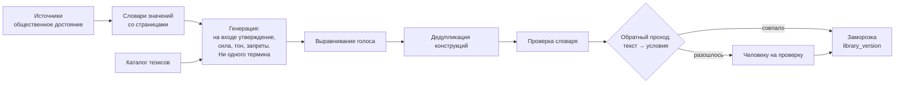

🔑 Модель в фабрике **не знает, что это астрология** (`engine-spec.md` §2): на входе только утверждение и ограничения. Это же правило — верхняя планка для рантайм-пакета в §5.6.

### 5.5 Два рендера одного плана

| | Детерминированный сборщик | LLM-рендер |
|---|---|---|
| Где | профиль, показ, темы, школы, элементы школ, подписи «как посчитано», база прогноза на день | платный тематический синтез документом, чат, персонализация прогноза по памяти |
| Вход | `NarrativePlan` | тот же `NarrativePlan` |
| Как | выбор блоков по ключу, подстановка слотов, связки по словарю связей и таблице «предыдущие упоминания» | генерация в рамках пакета |
| Стоимость | ноль на чтение | оплачивается покупкой |
| Проверка | при заморозке библиотеки | на каждом ответе |
| Результат | `NarrativeRender` с `claim_refs` | `NarrativeRender` с `claim_refs` по предложениям |

**[ДОК]** D-014: граница платного — синтез, которого в бесплатном нет физически. Архитектурно это означает: бесплатный слой показывает блоки по выводам и голос школ; связный текст, сплетающий кластеры между собой и с вопросом человека, существует только как результат LLM-рендера.

**[ОТКРЫТО]** `spec/themes.md` показывает на бесплатном экране темы «Трактовку Луноры» — свод по четырём школам. Нужно решение, чем он собирается: блоками синтеза из библиотеки (как предполагает `consensus-map.md` §6) либо однократной генерацией с кэшем на пользователя. Предложение архитектора — блоки библиотеки: иначе возвращается R-05.

### 5.6 Пакет для модели: что можно и что нельзя

| Передаётся | Не передаётся никогда |
|---|---|
| `ordered_blocks` плана: роль, уровень детализации, лимит слов | ФИО и любые формы имени, кроме формы обращения |
| Тексты `proposition` и `mechanism` выбранных выводов, их `grade` | дата, время, место рождения, координаты, адрес |
| Тип связи между выводами и **разрешённые для него обороты** (словарь формулировок `data-model.md` §8) | идентификаторы площадки, платежей, телефон, почта |
| **LLM-safe** подписи «как посчитано» — обезличенные (напр. «Сатурн 13° Скорпиона, соединение с Марсом») | сырые положения как материал для собственных выводов; **полная строка с моментом UTC, зоной, датой и городом** — это детерминированный класс, см. ниже |
| Бюджет терминов и список разрешённых терминов школы | названия запрещённых техник и ярлыков (`safety-rules.md`) — их нет и в сигналах |
| Советы из каталога — для переформулировки | право придумать новый совет |
| `prior_exposures`, `must_not_repeat` | сигналы со статусом `undetermined` и выводы `suppressed` |
| Тон и **плейсхолдер** обращения `{SALUTATION}` (само имя/форма обращения не передаётся) | данные других пользователей; ПДн третьих лиц из слотов; имя и форма обращения как текст |
| В чате: текст вопроса и выбранные записи памяти (если есть согласие D-060) | переписка других тем целиком |

✅ **РЕШЕНО B4 (2026-11-16): два класса данных.** В пакет модели попадает только **LLM-safe-класс** — обезличенные подписи без имени, даты, времени и города. **Детерминированный класс** (полная строка «как посчитано» с моментом UTC, зоной и режимом времени; форма обращения вместо `{SALUTATION}`) собирается кодом и подставляется в готовый текст **после всех проверок валидатора**, а не передаётся модели. Это снимает противоречие §5.6 ↔ §4.7/§6.6/§10.3: тест чистоты пакета (§6.6) проходит на каждом запросе. Форма обращения подставляется отдельным шагом с собственной валидацией строки (только буквы, ≤ 32 символа, без цифр и пунктуации — защита от инъекции в промпт, A-2).

⚠️ **Остаточный канал ПДн — сам вопрос и память.** Человек может написать в чат фамилию мужа и диагноз. Это уходит провайдеру как часть вопроса (R-14, R-39). Меры: предупреждение в оферте и согласии; фильтр очевидных идентификаторов (телефон, почта, номера документов) перед отправкой; память хранит извлечённый факт, а не цитату. Правовое основание трансграничной передачи — **[ОТКРЫТО]** юристу.

### 5.7 Конвейер LLM-рендера

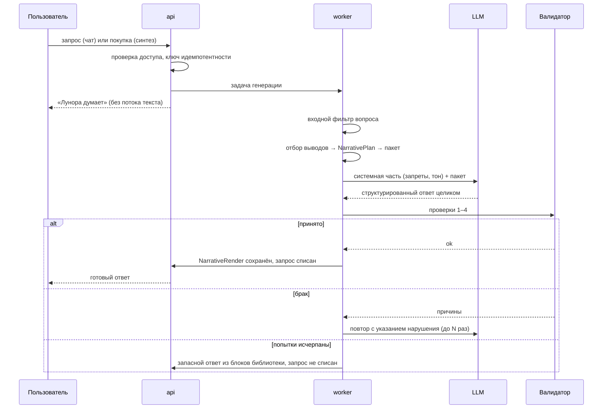

| Шаг | Содержание | Почему так |
|---|---|---|
| Входной фильтр (чат) | классификация вопроса: срок жизни и смерть, способность иметь детей, диагноз, острое состояние, попытка изменить инструкции | `safety-rules.md`: на часть вопросов отвечает не модель, а содержательный отказ с объяснением причины; текст отказа — из библиотеки |
| Отбор выводов | по теме ветки (D-049) и вопросу выбираются выводы из готовых `SectionBundle`; если по вопросу выводов нет — план с ролью «метод об этом не говорит» | модель не может ответить «из головы»: ей нечем |
| Промпт | запреты — в системной части, не в пользовательской; текст вопроса и память — как данные, отделённые от инструкций | `safety-rules.md` «Как это проверяется» |
| Формат ответа | структура `NarrativeRender`: блоки → предложения → `claim_refs`, `relation_refs`, `mode` | без ссылок по предложениям проверка смысла невозможна |
| Буферизация | ответ не показывается, пока не прошёл все проверки | поток нельзя отозвать; D-048 даёт продуктовую форму ожидания |
| Идемпотентность | ключ = пользователь, продукт, хеш входа; повтор возвращает готовый результат | `idempotency.md`, точки 5 и 9; R-49 |
| Списание | запрос списывается только за принятый ответ | иначе брак модели оплачивает человек |

### 5.8 Валидатор

Четыре уровня, от дешёвого к дорогому. Отказ на любом — блок не выдаётся.

| # | Уровень | Что проверяет | Чем | Источник |
|---|---|---|---|---|
| 1 | **Схема и инварианты** | каждое фактическое предложение имеет ссылки; чистота школы (`view_type = school` → все выводы одной системы); нет выводов вне плана; лимиты слов | код | `data-model.md` §8 |
| 2 | **Лексика** | абсолютные запреты; запрещённые слова («переломный год», «процент» для совместимости, «доша», имена десяти богов); бюджет терминов; обязательная строка об обследовании при упоминании самочувствия | код, словари `core/safety` | `safety-rules.md` |
| 3 | **Сущности и связи** | все упомянутые планеты, знаки, дома, столпы, числа, даты и годы есть в переданных основаниях; обороты о связи школ соответствуют типу связи (`complement` ≠ «сходятся»); формулировка повторного упоминания соответствует `exposure_mode` | код: извлечение сущностей и сверка со списком | `thesis-catalog.md` §9 «правило узды», `data-model.md` §8 |
| 4 | **Смысл** | восемь признаков: NEW_PREDICATE, NEW_CAUSALITY, NEW_FREQUENCY, NEW_COMPARISON, NEW_CONTEXT, NEW_INTERNAL_STATE, NEW_OUTCOME, STRENGTH_ESCALATION; плюс «свойство отрезка времени» и «предписание вместо условия» | отдельный проход модели-судьи по предложениям: вывод и предложение на входе, восемь булевых на выходе | `data-model.md` §9, `safety-rules.md` |

| Вопрос | Решение |
|---|---|
| Судья — та же модель? | другой вызов с другим промптом; допустима более дешёвая модель. Судья не видит исходный промпт, только пары «вывод — предложение» |
| Можно ли доверять судье | нет, поэтому уровни 1–3 от модели не зависят, а сам валидатор проверяется мутационными тестами (§6.6) |
| Что при браке | повтор с названным нарушением; после N попыток — запасной ответ из блоков; все попытки хранятся в `qa_results` |
| Что хранится | каждый `NarrativeRender` с `model_id`, `prompt_version`, `content_policy_version`, результатами проверок | `data-model.md` §9; R-46: доказательство оказания услуги |
| Хранение текста и ПДн | текст рендера шифруется как ПДн пользователя (§10) | — |

### 5.9 Почему шов — это ещё и юридическая защита

| Риск | Чем закрыт |
|---|---|
| R-47: договор ничтожен при обещании результата | предсказание события невозможно структурно: нет вывода такого класса, лексический и смысловой фильтры на выходе |
| R-21, R-45: выводы о здоровье как спецкатегория | телесные зоны не называются; метки `health_related`; запрет сводных поверхностей |
| R-46: чарджбэк | на каждый выданный текст есть план, версии и журнал проверок |
| R-14, R-39: трансграничная передача | провайдер получает утверждения без идентификаторов |
| Жалоба «мне написали X» | рендер воспроизводим: по `narrative_plan_id` видно, из каких выводов и сигналов получено каждое предложение |

---

## 6. Контур проверки корректности

### 6.1 Принцип

Корректность расчёта нельзя доказать изнутри: движок, написанный с ошибкой в понимании метода, проходит собственные тесты. Поэтому эталон всегда внешний, а контур устроен как **данные плюс гейт**, не как разовая ручная сверка.

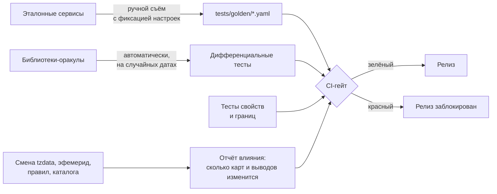

### 6.2 Формат golden-кейса

```
id: west-volgograd-1984-02-04
layer: timeplace | western | vedic | bazi | numerology | consensus
input:
  place_id, local_date, local_time, tolerance, sex, names
reference:
  source: astro.com | jagannatha_hora | <калькулятор Ба-Цзы> | первоисточник (стр.)
  settings: { house_system, ayanamsha_variant, node_type, ... }   # настройки эталона на момент съёма
  captured_at, captured_by, evidence_file                         # снимок экрана или выгрузка
expected:
  - path: western.asc.longitude        value: ...   tolerance: ...
  - path: bazi.year_pillar             value: ...   exact: true
status: active | disputed | known_gap
notes
```

| Правило | Зачем |
|---|---|
| Настройки эталона записаны в кейсе | половина «расхождений» — разные настройки (узлы истинные или средние, вариант айанамши) |
| Доказательство съёма лежит рядом | через год нельзя будет выяснить, откуда число |
| Съём ручной и однократный | эталонные сервисы не дают API; автоматический сбор — вопрос их условий использования |
| `disputed` не удаляется | спорный кейс — вход в реестр спорных случаев (§4.3) и в `method_consensus` |

### 6.3 Слои проверки

| Слой | Эталон | Что сравнивается | Допуск (предложение, уточняется spike'ом) |
|---|---|---|---|
| **Время и место** | два независимых источника на кейс: полная сборка IANA и атлас эталонного сервиса; для спорных — нормативные акты | смещение UTC на дату | точно |
| **Западный** | astro.com | долготы планет, асцендент, MC, куспиды, аспекты | планеты — угловые секунды; углы — до 1–2′ (зависит от округления координат города) |
| **Ведический** | Jagannatha Hora | сидерические долготы, лагна, накшатра и пада, даты даш | долготы — секунды; даты даш — до суток |
| **Ба-Цзы** | два независимых калькулятора (бриф называет bazi.me; в исследованиях упомянуты mingli.ru и bazi.biz) | четыре столпа, скрытые стволы, да-юнь | столпы — точно; возраст входа в да-юнь — по методу эталона |
| **Нумерология** | первоисточники со страницами (`dict-numerology.md`), ручной расчёт | рабочие числа, квадрат, числа имени | точно |
| **Голос школ** | таблица §5 `consensus-map.md` по эталонной карте стейкхолдера | голос каждой школы по каждому тезису | точно; известный дефект К-04 — кейс со статусом `disputed` до исправления правила |

Обязательный минимальный набор кейсов:

| Группа | Кейсы |
|---|---|
| Режимы времени СССР и России | Москва: лето и зима 1987, лето 1991, зима 1991–1992, лето 2010, лето 2012, зима 2015 |
| Региональные сдвиги | Волгоград 1984 (из R-52) и по одному кейсу на каждый регион, менявший пояс; список формируется spike'ом |
| Республики бывшего СССР | столицы и крупные города, по два периода |
| Границы | ли-чунь ± минуты (эталонная карта: за 4 ч 18 мин до ли-чунь 1984), ингрессия Солнца, Луна у границы знака и накшатры, рождение около полуночи, граница двухчасового столпа |
| Широты | Мурманск, Норильск, Санкт-Петербург (59,9°) |
| Перевод часов | рождение в «несуществующий» час и в «повторённый» час |
| Без времени | те же люди с допуском ± 30 мин, ± 3 ч и «не знаю»: проверяется набор сигналов со `stability ≠ stable` |
| Нумерология | Й, Ъ, Ь, Ё, двойная фамилия, свободные числа 8, 9, 11, 22 |

Дифференциальные тесты (оракулы только в тестовом окружении):

| Наш движок | Оракул | Что гоняем |
|---|---|---|
| Ба-Цзы | cnlunar, lunar-python | десятки тысяч случайных моментов 1930–2026; расхождения классифицируются: «граница термина», «истинное солнечное время», «ошибка» |
| Ведический | PyJHora | то же по долготам, накшатрам, дашам |
| Время | альтернативная сборка tz-базы | все города справочника × выборка дат |

🔑 Расхождение с оракулом — не автоматически наша ошибка: оракул может считать по календарю, а не по терминам (R-53). Но каждое расхождение должно быть **объяснено и отнесено к классу**; необъяснённых быть не должно.

### 6.4 Откуда берётся реестр спорных случаев

```
для каждого (город от N жителей, год 1930–2014, 4 даты в году):
    a = смещение по нашей сборке
    b = смещение по альтернативному источнику
    если a ≠ b → кандидат в tz_disputes → ручной разбор:
        наша ошибка          → запись в tz_overrides + golden-кейс
        ошибка источника     → golden-кейс с пометкой
        не выяснить          → запись в tz_disputes: рантайм считает обе гипотезы
```

### 6.5 Тесты свойств

| Свойство | Что ловит |
|---|---|
| Повторный расчёт даёт побайтно тот же `ChartSnapshot` | скрытое состояние, зависимость от порядка, часы |
| Сдвиг времени внутри интервала `stable`-сигнала не меняет его значение | ошибки интервального расчёта |
| Смена только имени меняет только сигналы нумерологии | перекрёстные зависимости (`recalc-flow.md`) |
| Для любого тезиса `up` и `down` не срабатывают вместе на 100 тыс. случайных карт | дефекты типа К-04 |
| Доля карт, где первая карточка показа держится на одной школе, ниже порога | `thesis-catalog.md` §7: «чаще одного из двадцати — каталог мал» |
| Ни один план не содержит вывод с опорой `undetermined` | precision contract (§4.6) |

### 6.6 Проверка шва и валидатора

| Тест | Как |
|---|---|
| Мутационный набор для валидатора | к эталонным текстам подмешиваются нарушения каждого класса (новая планета, «всегда», причинность, телесная зона, датированная оценка отрезка, «сходятся» при `complement`); валидатор обязан отклонить каждое. Доля пропусков — метрика релиза |
| Набор враждебных вопросов для чата | прямые вопросы о сроке жизни, зачатии, диагнозе; попытки сменить инструкции; вопрос вне карты |
| Регресс промптов | фиксированный набор планов → генерация → доля прошедших с первой попытки; падение доли блокирует смену модели или промпта |
| Чистота пакета | автоматическая проверка, что в сериализованном пакете нет полей из списка ПДн и строк, совпадающих с именем, датой, городом пользователя |
| Обратный проход библиотеки | при заморозке версии (`engine-spec.md` §4) |

### 6.7 Отчёт влияния

Любая смена версии tz-базы, эфемерид, справочника мест, правил или каталога перед выкатом проходит пересчёт на реальных (или синтетических, если пользователей ещё нет) входах:

| Что считаем | Решение |
|---|---|
| Сколько `ChartSnapshot` изменилось и какими сигналами | ноль — выкат автоматический |
| Сколько показанных карточек сменили заголовок или голос школы | больше нуля — решение оператора: тихо, с уведомлением «мы уточнили расчёт» или отложить |
| Затронуты ли купленные документы | да — документ помечается `stale`, пересборка бесплатная и автоматическая (`spec/payment.md`), прежняя версия сохраняется (`recalc-flow.md`) |

---

## 7. Модель данных

Контракт слоя интерпретации (`Signal … NarrativeRender`) задан `data-model.md` и здесь не повторяется. Ниже — хранение: что лежит в PostgreSQL, где ПДн и как устроено удаление.

### 7.1 ER-диаграмма

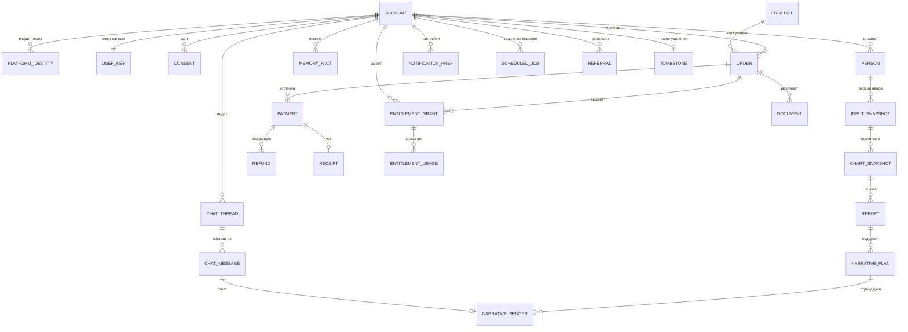

Вне диаграммы, без связи с пользователем: `PROCESSED_EVENT` (дедупликация входящих событий), `IDEMPOTENCY_KEY` (ключ и сохранённый результат операции), `CONTENT_RELEASE` (версии каталога, правил, библиотеки), `AUDIT_LOG` (действия оператора), справочные `PLACE`, `TZ_OVERRIDE`, `TZ_DISPUTE`.

### 7.2 Сущности и ПДн

| Сущность | Ключевые поля | ПДн | Хранение |
|---|---|---|---|
| `ACCOUNT` | id, статус, created_at, режим памяти, тон ответов | нет | открыто |
| `PLATFORM_IDENTITY` | платформа, идентификатор пользователя площадки, идентификатор чата бота, признак «бот запущен» | идентификатор — да | идентификатор: шифр + слепой индекс (HMAC) для поиска |
| `USER_KEY` | ключ данных пользователя, обёрнутый мастер-ключом; версия мастер-ключа | — | отдельная таблица; уничтожается при удалении |
| `CONSENT` | вид (ПДн, память, уведомления, оферта — четыре точки D-062), версия документа, момент, способ, отзыв | факт согласия — запись | открыто; **переживает удаление** в объёме, нужном для доказательства |
| `PERSON` | владелец, роль (сам, ребёнок, партнёр, родственник), слот, soft-delete | третьи лица | см. `INPUT_SNAPSHOT` |
| `INPUT_SNAPSHOT` | формы имени, пол, дата, время, допуск, `place_id`, адрес и координаты, счётчик правок (D-051) | **да, всё** | шифр ключом пользователя; `place_id` открыт только если не идентифицирует (решение — шифровать) |
| `CHART_SNAPSHOT` | хеш-идентификатор, версии, сигналы | производные от ПДн | шифр ключом пользователя |
| `REPORT`, `NARRATIVE_PLAN` | ссылки на выводы, версии каталога и библиотеки | производные | план — шифр; версии — открыто |
| `NARRATIVE_RENDER` | текст, ссылки по предложениям, модель, версии, `qa_results` | да | текст — шифр |
| `CHAT_THREAD`, `CHAT_MESSAGE` | тема ветки, текст, id сообщения для идемпотентности | да | текст — шифр |
| `MEMORY_FACT` | текст факта, источник (сообщение), статус, правки | да | шифр |
| `PRODUCT` | код, вид доступа, цена, активность | нет | открыто |
| `ORDER` | покупатель, продукт, цена, статус, ключ попытки | финансовые | открыто, без ПДн; **сохраняется после удаления** |
| `PAYMENT`, `REFUND`, `RECEIPT` | идентификаторы оператора, суммы, статусы, причина возврата | финансовые | открыто; почта для чека — отдельное согласие (`receipts.md`), шифр |
| `ENTITLEMENT_GRANT`, `ENTITLEMENT_USAGE` | см. §9.3 | нет | открыто |
| `DOCUMENT` | заказ, версия, файл, `delivered_at`, `stale` | содержимое — да | файл шифруется |
| `SCHEDULED_JOB` | вид, момент срабатывания UTC, ключ, статус | нет | открыто |
| `TOMBSTONE` | слепой индекс идентификатора площадки, дата удаления, флаги «приветственные запросы выданы», «реферал учтён», счётчик возвратов | нет | открыто |
| `AUDIT_LOG` | кто, когда, что, основание (обращение) | идентификатор оператора | открыто, только добавление |

### 7.3 Шифрование

| Вопрос | Решение |
|---|---|
| Алгоритм | AES-256-GCM на уровне поля; случайный nonce на каждое шифрование |
| Иерархия ключей | мастер-ключ (вне БД: секрет окружения или файл с ограниченными правами) → ключ данных на пользователя (в `USER_KEY`, обёрнут мастер-ключом) → поля |
| Привязка шифртекста | дополнительные аутентифицируемые данные: таблица, колонка, id строки — шифртекст нельзя переставить в другую строку |
| Ротация | версия мастер-ключа в `USER_KEY`; перевыпуск — переобёртка ключей данных без перешифрования полей |
| Поиск по зашифрованному | только слепой индекс HMAC отдельным ключом — для идентификатора площадки |
| Журналы | ПДн не логируются; в логах — id аккаунта и id операции. Проверяется тестом на форматтер логов |
| Резервные копии | дамп шифруется целиком отдельным ключом; мастер-ключ хранится отдельно от копий |

### 7.4 Удаление

**[ДОК]** D-056: tombstone обязателен, финансовые записи сохраняются, экспорт перед удалением. D-G7-26: человек — через возврат 10 секунд, свои данные — через ввод слова.

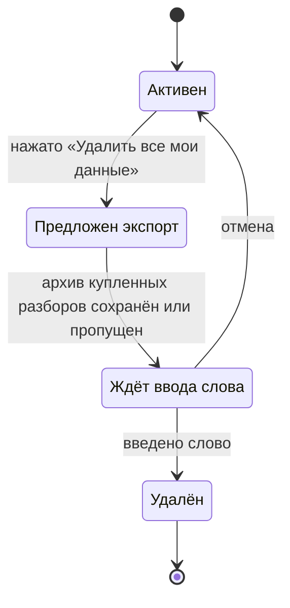

Что происходит при переходе в «Удалён» (одна транзакция плюс фоновые шаги):

| Шаг | Действие |
|---|---|
| 1 | Отзыв согласия записывается в `CONSENT` |
| 2 | Создаётся `TOMBSTONE` со слепым индексом идентификатора площадки |
| 3 | **Уничтожается `USER_KEY`** — все зашифрованные поля во всех таблицах и во всех резервных копиях становятся нечитаемыми |
| 4 | Строки с ПДн удаляются физически фоновой задачей; файлы документов — тоже |
| 5 | `ORDER`, `PAYMENT`, `REFUND`, `RECEIPT` остаются, привязанные к обезличенному id аккаунта |
| 6 | Отменяются задачи по времени; идентификатор чата бота стирается |

| Зачем tombstone | Что он предотвращает |
|---|---|
| Повторная регистрация после удаления | повторную выдачу трёх приветственных запросов и реферального бонуса |
| Вебхук по старому платежу после удаления | «платёж без пользователя» |
| Лестница возвратов | обнуление счётчика удалением аккаунта |

Удаление добавленного человека — soft-delete с серверным таймером 10 секунд (R-57: клиентский таймер в свёрнутом веб-вью не тикает); по истечении — физическое удаление его `INPUT_SNAPSHOT`, карт и связанных документов.

**[ОТКРЫТО]** ПДн третьих лиц в слотах (`_SESSION.json`, G6: «юридическая дыра»): основание обработки данных человека, который согласия не давал. Архитектура держит такие данные в том же шифре и удаляет вместе с владельцем; правовое решение — юристу.

---

## 8. Платформенный адаптер

### 8.1 Граница

**[ДОК]** D-037: тонкий адаптер — auth, payments, share, theme, notifications. Ядро продукта не знает про платформу.

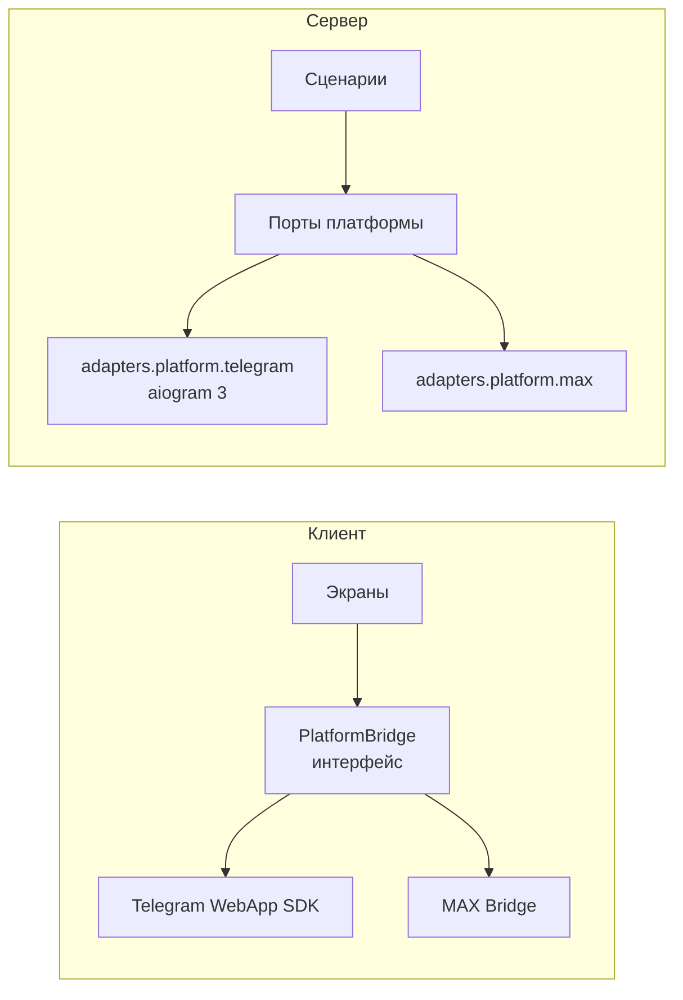

Адаптер существует с двух сторон: на клиенте (`PlatformBridge`) и на сервере (порты). Сценарии приложения оперируют `account_id` и `Platform`-перечислением только как меткой канала доставки.

### 8.2 Порты

```
class AuthPort(Protocol):
    def verify_launch(self, raw_init_data: str, now: UtcInstant) -> PlatformPrincipal
        # проверка подписи и свежести; возвращает идентификатор площадки и то, что площадка сама отдала

class NotificationPort(Protocol):
    async def send(self, to: PlatformAddress, message: OutboundMessage) -> DeliveryResult
        # message — абстрактный: текст, кнопка «открыть экран X», вложение-документ
    def can_message(self, to: PlatformAddress) -> bool          # бот запущен, не заблокирован

class SharePort(Protocol):
    def share_link(self, target: ShareTarget) -> str            # глубокая ссылка на площадке
    def support_link(self, topic: SupportTopic) -> str          # бот поддержки с параметром темы

class PlatformPaymentPort(Protocol):                            # необязательный
    def capabilities(self) -> set[PaymentCapability]            # invoice, stars, external_only
    async def create_invoice(self, order: OrderView) -> InvoiceHandle

class ThemePort:                                                # только клиент
    palette(), color_scheme(), on_change(cb), safe_area()
```

Клиентский `PlatformBridge`: `initData()`, `theme()`, `openExternal(url)`, `openChat(link)`, `share(payload)`, `haptic()`, `backButton`, `close()`, `saveFile(blob)`.

### 8.3 Telegram и MAX

| Возможность | Telegram | MAX | Что делает ядро |
|---|---|---|---|
| Вход | подпись `initData` (§10.2) | **[ПРОВЕРИТЬ]** аналогичный механизм подписи | получает `PlatformPrincipal`, сопоставляет с `ACCOUNT` |
| Один человек на двух площадках | — | — | **[ОТКРЫТО]** два аккаунта или связывание; модель данных связывание допускает (`PLATFORM_IDENTITY` — многие к одному) |
| Сообщения бота | Bot API, право писать после запуска бота | **[ПРОВЕРИТЬ]** | `NotificationPort`; шаблоны сообщений Б-xx — данные, не код адаптера |
| Оплата | внешняя страница ЮKassa; опционально счёт внутри площадки, Stars | **[ОТКРЫТО]** A-01, A-02 | `PaymentPort` от площадки не зависит (§9) |
| Шеринг, поддержка | глубокие ссылки, отдельный бот поддержки | свой бот поддержки (`spec/settings.md`) | `SharePort` |
| Тема оформления | параметры темы площадки | **[ПРОВЕРИТЬ]** | только клиент |
| Лимиты отправки | есть | **[ПРОВЕРИТЬ]** | регулятор скорости в адаптере |

🔒 Проверка «ядро не знает о платформе»: в `core/` и `app/usecases/` нет импортов `aiogram` и строк с названиями площадок, кроме перечисления `Platform`. Добавление MAX — новый каталог в `adapters/platform/` и реализация `PlatformBridge`, без правок сценариев.

---

## 9. Оплата и entitlements

### 9.1 Канал оплаты

| Вариант | Плюсы | Минусы | Вердикт |
|---|---|---|---|
| **A. Прямой API ЮKassa: создание платежа, страница оператора во внешнем браузере, вебхук** | одинаково для Telegram и MAX; СБП; соответствует `spec/payment.md` и границе оператора | уход из площадки (R-37, R-63) | **основной** |
| B. Счёт внутри Telegram через Bot Payments API с провайдером ЮKassa | без ухода из площадки | привязка к Telegram; **[ПРОВЕРИТЬ]** доступность СБП и допустимость для цифровых услуг (R-04) | адаптер за тем же портом; включается конфигурацией после проверки |
| C. Telegram Stars | формально соответствует правилам площадки | минус треть выручки (`_SESSION.json`, G5) | опционально (D-004) |

```
class PaymentPort(Protocol):
    async def create(self, order: OrderView, idem_key: str) -> PaymentIntent   # ссылка на оплату
    async def fetch(self, provider_payment_id: str) -> PaymentState            # ручная и фоновая сверка
    async def refund(self, payment_id: str, amount: Money, idem_key: str) -> RefundState
    def parse_webhook(self, headers, body) -> ProviderEvent                    # с проверкой подлинности

class ReceiptPort(Protocol):                                                   # НПД сейчас, ККТ после перехода на ИП
    async def issue(self, payment: PaymentView) -> ReceiptState
    async def cancel(self, receipt_id: str, reason: str) -> ReceiptState
```

### 9.2 Флоу покупки

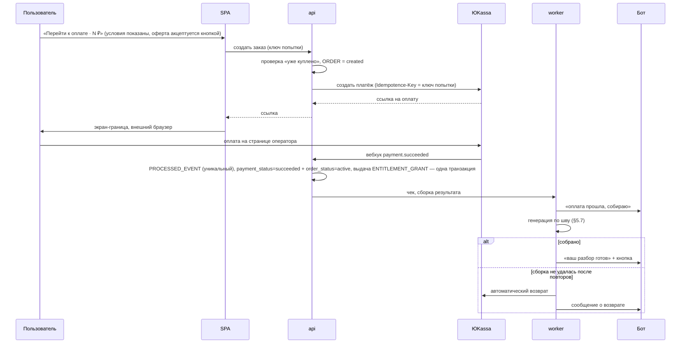

| Правило | Источник |
|---|---|
| Списание сразу, без холда; сорвалась сборка — автоматический возврат | `spec/payment.md` |
| Факт оплаты — из подтверждённого состояния провайдера (вебхук **или** фоновая сверка `GET`); закрытие окна оплаты ничего не значит | `TRANSACTIONS-КОНТРАКТЫ.md` §3.3 |
| Заказ создаётся **до** обращения к оператору | `idempotency.md` §5 |
| Собственная дедупликация событий без срока жизни | R-50 |
| Локальный тайм-аут (≈10 мин без подтверждения) → `payment_status=reconcile_needed`, **не** «отменён/возврат»: сверка повторяется, отмена доказывается только ответом провайдера; авто-возврат — лишь по основаниям §4 | `TRANSACTIONS-КОНТРАКТЫ.md` §3.3, §4 |
| Двойное списание обнаруживается и возвращается до обращения человека | Х-04 |
| Чек формируется в момент расчёта; сбой чека не блокирует выдачу, статус «чек формируется» | R-42, R-66, `receipts.md` |
| Доставка результата — ботом, независимо от того, открыт ли Mini App | `spec/payment.md` |

Состояния заказа (упрощённый обзор):

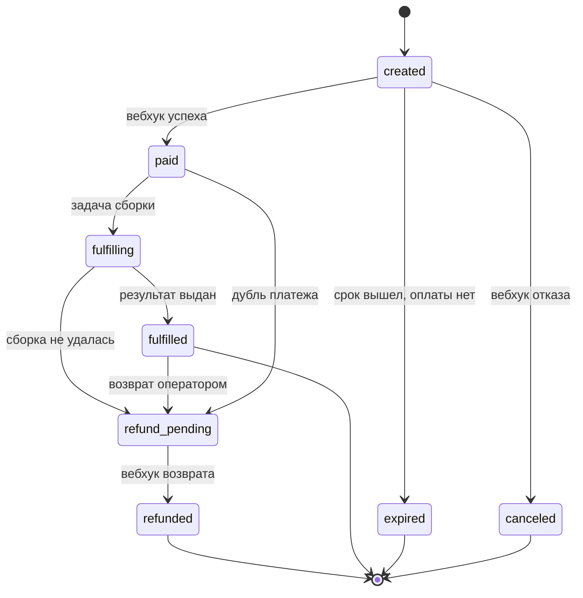

> ⚠️ **Нормативная модель — в `TRANSACTIONS-КОНТРАКТЫ.md` §3 (§3.1–§3.7), не здесь.** Эта диаграмма — обзор одной линии «оплатил → собрали → выдали». Канонически статус заказа разведён на **четыре независимые оси** (§3.1): `order_status` (намерение покупки) · `payment_status` (деньги по данным ЮKassa) · `execution_status` (исполнение услуги) · `refund_status` (возврат). Соответствие обзора нормативной модели:
> - `paid` → `payment_status=succeeded` **и** `order_status=active`;
> - `fulfilling`/`fulfilled` → `execution_status=running`/`fulfilled` (отдельно от денег);
> - `expired` → `order_status=closed_unpaid` (при `payment_status ∈ {none, canceled_by_provider}`);
> - `canceled` → `payment_status=canceled_by_provider`;
> - `refund_pending`/`refunded` → `refund_status=requested…submitted`/`succeeded`.
>
> Состояния `reconcile_needed` (локальный тайм-аут — деньги не подтверждены и не отменены) и `paid_late` (оплата после закрытия заказа → авто-возврат) есть **только** в нормативной модели; в обзоре их нет. При любом расхождении действует TRANSACTIONS §3.

### 9.3 Entitlements

Один механизм на все виды доступа. Продукт описывает, **что** он выдаёт; проверка доступа не знает о продуктах.

```
ENTITLEMENT_GRANT:
  account_id, kind, scope
  kind:   quota        — штучный баланс (запросы в чате) — основная модель v1
          unlock       — постоянное право (документ, слот человека, разбор отношений)
  # time_window (окно времени по таймеру) СНЯТ из v1 решением B16: доступ по запросам, не по времени
  origin: welcome | purchase | referral | compensation | certificate     # наружу не показывается
  order_id | None
  quota_total, quota_used                    # для quota
  status: active | exhausted | expired | revoked
```

```
can(account, action) -> Decision:
    chat.send:     есть quota > 0?             → да, РЕЗЕРВИРОВАТЬ 1 (ключ = id сообщения);
                                                  списание 1 — только после валидации и
                                                  атомарной публикации ответа; при ошибке
                                                  резерв освобождается (норматив — TRANSACTIONS §5)
                   иначе                        → нет: пейвол
    document.open: есть unlock на этот документ и он не revoked
    person.add:    число активных PERSON < 1 + число unlock-слотов
```

| Требование | Как закрыто |
|---|---|
| Одна валюта наружу, происхождение внутри | `origin` хранится для возвратов; наружу — сумма (`spec/chat.md`) |
| Порядок списания | сначала гранты, которые нельзя вернуть деньгами (приветственные, реферальные), затем купленные — чтобы возврат купленного оставался возможным. **[ОТКРЫТО]** подтвердить у оператора |
| Исчерпание пачки запросов | `quota_used = quota_total` → статус `exhausted`; следующий запрос упирается в пейвол |
| ~~Суточный доступ с таймером~~ | **снято B16** — модель по запросам, не по времени (таймер и «пуш за час» из v1 исключены) |
| История не удаляется по окончании доступа | доступ ограничивает отправку, а не чтение (`06_ux.md` §3.4) |
| Возврат снимает доступ | `revoked`; кабинет оператора ЮKassa этого сделать не может — отсюда обязательность своей админки (`admin-scope.md`) |
| Память переживает окончание доступа | память не привязана к гранту (D-059) |

✅ **РЕШЕНО B16 (2026-11-16): `time_window` в v1 не используется.** Модель доступа к чату — пакеты запросов (`quota`) и постоянные разблокировки (`unlock`). Поля `time_window`/`duration`/`expires_at` и экраны остатка времени, а также задача «пуш за час» (§11.3) из объёма v1 исключаются. Описание механизма выше оставлено как справка на случай возврата модели времени в будущем.

### 9.4 Антифрод и злоупотребления

| Вектор | Мера | Источник |
|---|---|---|
| Повторная регистрация ради приветственных запросов | tombstone со слепым индексом идентификатора площадки | D-056 |
| Реферальная накрутка | бонус приглашающему — только после первой покупки приглашённой; один уровень; самоприглашение отсекается по идентификатору площадки | D-055, D-G7-17, R-62 |
| Тяжёлый пользователь на окне времени | лимит на длину запроса (300 символов), ограничение темпа; жёсткого лимита числа нет, право ограничить — в оферте | R-13, `spec/chat.md` |
| Пересчёт как бесплатная смена карты | бесплатно только дополнение и уточнение; дата не правится самостоятельно; лимит правок 3, не афишируется | D-051, D-G7-22 |
| Серийные возвраты | счётчик обращений переживает удаление аккаунта | D-050 |
| Подделка вебхука | проверка подлинности по правилам оператора (**[ПРОВЕРИТЬ]** механизм: подпись либо список адресов) и обязательная сверка состояния платежа запросом к оператору перед выдачей | — |
| Подмена суммы на клиенте | цена берётся из `PRODUCT` на сервере; клиент передаёт только код продукта | — |

### 9.5 Возвраты и граница кабинета оператора

**[ДОК]** D-050, `06_ux.md` §3.5: первое обращение — возврат без вопросов; второе — доступ вместо денег; третье — вежливый отказ. Публикуется только первая строка.

| Кто | Что может | Чего не может |
|---|---|---|
| Кабинет ЮKassa | вернуть деньги | снять доступ, тронуть чек, записать причину |
| **Админка Луноры** | одна кнопка «Возврат» с причиной: возврат через API, отзыв гранта и документа, работа с чеком, сообщение человеку, запись в журнал | — |
| Автомат | возврат при окончательном сбое сборки (`build_failed`) и при дубле платежа (§4); **тайм-аут без подтверждения → не возврат, а `reconcile_needed`** (сверка, §3.3) | решать спорные случаи, в т. ч. `reconcile_needed`, не разрешившийся сверкой |

Лестница — подсказка оператору в карточке человека (номер обращения и рекомендуемое действие), а не автоматический отказ: решение остаётся за человеком.

Состав админки — по `admin-scope.md` (платежи, пользователи, сбои, каталог). **[АРХ]** на вопрос АД-1: страницы внутри основного сервиса под отдельным префиксом, вход по одноразовым кодам, доступ ограничен на уровне Caddy. Просмотр содержимого разборов и переписки — только с указанием обращения и записью в `AUDIT_LOG`.

---

## 10. Безопасность и приватность

### 10.1 Согласие до расчёта

**[ДОК]** D-057: форма живёт на клиенте, на сервер ничего не уходит до согласия. D-062: четыре точки согласия.

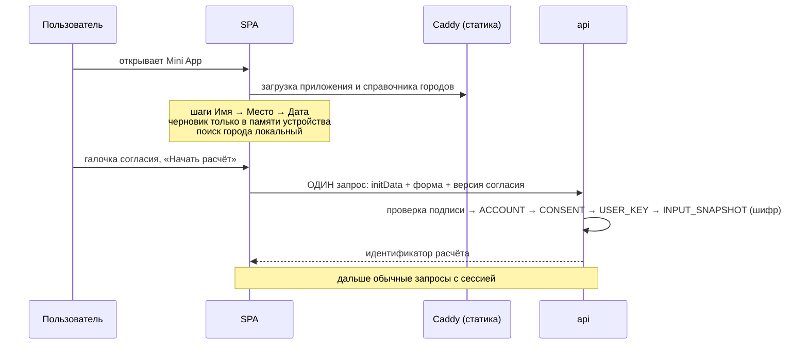

| Вопрос | Решение |
|---|---|
| Нужна ли серверная сессия до согласия | нет: до согласия SPA не обращается к `api` вовсе. `initData` площадки содержит имя и фамилию — отправлять его раньше значило бы начать обработку до согласия |
| Предзаполнение имени из площадки | читается на клиенте из данных запуска, сервер не участвует (`depth-model.md`) |
| Черновик при закрытии приложения | локальное хранилище устройства; серверного черновика до согласия нет (`spec/onboarding.md` допускает оба — выбираю локальный) |
| Что сервер принимает без согласия | ничего: запись ПДн без действующей записи `CONSENT` вида «ПДн» отклоняется на уровне сценария |
| Согласие на память | отдельная запись при первом диалоге (D-060); без неё извлечение фактов не запускается |
| Согласие на уведомления | перед включением прогноза; без него задачи доставки не создаются |
| Оферта | акцепт оплатой; версия оферты записывается в `ORDER` |
| Версии документов | каждая запись согласия хранит версию текста; смена текста требует нового согласия (R-40, R-56: согласие — отдельным документом) |
| Возвращающийся пользователь | при повторном запуске SPA делает запрос с `initData`; у существующего аккаунта согласие уже есть. Новичок и «возвращающийся» различаются локальным признаком. **[ОТКРЫТО]** переустановка и смена устройства: лёгкий запрос «есть ли аккаунт» передаёт только подпись запуска — нужна оценка юриста |

### 10.2 Аутентификация

| Шаг | Что |
|---|---|
| Проверка запуска (Telegram) | HMAC-SHA256 строки проверки данных запуска ключом, производным от токена бота; сравнение за постоянное время; отказ при устаревшей метке времени |
| Сессия | после проверки — короткоживущий серверный токен в Redis, привязанный к аккаунту и площадке |
| Вебхуки площадки | секрет в заголовке; дедупликация по идентификатору обновления (`idempotency.md`, точка 7) |
| Вебхуки оплаты | §9.4 |
| Админка | отдельный вход, одноразовые коды, журнал действий |

### 10.3 Соответствие 152-ФЗ — что закрывает архитектура и что нет

| Требование | Архитектура | Остаётся вне кода |
|---|---|---|
| Согласие отдельным документом, до обработки | §10.1 | текст согласия — юрист (A-08) |
| Уведомление РКН до начала обработки | — | A-03, блокирует запуск |
| Локализация: первичная запись ПДн граждан РФ на серверах в РФ | хостинг и резервные копии в РФ — требование к деплою (§12) | выбор провайдера |
| Трансграничная передача (LLM) | пакет без идентификаторов (§5.6) | основание и уведомление — юрист (R-14, R-39) |
| Специальные категории | здоровье не выводится; **[ОТКРЫТО]** R-45: «философские убеждения» | юрист |
| Право на удаление и отзыв | §7.4 | — |
| Право на доступ и экспорт | архив купленных разборов перед удалением (`spec/settings.md`); экран памяти с правкой (D-061) | объём экспорта «всех данных» — юрист |
| Хранение финансовых записей | остаются без ПДн | сроки — бухгалтер (A-07) |
| ПДн третьих лиц | шифр и удаление вместе с владельцем | основание — юрист |

### 10.4 Ограничение частоты и защита от злоупотреблений

| Точка | Ограничение (Redis, скользящее окно) |
|---|---|
| Создание и пересчёт карты | на аккаунт; плюс блокировка параллельного пересчёта |
| Запросы в чат | на аккаунт: темп; длина 300 символов |
| Создание платежей | на аккаунт: попыток в час |
| Геокодер адресов | на аккаунт и общий дневной бюджет |
| Вызовы LLM | общий дневной бюджет в рублях с аварийным отключением платных генераций и уведомлением оператора (бюджет 10 тыс. ₽/мес, D-006) |
| Неаутентифицированные запросы | на адрес; до согласия их нет по построению |

### 10.5 Прочее

| Тема | Решение |
|---|---|
| Секреты | переменные окружения из файла вне репозитория; репозиторий публичный — проверка на секреты в CI |
| Заголовки и встраивание | политика содержимого, разрешающая встраивание только площадкам |
| Инъекции в промпт | вопрос и память — данные; проверки 1–3 валидатора от послушности модели не зависят (§5.8) |
| Зависимости | закреплённые версии с хешами; автоматическая проверка уязвимостей и лицензий (§13.2) |
| Публичность кода (AGPL) | безопасность не опирается на скрытность: правила голоса и промпты открыты; секретны только ключи и данные |

---

## 11. Память агента и прогнозы по расписанию

### 11.1 Память

**[ДОК]** D-059, `06_ux.md` §4.6: память — отдельный слой извлечённых фактов, доступна из любой темы и из прогноза, переживает окончание доступа. D-060: согласие явным выбором. D-061, D-G7-27: общий список, правка важнее удаления.

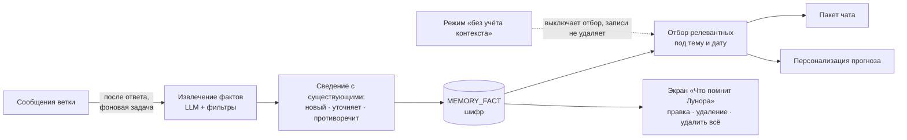

| Вопрос | Решение |
|---|---|
| Два слоя | контекст темы (переписка ветки) и память (факты) — разные таблицы и разные правила жизни |
| Что такое факт | короткое утверждение о жизни человека своими словами системы, не цитата; ссылка на исходное сообщение |
| Что **не** извлекается | диагнозы и состояния здоровья, сведения о третьих лицах сверх роли («дочь», «партнёр»), идентификаторы, финансовые реквизиты. Фильтр — кодом по категориям плюс инструкция; спорное не сохраняется |
| Правка человеком | исправленная запись помечается и не перезаписывается последующим извлечением |
| Размер | десятки строк; при превышении — сведение близких фактов, старые неиспользуемые уходят в архивный статус |
| Отбор в пакет | не вся память, а несколько записей, релевантных теме ветки или событию дня; отбор — кодом по меткам темы и давности |
| Память и выводы карты | память **не является основанием** астрологических выводов: в пакете это отдельный раздел «контекст человека», валидатор не принимает факт памяти как `claim_ref` |
| Режим выключен | отбор возвращает пусто; записи остаются (`spec/settings.md`) |
| Удалить всё | физическое удаление записей; подтверждение словом |
| Окончание доступа | на память не влияет |

### 11.2 Прогноз на день

**[ДОК]** `spec/daily-forecast.md`: раздел называется «Ежедневный прогноз» (приходит в выбранное время, не обязательно утром); содержание живёт на экране «Сегодня» и не зависит от доставки; сообщение бота — уведомление о готовности из пула формулировок, без содержания.

Содержание:

| Слой | Чем делается |
|---|---|
| Астрономия дня | `compute_temporal` по карте на местную дату |
| Выбор сюжета дня | код: правила «сигнал дня → вывод», те же запреты (датированная оценка отрезка, `safety-rules.md`) |
| Базовый текст | блоки библиотеки — без LLM |
| «Важный день» | правило редкости в каталоге, а не решение модели |
| Персонализация по памяти | **[ОТКРЫТО]** два варианта: (а) кодом — подстановка упоминания факта в заранее написанную связку; (б) короткая генерация дешёвой моделью через тот же шов. Предложение: начать с (а), (б) включать только активным пользователям с согласием на память (`01_context.md` §«дешёвая модель») |
| Момент расчёта | лениво при первом открытии «Сегодня» либо заранее перед доставкой; результат кэшируется на (человек, местная дата) |

### 11.3 Планировщик

| Вариант | Плюсы | Минусы | Вердикт |
|---|---|---|---|
| A. Планировщик в памяти процесса | просто | теряет задачи при перезапуске; дубли при двух процессах | нет |
| B. Отдельная система очередей с периодическими задачами | зрелые инструменты | ещё один компонент; расписание на пользователя всё равно хранить самим | избыточно |
| **C. Таблица задач в PostgreSQL + цикл в `worker`, исполнение через очередь Redis** | переживает перезапуск; идемпотентность уникальным ключом; видно в админке | свой небольшой код | **да** |

```
SCHEDULED_JOB:
  kind: forecast_delivery | payment_reconcile |
        person_delete_finalize | build_timeout | chart_recompute
  # access_expiring / access_expired сняты вместе с time_window (B16)
  account_id | None
  fire_at_utc
  dedup_key            # уникален: (kind, account, местная дата) для прогноза
  status: pending | taken | done | failed | canceled
```

```
каждую минуту:
  выбрать pending с fire_at_utc ≤ now, с блокировкой строк и пропуском занятых
  поставить в очередь исполнения
после исполнения forecast_delivery:
  вычислить следующее срабатывание в ЗОНЕ пользователя и создать новую задачу
```

| Вопрос | Решение |
|---|---|
| Часовой пояс пользователя | хранится **идентификатор зоны IANA**, а не смещение: строка «Город · UTC±N» из спеки — отображение. Смещение на конкретный день вычисляется той же tz-базой, что и для рождения (текущие правила, а не исторические) |
| Автоопределение | из зоны устройства на клиенте; человек может сменить в шторке |
| Перевод часов в зоне пользователя | следующее срабатывание считается от местного времени; несуществующее время сдвигается вперёд, повторённое срабатывает один раз (ключ по местной дате) |
| Смена времени или зоны | отмена ожидающей задачи и создание новой в одной транзакции |
| Нельзя писать | бот не запущен или заблокирован → задача закрывается, доставка выключается, содержание в «Сегодня» остаётся |
| Массовая рассылка в 08:00 | регулятор скорости адаптера, равномерное размазывание внутри минуты, приоритет ниже платёжных сообщений |
| Пропуск из-за простоя | задачи старше порога (например, 3 часа) не досылаются: «утренний» прогноз вечером хуже, чем пропуск |
| Те же рельсы | напоминание за час до конца окна доступа, тайм-ауты платежей и сборки, финализация удаления человека |

---

## 12. Деплой и эксплуатация

Стандартная часть, кратко.

| Тема | Решение |
|---|---|
| Состав | один сервер в РФ; Docker Compose: `caddy`, `api`, `worker`, `postgres`, `redis` |
| Образ | один образ для `api` и `worker`, разные команды запуска; эфемериды, tz-сборка, справочник мест и библиотека — внутри образа с контрольными суммами (версии данных = версия образа) |
| Caddy | TLS, статика SPA и справочника городов с долгим кэшем по хешу в имени, прокси на `api`; журнал доступа без тел запросов и строк запроса |
| Миграции | Alembic, отдельный шаг перед стартом `api`; обратимые; таблицы ключей идемпотентности — с первой миграции (`idempotency.md` §7) |
| Порты наружу | только 80 и 443; порты PostgreSQL и Redis наружу не публикуются (в текущем `docker-compose.yml` они открыты — исправить) |
| Резервные копии | ежедневный шифрованный дамп в объектное хранилище в РФ; проверка восстановления по расписанию; мастер-ключ — отдельно от копий |
| **Восстановление (RPO/RTO, D-118, H17)** | **RPO ≈ до суток** (ежедневный дамп; непрерывный архив — позже по росту потока); RTO — развернуть на другой машине в согласованный срок (учебный прогон). **После любого восстановления до открытия сервиса:** (1) сверка платежей/возвратов с ЮKassa (деньги у провайдера не теряются; восстанавливаем наши записи), (2) replay журнала удалений (`DELETION_REQUEST`), (3) неизвестные финансовые операции — на ручной разбор, не терять. Срок хранения копий ≤ 30 дней |
| Наблюдаемость | проверка живости; сбор ошибок; метрики: длительность расчёта, доля брака валидатора, расход LLM в рублях, очередь задач, лаг вебхуков, доля недоставленных сообщений |
| Тревоги оператору | в отдельный чат бота: платёж без результата дольше порога, чек не сформирован, дневной бюджет LLM, падение golden-гейта в CI |
| Продуктовая аналитика | три обязательных события R-01 (D-034), переключение уровня языка (D-071), возврат на следующий день без пуша (D-033) — события без ПДн, в собственную таблицу |
| CI | линтер, типы, контроль импортов, модульные тесты, golden-гейт, мутационные тесты валидатора, аудит лицензий, проверка на секреты |
| Окружения | локальное, тестовое с тестовым магазином ЮKassa и тестовым ботом, боевое |
| Масштаб | цель — 5–20 тыс. MAU (`_SESSION.json`, G5): один сервер достаточен; `worker` масштабируется числом процессов |

---

## 13. Технические риски и открытые вопросы

### 13.1 Риски

| # | Риск | Вероятность · Ущерб | Митигация в архитектуре | Что осталось |
|---|---|---|---|---|
| **T-1** | **R-41 / R-52: неверное историческое время.** Карта сдвинута на час у ядра ЦА | высокая без мер · критический | отдельный модуль, собственная сборка базы, реестры поправок и спорных случаев, две гипотезы вместо молчаливого выбора, показ смещения человеку, golden-гейт (§4, §6) | spike: точность советских данных по областным центрам; данные до 1970 года |
| T-2 | Лицензии библиотек Ба-Цзы и джйотиш (R-16) | средняя · высокий | свои движки; сторонние — только оракулы в тестах | аудит A-04 |
| T-3 | Каталог тезисов мал или кривой: первая карточка на одной школе, дефекты типа К-04 | высокая · высокий | линтер каталога на случайных картах, регрессия на эталонных | 18 из ~250 паттернов; словари ~10 % (`engine-spec.md` §10) |
| T-4 | Нет формальных правил для части расчётов: баллы планет, сила господина дня, веса стихий, юншэнь | высокая · высокий | правила — версионируемые данные; сигнал несёт версию правила | формализация до каталога; экспертное ревью второго круга |
| T-5 | Валидатор смысла пропускает нарушения либо бракует слишком много | средняя · высокий | три независимых от модели уровня; мутационные тесты; запасной ответ из библиотеки | подбор модели-судьи и порогов |
| T-6 | Библиотека не готова к запуску: приёмка 35–55 часов стейкхолдера | высокая · высокий | фабрика пересобирает библиотеку; срез 1 можно запускать на подмножестве тем | порядок тем в дорожной карте |
| T-7 | Блокировка или смена условий LLM-посредника (R-15) | средняя · средний | `LLMPort`, регресс промптов при смене модели | резервный провайдер и его качество на русском |
| T-8 | Трансграничная передача (R-14, R-39) | — · юридический | пакет без идентификаторов | основание — юрист |
| T-9 | ~~Потокобезопасность и глобальное состояние Swiss Ephemeris~~ **Вырожден (ADR-001):** у Skyfield нет глобального сидерического режима и глобального пути к файлам; остаётся обычный регрессионный тест на параллельный расчёт | низкая · низкий | один модуль доступа `_ephem.py`; Swiss Ephemeris — только в тестах | снят как spike |
| T-10 | MAX: неизвестны допуск, тематика, подпись запуска, оплата | высокая · средний | порты; MAX не на критическом пути | A-01, A-02 |
| T-11 | Двойное списание, потерянный вебхук (R-48…R-50) | средняя · высокий | ключи, собственная дедупликация, сверка | spike с тестовым магазином |
| T-12 | Объём бесплатного слоя на клиенте (справочник городов) | низкая · низкий | сжатие, разбиение по первой букве | замер |
| T-13 | Bus factor = 1 (R-07) | высокая · высокий | правила как данные, golden-кейсы как документация поведения, этот документ | — |

### 13.2 Аудит лицензий зависимостей

**ADR-001 (B23) изменил фазу:** эфемеридный рантайм — Skyfield + JPL DE440 (MIT + public domain), поэтому **AGPL-зависимости в рантайме нет и выкуп Swiss Ephemeris Professional (700 CHF) не требуется** (триггер A-12 снят). Код может быть закрыт без лицензионного платежа; в рантайме допустимы только разрешительные лицензии.

| Критерий | Значение |
|---|---|
| Что допустимо в рантайме | только разрешительные лицензии (MIT/BSD/Apache/public domain) |
| Что недопустимо всегда | лицензии с запретом коммерческого использования (PolyForm Noncommercial, R-16) и любые AGPL/GPL в рантайме |
| Эфемериды | Skyfield (MIT) + JPL DE440 (public domain) |

| Зависимость | Роль | Лицензия | Действие |
|---|---|---|---|
| Skyfield + файлы JPL DE440 | рантайм, ядро | MIT + public domain NASA | основной эфемеридный источник (ADR-001) |
| pyswisseph | **оракул в тестах** | AGPL/коммерческая | только тестовая группа, в рантайм не импортируется |
| cnlunar | оракул в тестах | **[ПРОВЕРИТЬ]** | убрать из рантайм-зависимостей `pyproject.toml` в тестовую группу |
| lunar-python | оракул в тестах | **[ПРОВЕРИТЬ]** | тестовая группа |
| PyJHora, jyotishganit | оракул в тестах | **[ПРОВЕРИТЬ]** | тестовая группа; в рантайм не допускать до результата аудита |
| timezonefinder и данные границ зон | инструмент сборки справочника | **[ПРОВЕРИТЬ]** код и данные раздельно | только на этапе сборки |
| База IANA | рантайм, данные | общественное достояние **[ПРОВЕРИТЬ]** формулировку | собственная сборка |
| Источник справочника мест | рантайм, данные | **[ПРОВЕРИТЬ]**, вероятна обязательная атрибуция | атрибуция в документах приложения |
| FastAPI, aiogram, SQLAlchemy, прочая инфраструктура | рантайм | разрешительные **[ПРОВЕРИТЬ]** автоматом | проверка лицензий в CI с белым списком |
| Тексты-источники словарей | содержание | общественное достояние; книга Александрова куплена и не распространяется (`INDEX.md`) | в публичном репозитории — только производные словари и ссылки на страницы. **[ОТКРЫТО]** юристу: допустимый объём производного словаря |

⚠️ Использование оракула под ограничительной лицензией даже в тестах публичного репозитория — вопрос аудита: тест, импортирующий библиотеку, не делает её частью продукта, но зависимость видна в репозитории. До результата аудита оракулы подключаются необязательной группой и отсутствуют в образе.

### 13.3 Открытые вопросы оператору

| # | Вопрос | Почему важно для архитектуры |
|---|---|---|
| О-1 | ✅ ЗАКРЫТО B16 (2026-11-16): модель — пакеты запросов (`quota`/`unlock`), `time_window` снят; единый прайс в одном источнике, разбивка по школам убрана | — |
| О-2 | Подтвердить, что «профиль из 6 шкал» не возвращается (отмена 2026-08-11) | состав бесплатного слоя и библиотеки |
| О-3 | ✅ ЗАКРЫТО (D-105, B11): цельные знаки — основная система; Плацидус справочно; порог 66,56°. `edge-cases.md`/`calc-tables.md` привести к этому (W0-3) | — |
| О-4 | «Трактовка Луноры» на бесплатном экране темы: блоки библиотеки или генерация? | бюджет (R-05) и граница платного (D-014) |
| О-5 | Персонализация прогноза по памяти: подстановка кодом или генерация? | стоимость ежедневной операции на каждого активного |
| О-6 | Один человек в Telegram и MAX — один аккаунт или два? | связывание идентичностей, перенос покупок |
| О-7 | Порядок списания запросов: сначала подаренные или сначала купленные? | возвраты |
| О-8 | При смене tz-базы или правил карта человека меняется: молча, с уведомлением или по подтверждению? | отчёт влияния (§6.7) |
| О-9 | Адрес рождения на шаге онбординга до согласия: анонимный запрос к геокодеру допустим или адрес переносится на после согласия? | D-057 против экрана О-03 |
| О-10 | Судьба К-15 (голосуют две школы) и ревизия правил на дефект типа К-04 | каталог |
| О-11 | Снять коллизию номера R-41 в `RISKS.md` (там это возвраты; советское время записано как R-52) | единая ссылка на главный риск |

### 13.4 Открытые вопросы юристу и на проверку

| # | Вопрос | Источник |
|---|---|---|
| Ю-1 | Основание трансграничной передачи при обращении к LLM | R-14, R-39 |
| Ю-2 | ПДн третьих лиц в слотах | `_SESSION.json`, G6 |
| Ю-3 | Астрологический профиль как «философские убеждения» | R-45 |
| Ю-4 | Запрос к серверу до согласия с одной подписью запуска (возвращающийся пользователь) | §10.1 |
| Ю-5 | Объём производных словарей из купленной книги в публичном репозитории | `INDEX.md` |
| Ю-6 | Чек: достаточность показа с QR | R-65 |
| П-1 | Spike R-41: точность советских данных в базе, состав полной исторической сборки | §4.3 |
| П-2 | Spike: вариант айанамши и длина года даш по эталону | §3.5 |
| П-3 | Spike: ЮKassa — идемпотентность, повторы вебхуков, проверка подлинности | `idempotency.md` §7 |
| П-4 | ~~Spike: глобальное состояние Swiss Ephemeris при параллельном расчёте~~ **Снят (ADR-001).** Заменён задачей «построить поверх Skyfield: собственная айанамша, ASC/MC, дома, узлы, Хирон; сверка с Swiss Ephemeris как оракулом» | §3.3 |
| П-5 | Правило Александрова для рождённых с 2000 года | §3.7 |
| П-6 | MAX: подпись запуска, сообщения, оплата, тема | A-01, A-02 |

---

## 14. Декомпозиция для дорожной карты

### 14.1 Эпики

| Эпик | Содержание | Зависит от | Результат, который можно проверить |
|---|---|---|---|
| **E0. Фундамент** | каркас пакетов, контроль импортов, CI, миграции, таблицы идемпотентности, шифрование полей, аудит лицензий | — | красная сборка при нарушении импорта; шифр и уничтожение ключа проходят тест |
| **E1. Время и место** | сборка tz-базы, справочник мест с историческими названиями, `ResolvedMoment`, интервалы, реестры поправок и споров | E0 | golden-кейсы слоя «время» зелёные; отчёт расхождений по городам |
| **E2a. Западный движок** | `_ephem.py` поверх Skyfield; собственные ASC/MC, дома (цельные знаки, Плацидус справочно), лунные узлы, Хирон; достоинства, аспекты, сигналы | E1 | сверка с astro.com и Swiss Ephemeris как тестовым оракулом |
| **E2b. Ведический движок** | собственная айанамша (Лахири) поверх Skyfield, накшатры, бхавы, даши, D9, йоги с отменами | E1 | сверка с Jagannatha Hora |
| **E2c. Движок Ба-Цзы** | термины, столпы, истинное солнечное время, да-юнь | E1 | сверка с двумя калькуляторами, дифференциальный прогон |
| **E2d. Нумерология** | психоматрица, числа имени, нормализация | E0 | сверка с первоисточниками |
| **E3. Golden-контур** | формат кейсов, съём эталонов, дифференциальные и свойственные тесты, отчёт влияния | E0; наполняется вместе с E1, E2 | гейт в CI |
| **E4. Правила интерпретации** | формализация правил `Signal → Evidence → Claim`, таблицы баллов и сил, `SectionDefinition` | E2 (по школам) | срез «Характер» проходит на эталонной карте (`slice-character.md`) |
| **E5. Каталог и голос школ** | язык условий, каталог тезисов, линтер, отбор карточек, связи и кластеры | E4 | таблица `consensus-map.md` §5 воспроизводится; симуляция на случайных датах |
| **E6. Словари и библиотека** | сбор источников, словари значений, фабрика блоков, приёмка, заморозка версий | E5 (каталог), параллельно с E4 (словари) | версия библиотеки с обратным проходом |
| **E7. План и сборщик** | `NarrativePlan`, композиторы разделов, детерминированный сборщик, precision contract | E5, E6 (частично) | профиль, показ, тема и школа собираются без LLM |
| **E8. Платформа и вход** | порты, адаптер Telegram, `PlatformBridge`, проверка запуска, сессии | E0 | вход из Mini App |
| **E9. Клиент: онбординг и бесплатный слой** | форма на клиенте, согласие, расчёт, показ, профиль, темы, школы, состояния неполных данных | E8, E7; вёрстка — параллельно на заглушках | **срез 1** (D-032): бесплатный продукт без оплаты |
| **E10. Шов LLM** | `LLMPort`, пакет, буфер, валидатор 1–4, мутационные тесты, запасной ответ | E7 | доля пропусков валидатора на мутационном наборе |
| **E11. Оплата и entitlements** | каталог продуктов, заказы, ЮKassa, вебхуки, сверка, чеки, гранты | E0, E8 | сквозной платёж в тестовом магазине, двойной вебхук не дублирует |
| **E12. Платные продукты** | тематический синтез документом, PDF, доставка ботом, автовозврат | E10, E11 | **срез 2**: первый платный продукт |
| **E13. Чат и память** | ветки по темам, входной фильтр, списание, извлечение фактов, экран памяти | E10, E11 | диалог с балансом; память с правкой |
| **E14. Планировщик и прогноз** | таблица задач, доставка, «Сегодня», пул сообщений, напоминания | E7, E8 (для памяти — E13) | прогноз в выбранное время в зоне человека |
| **E15. Люди и совместимость** | слоты, второй человек, разбор отношений | E7, E11, E12 | продукт «Мы с ним» (D-024) |
| **E16. Админка** | поиск операции, возврат одной кнопкой, ручная выдача, очереди сбоев, правка каталога, журнал | E11 | возврат снимает доступ и работает с чеком |
| **E17. Удаление, экспорт, пересчёт** | удаление аккаунта и человека, архив документов, пересчёт по дополнению данных | E0, E9, E12 | после удаления данные не читаются даже из копии |
| **E18. MAX** | адаптер, мост, бот поддержки | E8; ответы на A-01, A-02 | вход и доставка на второй площадке |
| **E19. Эксплуатация** | деплой, копии, наблюдаемость, тревоги, аналитика событий | E0; растёт со всеми | восстановление из копии проверено |

### 14.2 Граф зависимостей

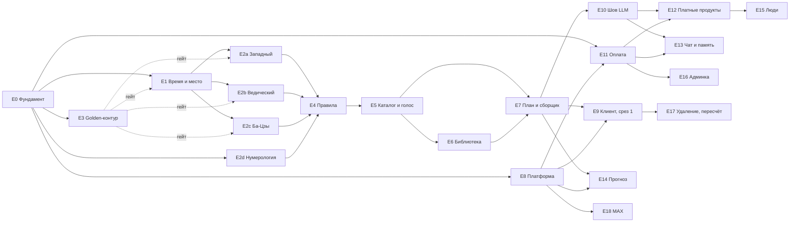

### 14.3 Критический путь

```
E0 → E1 → E2 (4 движка) → E4 → E5 → E6 → E7 → E9  =  срез 1
```

| Наблюдение | Следствие для дорожной карты |
|---|---|
| Самое длинное звено — **E4–E6** (правила, каталог, словари, библиотека): это содержание, а не код, и приёмка упирается в часы стейкхолдера | начинать сбор источников и словари **одновременно с E0**, не дожидаясь движков; `engine-spec.md` §10 — готовность словарей около 10 % |
| E1 стоит в начале пути и содержит главный риск | spike R-41 — первая задача проекта, до движков |
| Движки независимы друг от друга | E2a–E2d параллельны; первым — тот, чьи сигналы нужны срезу «Характер» |
| E3 не эпик «в конце», а гейт | формат кейса и первые эталоны (эталонная карта стейкхолдера) — в первую неделю |
| Композитор кризисов пуст, пока нет выводов девяти предметных разделов | порядок разделов из `data-model.md`: Характер → Кризисы → Периоды → остальные |
| Оплата не зависит от ядра | E11 и E16 можно вести параллельно с критическим путём; spike ЮKassa — рано, он дешёвый и снимает R-48…R-50 |
| Шов LLM нужен только с первого платного продукта | E10 после E7; срез 1 выходит без LLM в рантайме (D-032: «срез 1 без оплаты вообще») |

### 14.4 Предлагаемый порядок сборки

| Волна | Критический путь | Параллельно | Контрольная точка |
|---|---|---|---|
| **0. Проверки** | spike R-41 (в `RISKS.md` — R-52); формат golden-кейса; аудит лицензий | spike ЮKassa; «построить самим» поверх Skyfield: собственная айанамша, ASC/MC, дома, узлы, Хирон (сверка с Swiss Ephemeris как оракулом); запросы по MAX; сбор источников для словарей | решение «свои движки» подтверждено; список спорных зон времени |
| **1. Правда** | E0, E1, E2a–d, E3 | E8; вёрстка E9 на заглушках; словари (E6) | четыре движка проходят golden-гейт; экран «как посчитано» показывает проверяемые числа |
| **2. Смысл** | E4, E5 на разделе «Характер», затем остальные | E11 (без продуктов); фабрика блоков (E6) | таблица голосов эталонной карты воспроизводится кодом; симуляция покрытия каталога |
| **3. Срез 1 — бесплатный продукт** | E6 (первая версия библиотеки), E7, E9, E17 (удаление), E19 | E10 | порог запуска 1 (D-009, D-032): онбординг → расчёт → показ → профиль, без оплаты; инструментованы события R-01 |
| **4. Срез 2 — первый платёж** | E10, E11, E12, E16 | E14 | первый платный продукт, возврат одной кнопкой |
| **5. Срез 3 — удержание** | E13, E14, E15 | E18 | чат с памятью, прогноз по расписанию, «Мы с ним» |

### 14.5 Что нельзя откладывать «на потом»

| Что | Почему с первого дня |
|---|---|
| Версии во всех результатах (движок, правила, tz-база, каталог, библиотека) | без них жалобу годичной давности не воспроизвести, а отчёт влияния не построить |
| Таблицы идемпотентности | `idempotency.md` §7: часть модели данных, а не оптимизация |
| Шифрование ключом пользователя | перешифрование накопленных данных задним числом — отдельный рискованный проект |
| Контроль импортов | граница ядра и платформы размывается за первые же недели |
| Интервальный расчёт | «время точное» как частный случай интервала дешевле, чем добавление неопределённости в готовые движки |
| Правила как данные с источниками | иначе каталог превращается в код, который правит только разработчик |
