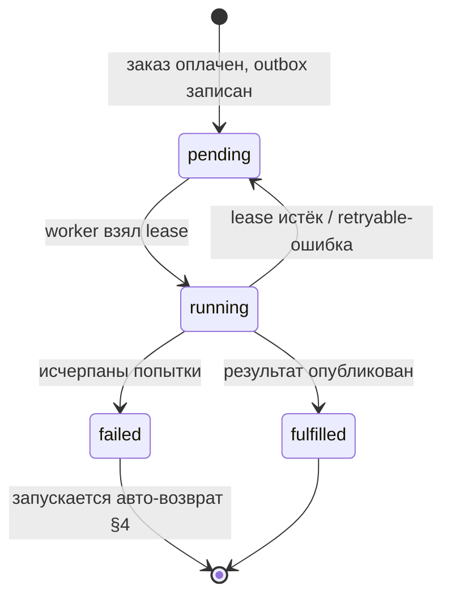
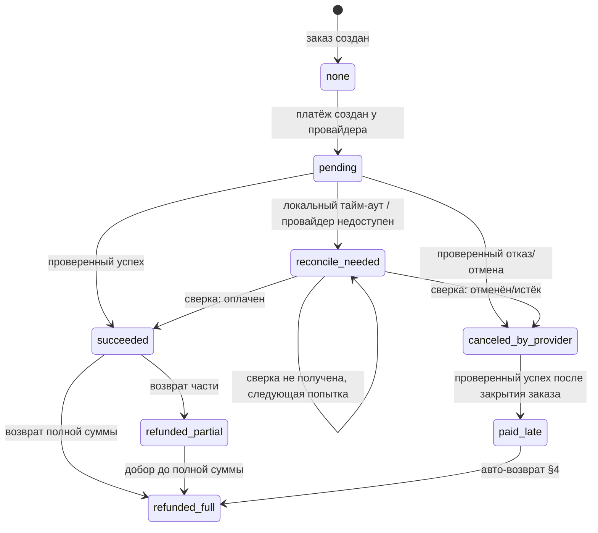
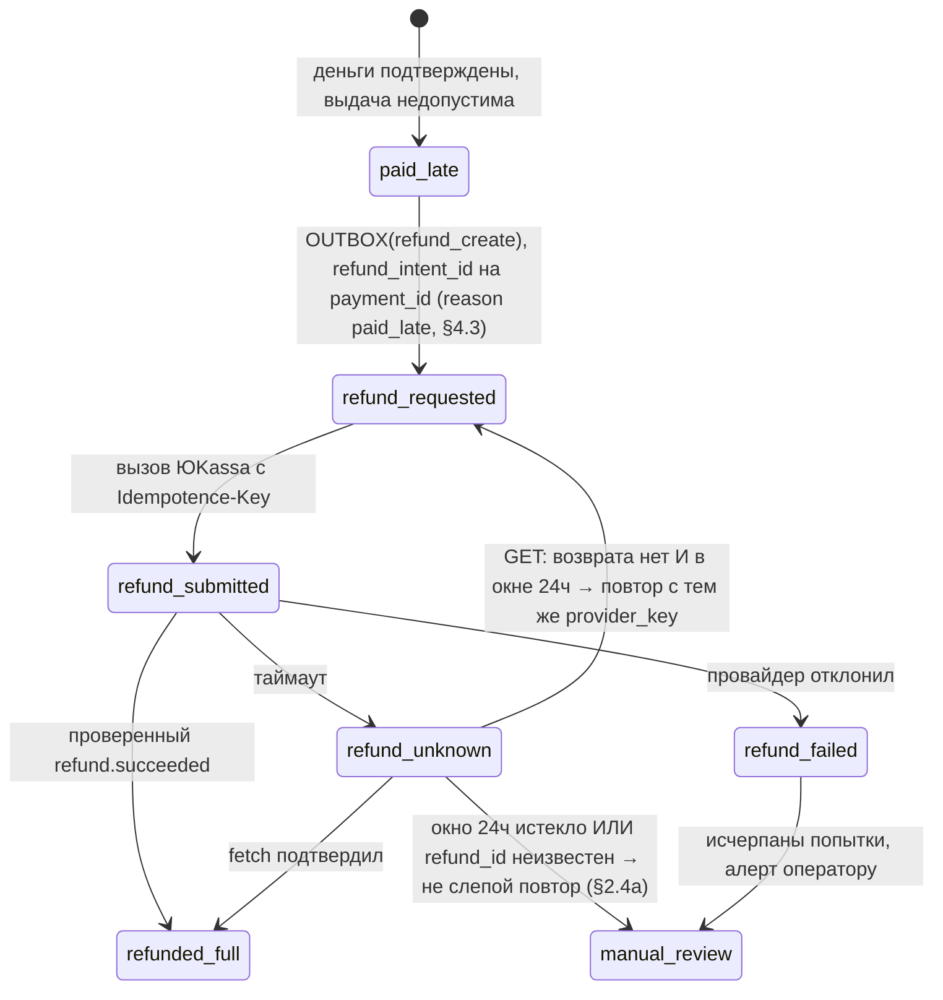
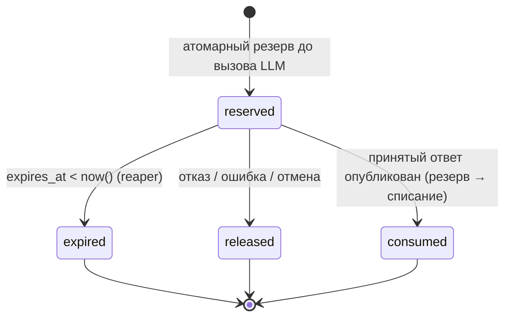
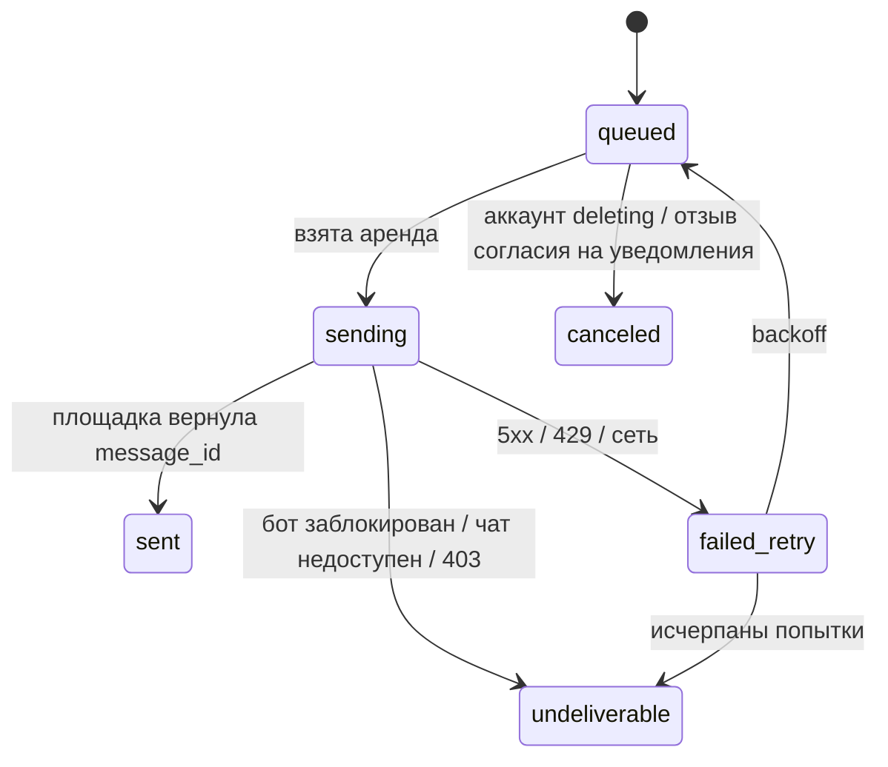
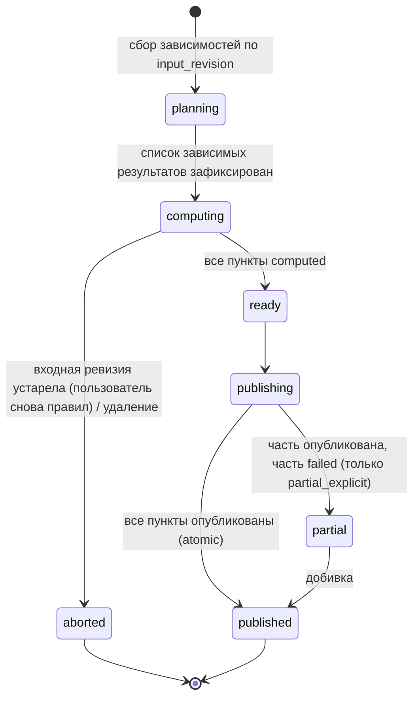
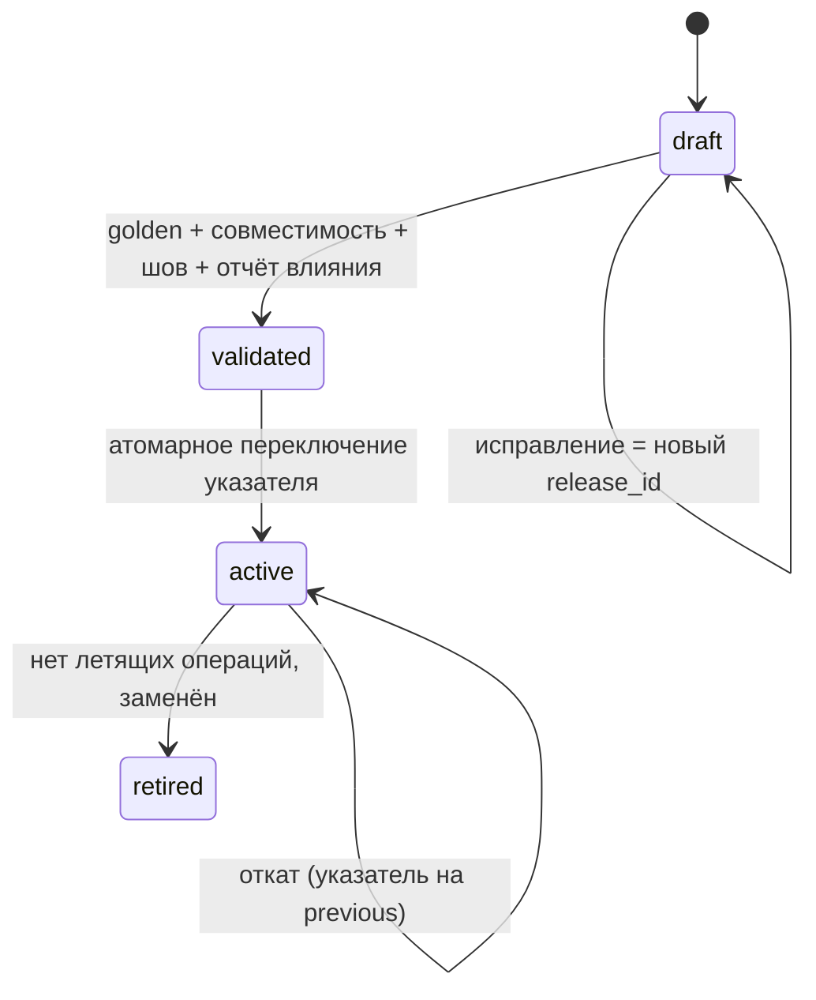

# Лунора — транзакционные контракты

**Дата:** 2026-11-17 · **Статус:** принят для реализации — канон (`КАНОН-И-АРХИВ.md` §1; Волна B выполнена). Открытые параметры (численные пороги ретраев/TTL/сверки, spike подлинности вебхука и возврата по СБП/из кабинета ЮKassa, идемпотентность чеков НПД) перечислены по месту и в `ПЕРЕДАЧА-КОМАНДЕ §6`; это уточнения при реализации, не пересмотр контракта · **Закрывает:** A01–A10, A16–A19, A26 внешнего архитектурного ревью v3
**Опирается на:** `ARCHITECTURE.md` §3.8, §6.7, §7.3–7.4, §9.2–9.5, §11.3; `idempotency.md`; `spec/payment.md`; `refunds.md`; `ПРАЙС.md`; `РЕШЕНИЯ-БЛОКЕРЫ.md` (B7, B16)
**Принятые решения, которые здесь не обсуждаются:** списание сразу, без холда; при сбое сборки — авто-возврат (`spec/payment.md`, `ARCHITECTURE` §9.2); чат — пакеты запросов, не время (B16); оплата — ЮKassa/СБП; удаление — уничтожение ключа пользователя; оператор — НПД (D-115).

> Принцип документа: **всё, что нельзя потерять, лежит в PostgreSQL в той же транзакции, что и вызвавшее его событие.** Redis, очереди, боты и LLM — исполнители и ускорители, не хранилища правды. Любой побочный эффект — отдельная операция со своим устойчивым `operation_id`, и повтор любой операции безопасен.

---

## 0. Минимальные объекты

| Объект | Назначение | Где живёт | Ключ уникальности |
|---|---|---|---|
| `Operation` / `Job` | единица внешнего или фонового побочного эффекта (вызов ЮKassa, генерация, отправка в бот, возврат, удаление) | PostgreSQL | `operation_id` (детерминированный, см. §2.4) |
| `Outbox` | намерение работы, записанное в одной транзакции с изменением состояния; из него worker создаёт/берёт `Job` | PostgreSQL | `(kind, dedup_key)` |
| `QuotaReservation` | резерв единицы квоты под одно сообщение чата до вызова LLM | PostgreSQL | `(account_id, message_id)` |
| `FeedMembership` | членство человека в утренней ленте: слот (`unlock`) ↔ человек, версия, статус | PostgreSQL | `(account_id, person_id)` |
| `RecalculationBatch` | пакет пересчёта: ревизия входа, список зависимых результатов, статусы, публикация | PostgreSQL | `recalculation_id` |
| `DeletionRequest` / `DeletionEpoch` | запрос удаления/отзыва согласия и монотонный счётчик «поколения» данных субъекта | PostgreSQL | `(account_id)` для эпохи; `deletion_id` для запроса |
| `ContentReleaseManifest` | неизменяемый манифест совместимых версий схем, правил, каталогов, шаблонов, промптов | PostgreSQL + файл-артефакт | `release_id` (хеш содержимого) |

Остальные сущности — по `ARCHITECTURE` §7.2; ниже добавляются только поля, нужные контрактам.

Общие соглашения:

- Все метки времени — UTC, `timestamptz`; сравнение «истёк» делается **в SQL по часам БД** (`now()`), а не по часам worker.
- Все переходы состояний — условный `UPDATE ... WHERE status = :ожидаемое RETURNING` (компаре-энд-своп). Ноль строк = переход уже сделан кем-то другим, это не ошибка.
- Лог содержит `account_id`, `order_id`, `operation_id`; ПДн в логах нет (`ARCHITECTURE` §7.3).

---

## 1. Выполнение заказа по типам продукта (A01)

### 1.1 Что значит «оказано»

Деньги списаны сразу, поэтому момент «услуга оказана» должен быть **объективным, серверным и записанным**, иначе невозможно решить, возвращать ли деньги автоматически. Открытие результата пользователем — **не** момент оказания.

| Тип продукта | Примеры (`ПРАЙС.md`) | Событие `fulfilled` (услуга оказана) | Что НЕ считается оказанием |
|---|---|---|---|
| **Документ-разбор** | год 1990, ребёнок 1490, совместимость 990, дата 390 | `DOCUMENT` создан: `status=ready`, версия записана, прошёл валидатор шва (§5.8 архитектуры), файл/текст зашифрован и читается | открытие, прокрутка, доставка в бот |
| **Документ-форма (PDF)** | PDF карты 149 | файл PDF собран, контрольная сумма записана, доступен по скачиванию из приложения | отправка файла в бот, скачивание |
| **Квота** | пакеты 3 / 10 / 50 запросов | `ENTITLEMENT_GRANT(kind=quota)` создан со статусом `active`, `quota_total = N` | первое сообщение, расход квоты |
| **Слот** | слот в ленте 290 | `ENTITLEMENT_GRANT(kind=unlock, scope=slot)` создан **и** связан с `FeedMembership` либо остаётся свободным слотом (человек может быть добавлен позже) | добавление человека, первый прогноз |

Для слота «оказано» = право создано и доступно; ленту наполняет пользователь — это его действие, а не обязательство выдачи. Для квоты — аналогично.

### 1.2 Раздельные события

| Событие | Таблица/поле | Кто пишет | Влияет на деньги? |
|---|---|---|---|
| `fulfilled_at` | `ORDER_EXECUTION.fulfilled_at` | worker в транзакции публикации результата | да — порог «авто-возврат невозможен без отзыва результата» |
| `delivered_at` / попытки | `NOTIFICATION` (§6) | доставщик | нет |
| `first_viewed_at` | `DOCUMENT_VIEW` (append-only) | api при открытии | нет — только аналитика и доводы в споре («результат открывался») |

Инвариант: `first_viewed_at` не меняет ни одного состояния заказа, платежа или возврата. Открытие не может «потратить» купленное; повторное открытие доступно бесконечно (`06_ux.md` §3.4: доступ ограничивает отправку, не чтение).

### 1.3 Состояния исполнения



### 1.4 Инварианты

- **E1.** `fulfilled` возможен ровно один раз на заказ; публикация — условный `UPDATE ... WHERE execution_status IN ('pending','running') AND lease_token = :мой`.
- **E2.** Результат принадлежит заказу: `DOCUMENT.order_id` уникален на `(order_id, version)`; повторный запуск генерации (ключ по `hash входа`, `idempotency.md` п.5) возвращает готовый результат, а не генерирует новый текст.
- **E3.** Выдача гранта и пометка `fulfilled` для квоты и слота — часть той же транзакции, что фиксация оплаты (`payment_status=succeeded` + `order_status=active`, §3.1): у них нет внешней сборки, «pending» для них транзитный.
- **E4.** Если у документа `stale` (пересчёт, §10), `fulfilled_at` не сбрасывается: пересборка — бесплатная доработка, не новое исполнение.

### 1.5 Критерии приёмки

| # | Сценарий | Ожидание |
|---|---|---|
| П1.1 | Заказ разбора оплачен, генерация падает 3 раза подряд | `execution=failed`, создан возврат обеспечивающего платежа (`refund_intent_id` на `securing_payment_id`, reason `build_failed`, §4.3), грант документа не выдан |
| П1.2 | Документ собран, бот недоступен 2 часа | `execution=fulfilled`; заказ **не** возвращается; результат доступен в приложении; доставка в статусе «ожидает» (§6) |
| П1.3 | Пользователь ни разу не открыл документ 30 дней | заказ остаётся `fulfilled`; автоматических возвратов по «неоткрыт» нет |
| П1.4 | Квота: оплата прошла, процесс упал сразу после коммита | грант есть (он в той же транзакции), потеряться нечему |
| П1.5 | Worker падает между «текст сгенерирован» и «опубликован» | после истечения lease другой worker находит сохранённый черновик по `operation_id` либо перегенерирует; публикуется один результат |

---

## 2. Outbox и исполнение работы (A02, A03)

### 2.1 Таблицы

```
OUTBOX:                                  # намерение, пишется В ТОЙ ЖЕ транзакции, что и изменение состояния
  outbox_id            uuid pk
  kind                 text   # build_document | issue_receipt | notify_user | refund_create | refund_revoke_grant
                              # | payment_reconcile | delete_finalize | recalc_publish | ...
  dedup_key            text   # детерминированный, см. §2.4
  payload              jsonb  # только id-ссылки, без ПДн
  account_id, order_id nullable
  deletion_epoch       int    # эпоха субъекта на момент постановки (§7)
  release_id           text   # ContentRelease, зафиксированный при постановке (§12)
  created_at
  UNIQUE (kind, dedup_key)

JOB:                                     # исполнение одного outbox-намерения
  operation_id         text pk           # устойчивый, детерминированный (§2.4)
  outbox_id            fk
  status               pending | leased | succeeded | failed_retry | failed_final | canceled
  attempts             int
  max_attempts         int
  lease_token          uuid              # меняется при каждом взятии
  lease_until          timestamptz
  next_attempt_at      timestamptz
  last_error_class     text              # retryable | permanent | provider_unknown
  result_ref           text              # id созданного ресурса / ответ провайдера
```

`SCHEDULED_JOB` из `ARCHITECTURE` §11.3 — частный случай `OUTBOX` с `fire_at`; его таблицу можно оставить как представление или влить сюда (**[ОТКРЫТО]** выбрать при реализации; контракт от этого не меняется).

### 2.2 Протокол worker

```
1. ВЗЯТИЕ (атомарно):
   UPDATE job SET status='leased', lease_token=gen_random_uuid(),
                  lease_until = now() + :ttl, attempts = attempts + 1
   WHERE operation_id = (
       SELECT operation_id FROM job
       WHERE status IN ('pending','failed_retry') AND next_attempt_at <= now()
       ORDER BY next_attempt_at FOR UPDATE SKIP LOCKED LIMIT 1)
   RETURNING *;
2. ПРОВЕРКА ПЕРЕД ДЕЙСТВИЕМ — ПО ПОЛИТИКЕ ДОПУСКА ВИДА ЗАДАЧИ (§2.2a, H03), НЕ единым guard'ом для всех.
3. ВНЕШНИЙ ВЫЗОВ **по политике идемпотентности соответствующего адаптера**. Для финансового адаптера ЮKassa — производный `provider_key` (§2.4a), внутренний `operation_id` провайдеру не передаётся (O5). Для нефинансовых адаптеров (LLM, бот, чек) — их собственная модель идемпотентности.
4. ФИКСАЦИЯ (fencing, H05): `UPDATE job SET status='succeeded', result_ref=... WHERE operation_id=:id AND lease_token=:мой AND status='leased' AND lease_until > now();`
   если 0 строк — аренда потеряна/истекла или статус уже терминальный → результат **НЕ публиковать** (та же проверка — в `QUOTA_RESERVATION`: `consume` только при `status='reserved' AND expires_at > now()`).
5. ПРОДЛЕНИЕ: для долгих операций worker продлевает lease_until (heartbeat) пока жив.
```

**Восстановление зависших (H05).** `reaper` (раз в минуту): `leased` с `lease_until < now()` → **ротирует `lease_token`** (новый uuid) и переводит в `failed_retry` (если `attempts < max_attempts`, `next_attempt_at = now() + backoff(attempts)`) либо `failed_final`. Ротация токена гарантирует, что **поздний старый worker не пройдёт fixation** (его `lease_token` больше не актуален), даже если новый worker ещё не взял задачу. `failed_final` порождает событие по виду операции (для `build_document` — авто-возврат, §4). ⚠️ Локальный fencing не отменяет **уже отправленный** внешний запрос — он лишь не публикует его результат.

**Ускорение через Redis.** После коммита outbox ставится в очередь Redis для скорости. Потеря Redis = задержка до следующего прохода `poller`, который каждые N секунд выбирает `pending` из PostgreSQL. Единственного места незавершённой работы вне PostgreSQL нет.

### 2.2a Политика допуска по виду задачи (H03)

⚠️ **Единый guard «только при `state=active` и неизменной эпохе» неверен для удаления и финансов — он отменил бы сами эти операции.** Допуск определяется по `kind`:

| Класс задач | Виды | Допустимое состояние | Отменяется при `deleting`? | Доп. проверки |
|---|---|---|---|---|
| **Пользовательские** | `chart_compute`, `build_document`, `chat_answer`, `forecast`, `export` | `state=active`, эпоха и согласие актуальны | да | заказ не в refund/refunded |
| **Удаление данных** | `delete_finalize`, шаги §7.4 | `state=deleting` (это и есть их штатное состояние) | **нет** (иначе отменят себя) | идемпотентность шага |
| **Финансовое завершение** | `refund_create`, `refund_revoke_grant`, `receipt_cancel`, `reconcile` | любое состояние аккаунта, включая `deleting`/удалён | **нет** | завершаются по минимальным **финансовым** идентификаторам (`payment_id`, `refund_intent_id`), без ПДн; НЕ требуют «заказ не в возврате» |

**Инвариант:** удаление аккаунта с незавершённой оплатой доходит до конца, и поздняя оплата по нему корректно возвращается — финансовый контур работает поверх `deleting` и после удаления ПДн (приёмка H03: удалить аккаунт с незакрытой оплатой → перезапустить worker → успешная оплата → удаление завершено, возврат выполнен, пользовательские данные не воскрешены).

### 2.3 Классы ошибок

| Класс | Примеры | Действие |
|---|---|---|
| `retryable` | 5xx, таймаут сети до отправки, пул занят | `failed_retry`, экспоненциальный backoff с джиттером |
| `provider_unknown` | таймаут **после** отправки платежа/возврата | НЕ повторять вслепую: `GET` по сохранённому `provider_payment_id`/`provider_refund_id` (§2.4a); id неизвестен → `manual_review`. `operation_id` — внутренний, провайдеру не передаётся и для поиска не годится |
| `permanent` | 4xx валидации, отказ валидатора шва, неверные данные | `failed_final` без повторов |

### 2.4 Устойчивые `operation_id` по побочным эффектам

`operation_id` вычисляется детерминированно из бизнес-ключа и не зависит от номера попытки:

| Побочный эффект | `operation_id` | Передаётся провайдеру как |
|---|---|---|
| Создание платежа | `pay:{order_id}:{attempt_key}` | `provider_key` (§2.4a) → `Idempotence-Key` ЮKassa |
| Запрос возврата | `refund:{payment_id}:{refund_intent_id}` | `provider_key` (§2.4a) → `Idempotence-Key` ЮKassa (H04) |
| Отзыв гранта | `revoke:{grant_id}:{refund_intent_id}` | внутренний |
| Сборка документа | `build:{order_id}:{input_hash}:{release_id}` | ключ кэша результата |
| Чек исходный | `receipt:{payment_id}:issue` | ключ Мой налог/ККТ |
| Чек при возврате | **по режиму** (`refunds.md`): НПД — `receipt:{payment_id}:cancel` (аннулирование исходного); ККТ — `receipt_refund:{payment_id}:{refund_intent_id}` (**отдельный** чек «Возврат прихода» на КАЖДЫЙ возврат, т.к. возвратов по платежу может быть несколько) | ключ Мой налог/ККТ |
| Уведомление в бот | `notify:{order_id|doc_id}:{template}` | локальный; Telegram exactly-once не гарантирует (§6) |
| Резерв квоты | `quota:{account_id}:{message_id}` | уникальный индекс |
| Финализация удаления | `delete:{deletion_id}:{step}` | локальный |
| Публикация пересчёта | `recalc:{recalculation_id}:{result_id}` | локальный |

Собственная дедупликация **без срока жизни** (R-50): `PROCESSED_EVENT(source, event_id)` уникален навсегда; окно провайдера 24 ч не используется как гарантия.

### 2.4a Контракт адаптера ЮKassa (H07)

⚠️ **Внутренний `operation_id` ≠ `Idempotence-Key` провайдера.** У ЮKassa ключ идемпотентности **≤ 64 символов**, окно — **24 часа** ([S1]). Наши ключи вида `pay:{order_id}:{attempt_key}` c UUID могут превышать 64 — поэтому:
- хранить **отдельно** внутренний `operation_id` (любой длины) и **provider_key** (детерминированный короткий хеш `operation_id`, ≤ 64, напр. base32 от SHA-256, усечённый);
- **подлинность вебхука** — не самодельная «подпись», а по схеме ЮKassa: повторный `GET` статуса объекта по его id (и/или allowlist IP), затем применяем **только проверенное состояние провайдера** ([S2]). Тело вебхука: `{type, event, object}` — правила отображения объектов провайдера во внутренние состояния задать явно;
- **собственный `event_id`** для дедупликации формируем из `(type, event, object.id, object.status)` — у провайдера нет верхнеуровневого `event_id`;
- **после истечения окна 24 ч** при потерянном ответе — **сверка/ручное разрешение**, НЕ слепое новое списание/возврат;
- наличие поиска по `Idempotence-Key` у провайдера не гарантировано — восстановление «неизвестного исхода» строить на `GET` по известному id платежа/возврата, иначе — `manual_review`.

Приёмка — контрактные тесты в sandbox (§... «потерянный ответ создания/возврата», «повтор позже 24 ч», «повтор вебхука», «возврат из кабинета»).

### 2.5 Инварианты

- **O1.** Изменение бизнес-состояния и запись `OUTBOX` — одна транзакция. Невозможно «оплачено, но задача не поставлена».
- **O2.** Для одной пары `(kind, dedup_key)` существует не более одной записи `OUTBOX` и не более одного `JOB` на `operation_id`.
- **O3.** Результат операции записывается только держателем актуального `lease_token`.
- **O4.** `failed_final` всегда имеет обработчик (авто-возврат, алерт оператору или пометка «нужна ручная проверка»); молчаливого «потерянного» состояния нет.
- **O5.** Все внешние вызовы с деньгами используют производный **`provider_key`** (детерминированный короткий хеш `operation_id`, ≤ 64, §2.4a) как `Idempotence-Key` провайдера; сам `operation_id` — внутренний и провайдеру не передаётся. Один и тот же сохранённый `provider_key` переиспользуется при повторах в окне провайдера.

### 2.6 Критерии приёмки

| # | Сценарий сбоя | Ожидание |
|---|---|---|
| П2.1 | Убить api сразу после коммита транзакции оплаты, до постановки в Redis | poller находит `OUTBOX/JOB pending`, сборка запускается, дубля нет |
| П2.2 | Убить worker посреди генерации (`kill -9`) | через `lease_until` reaper возвращает задачу; второй worker завершает; опубликован один результат |
| П2.3 | Полная потеря Redis | работа продолжается из PostgreSQL с задержкой не более N секунд, ни одна задача не потеряна |
| П2.4 | Два worker берут одну задачу (гонка) | `SKIP LOCKED` + `lease_token`: публикует только один; второй получает 0 строк и молча выходит |
| П2.5 | Тот же вебхук 5 раз и через 25 часов | `PROCESSED_EVENT` отсекает все повторы; побочные эффекты один раз |
| П2.6 | Таймаут ответа на `refund` от ЮKassa | `provider_unknown` → `GET` по сохранённому `provider_refund_id`: возврат найден → фиксируем; не найден и **в окне 24 ч** → повтор с тем же `provider_key`; **после окна** или при неизвестном refund_id → `manual_review`, не слепой повтор. Двойного возврата нет |
| П2.7 | Один и тот же `operation_id` пришёл по двум путям (вебхук и сверка) | один `JOB`, один эффект |

---

## 3. Машина состояний оплаты, исполнения и возврата (A04, A05, A06)

### 3.1 Четыре независимые оси

Единое поле `ORDER.status` из `ARCHITECTURE` §9.2 смешивает разные факты. Вводятся **раздельные** состояния; `ORDER.status` остаётся производным (вычисляемым) полем для UI и админки.

| Ось | Таблица | Значения | Кто владеет |
|---|---|---|---|
| `order_status` | `ORDER` | `created`, `awaiting_payment`, `closed_unpaid`, `active`, `closed` | заказ как намерение покупки |
| `payment_status` | `PAYMENT` | `none`, `pending`, `reconcile_needed`, `succeeded`, `canceled_by_provider`, `paid_late`, `refunded_full`, `refunded_partial` | факт денег по данным ЮKassa |
| `execution_status` | `ORDER_EXECUTION` | `not_started`, `pending`, `running`, `fulfilled`, `failed`, `revoked` | выполнение услуги (§1.3) |
| `refund_status` | `REFUND` | `requested`, `submitted`, `succeeded`, `failed`, `unknown`, `canceled` | возврат денег |

`closed_unpaid` допустим только при `payment_status ∈ {none, canceled_by_provider}` и подтверждённой сверкой (п. 3.3).

### 3.2 Оплата



**Центральное правило.** Локальный тайм-аут (например, 10 минут без подтверждения) переводит платёж в **`reconcile_needed`**, а не в «отменён». Отмена доказывается только ответом провайдера (`payment.status = canceled`) или истечением срока жизни платёжной ссылки на его стороне, подтверждённым запросом `GET`. Пока доказательства нет, заказ не закрывается окончательно, а нового платежа на тот же заказ без отмены старого не создаём.

### 3.3 Единый обработчик проверенного состояния

Вебхук и ручной/фоновый `GET /payments/{id}` приводят к **одной функции**:

```
apply_verified_payment_state(provider_payment_id, snapshot: PaymentState, source: webhook|poll|manual) -> Outcome
```

Правила:

1. Вебхук — только **сигнал**: по нему всегда делается `fetch` (`PaymentPort.fetch`), решение принимается по ответу `GET`, а не по телу вебхука (см. `ARCHITECTURE` §9.4: «обязательная сверка перед выдачей»). Тело вебхука используется как подсказка, какой платёж смотреть.
2. `apply_verified_payment_state` работает под блокировкой строки `PAYMENT` (`SELECT ... FOR UPDATE`) и идемпотентна: одинаковый `snapshot` даёт одинаковый результат.
3. **Сверка денег** перед любым переходом в `succeeded`/`paid_late`. Все проверки ниже обязательны; при расхождении действует правило из колонки «При расхождении» **этой** строки, а не общий «выдачи нет». По умолчанию расхождение → `reconcile_needed` + алерт, выдачи нет. Три случая по сумме: **точная сумма** — штатное исполнение; **недоплата** — выдачи нет, `reconcile_needed`; **подтверждённая переплата** — исключение: только после того как все прочие проверки (валюта, магазин, `order_id`, `operation_id`, статус) прошли, заказ исполняется **по цене заказа**, а разница возвращается отдельным возвратом (`amount_overpaid`, §4.3).

| Поле | Сравнивается с | При расхождении |
|---|---|---|
| `currency` | валюта заказа (RUB) | алерт «подмена валюты», выдачи нет |
| `amount` | `ORDER.price_snapshot` (цена в момент создания заказа, из `PRODUCT` на сервере) | недоплата — не выдавать; переплата — выдать и вернуть разницу отдельным возвратом |
| `shop_id` / аккаунт магазина | конфигурация магазина | алерт, платёж чужого магазина игнорируется |
| `metadata.order_id` | `ORDER.id` | алерт; платёж привязывается только по нашему `order_id`, не по присланному |
| внутренний `operation_id` | `pay:{order_id}:{attempt_key}` из записи; провайдеру — производный `provider_key` (§2.4a) | чужой ключ — не наш платёж |
| статус и `paid=true` | допустимые для перехода | иначе переход запрещён |

4. Побочный эффект «деньги пришли» — **одна транзакция**: `PROCESSED_EVENT` (если источник вебхук), `PAYMENT=succeeded`, `ORDER=active`, `ENTITLEMENT_GRANT` (для квоты/слота) либо `OUTBOX(build_document)`, `OUTBOX(issue_receipt)`, `OUTBOX(notify_user)`.

### 3.4 Таблица переходов и событий

`—` означает «нет действия, событие учтено в `PROCESSED_EVENT`».

| Ситуация | Состояние до | Событие | Решение | Состояние после |
|---|---|---|---|---|
| Штатный успех | `payment=pending` | проверенный успех, сверка OK | выдача + outbox | `succeeded`, `execution=pending` |
| **Поздний успех** (оплата на 15-й минуте) | `payment=reconcile_needed` или `canceled` по таймеру, но не по доказательству | проверенный успех, сверка OK | если заказ ещё не закрыт окончательно — штатная выдача; если закрыт — `paid_late` (§4) | `succeeded` либо `paid_late` |
| Успех пришёл после проверенного отказа | `canceled_by_provider` | проверенный успех | деньги есть без заказа → `paid_late`, авто-возврат | `paid_late` → `refunded_full` |
| Повтор того же вебхука | любое | событие с известным `event_id` | отсечь | без изменений |
| **Переставленные события** (`canceled` пришёл позже `succeeded`) | `succeeded` | старое событие `canceled` | сверка `GET`: провайдер говорит `succeeded` → событие устарело; регрессии статуса нет | без изменений (переходы только вперёд, §3.5) |
| Вебхук раньше записи заказа | — | событие о неизвестном `order_id` | заказ создаётся до обращения к провайдеру (`idempotency.md` §5); если всё же не найден — `PROCESSED_EVENT` со статусом «отложено», сверка позже, не терять | отложено |
| **Провайдер недоступен** | `pending` | `GET` по таймауту/5xx | `reconcile_needed`, повтор с backoff; пользователю: «проверяем оплату», без «не оплачено» | `reconcile_needed` |
| Провайдер недоступен долго (> порога T) | `reconcile_needed` | порог | алерт оператору; деньги не трогаем; выдачи нет | `reconcile_needed` + алерт |
| **Возврат из кабинета ЮKassa** (оператор нажал там) | `succeeded`, `execution=fulfilled` | вебхук `refund.succeeded`, `refund_id` нам неизвестен | создать `REFUND(origin=provider_cabinet)`, применить **§3.6 по сумме** (полный → отзыв гранта/документа и аннулирование чека, то, чего кабинет не умеет, `ARCHITECTURE` §9.5; частичный → по правилам продукта §3.6, по умолчанию доступ остаётся), **обработать чек по режиму** (`refunds.md`: НПД — аннулировать исходный; ККТ — чек возврата на сумму), пометить «возврат вне админки» | полный → `refunded_full`, `execution=revoked`; частичный → `refunded_partial`, доступ по §3.6 |
| **Частичный возврат** | `succeeded` | `refund.succeeded` на сумму < оплаты | запись `REFUND.amount`; **грант не отзывается автоматически**: решение по продукту (таблица §3.6) требует решения оператора; для частичного возврата квоты — пропорциональное снятие `quota_total` | `refunded_partial` |
| **Уже выданный результат** + возврат | `execution=fulfilled` | возврат (любой источник) | эффект **по сумме (§3.6)**: при ПОЛНОМ возврате доступ отзывается (`revoked`), контент остаётся в хранилище по сроку удержания для спора; при ЧАСТИЧНОМ — по умолчанию доступ к документу **сохраняется** (частичный = компенсация), отзыв — только по решению оператора. Не «любой возврат отзывает» | полный → `execution=revoked`; частичный → доступ по §3.6 |
| Повторный платёж на тот же заказ (дубль) | `succeeded` | второй успех по тому же `order_id` | второй платёж → `paid_late`-класс «дубль», авто-возврат **второго платежа** (`refund_intent_id` на его `payment_id`, reason `duplicate`, §4.3); обеспечивающий платёж не трогаем | вторая запись `PAYMENT`: `refunded_full` |
| Возврат вернул «ошибка» от провайдера | `refund=submitted` | `refund.canceled/failed` | `refund=failed`, повтор по политике, алерт | `failed` → повтор |
| Ответ на возврат неизвестен | `refund=submitted` | таймаут | `refund=unknown` → **`GET` по сохранённому refund id** → фиксировать; поиск по `Idempotence-Key` не предполагаем (§2.4a), id неизвестен → сверка/`manual_review` | `succeeded/failed` |

### 3.5 Инварианты

- **P1.** Переходы `payment_status` идут «вперёд» по частичному порядку: `succeeded` никогда не откатывается в `pending/canceled`; регресс запрещён на уровне условного `UPDATE`.
- **P2.** Выдача права возможна только из проверенного (`GET`) состояния и только после успешной сверки денег (§3.3).
- **P3.** `closed_unpaid` — только при доказанной отмене, иначе заказ остаётся открытым для сверки не менее срока жизни ссылки + запас.
- **P4.** Сумма всех `REFUND` по платежу не превышает сумму платежа: `CHECK` + проверка в транзакции.
- **P5.** Любой возврат, независимо от источника (авто, админка, кабинет), проходит через **один и тот же** обработчик `apply_verified_refund_state`. Его эффект на доступ зависит от **суммы**: полный возврат → полный отзыв (грант/результат) и обработка чека; частичный — по правилам продукта §3.6 (по умолчанию доступ сохраняется, для части продуктов — решение оператора). «Любой возврат отзывает грант» — **неверно**; обработчик смотрит на `refund.amount` против суммы платежа, а не только на факт `refund.succeeded`.
- **P6.** `ORDER.status` на экране вычисляется из четырёх осей; отдельно хранимое значение не может противоречить им.

### 3.6 Что отзывается при возврате

| Продукт | Полный возврат | Частичный возврат |
|---|---|---|
| Документ / PDF | `execution=revoked`; доступ закрыт; повторная покупка возможна | по решению оператора; по умолчанию доступ остаётся (частичный = компенсация) |
| Квота | `quota_total` уменьшается на невозвращённый остаток, потраченное не отзывается; если баланс уже ≤ 0, грант `revoked`, долга нет | пропорциональное снятие неиспользованной части |
| Слот | `unlock=revoked`; `FeedMembership` ставится в `suspended` (данные человека остаются, прогноз не приходит) | по решению оператора |

Порядок расходования грантов (§5.6) нужен именно затем, чтобы отзывать было что.

### 3.7 Критерии приёмки

| # | Сценарий | Ожидание |
|---|---|---|
| П3.1 | Оплата на 15-й минуте, при локальном тайм-ауте 10 минут | платёж был `reconcile_needed`, не `canceled`; по сверке — штатная выдача; пользователю не показано «оплата не прошла» как итог |
| П3.2 | Вебхук `succeeded`, но сумма в `GET` ≠ цена заказа | выдачи нет, `reconcile_needed`, алерт оператору |
| П3.3 | Приходят события `succeeded → canceled → succeeded` в перепутанном порядке | итог `succeeded`; нет двойной выдачи и нет отзыва |
| П3.4 | ЮKassa недоступна 40 минут, потом поднимается | заказ не закрыт; после восстановления сверка находит успех/отказ и применяет |
| П3.5 | Оператор вернул деньги в кабинете ЮKassa | в течение минуты по вебхуку отозван грант, чек обработан, запись в `AUDIT_LOG` |
| П3.6 | Частичный возврат 50% | `payment=refunded_partial`, остаток права решается по §3.6, возврат не превышает сумму (P4) |
| П3.7 | Возврат по уже выданному и открытому документу | доступ отозван; `first_viewed_at` сохранён как факт; запись для спора |
| П3.8 | Повтор вебхука возврата ×3 | один `REFUND`, один отзыв гранта |
| П3.9 | Платёж с чужим `shop_id` или валютой, отличной от RUB | не принят; алерт |

---

## 4. Авто-возврат как контракт (A07-смежное; требование ревью «авто-возврата нет»)

`refunds.md` описывает только ручной возврат через поддержку. Решение «списание сразу + авто-возврат при сбое сборки» (`spec/payment.md`) требует отдельного контракта.

### 4.1 Триггеры авто-возврата

| Причина (`reason`) | Условие | Автоматически? |
|---|---|---|
| `build_failed` | `execution=failed` (исчерпаны попытки, §2.2) | да |
| `duplicate` | второй успешный платёж по тому же заказу/продукту | да |
| `paid_late` | деньги получены после окончательного закрытия заказа/продукт недоступен | да |
| `amount_overpaid` | переплата (разница) | да, возврат разницы |
| `unconfirmed_10min` | нет подтверждения, но деньги есть у провайдера (после сверки) | сначала сверка; возврат только при доказанном `succeeded` без возможности выдать |
| `support_manual` | решение оператора | нет, через админку (`ARCHITECTURE` §9.5) |

Спорные случаи автомат не решает (`§9.5`): «первое обращение без вопросов, второе — доступ вместо денег» остаётся за человеком.

### 4.2 Состояние `paid_late`

`paid_late` — платёж, по которому деньги **подтверждены**, но выдать результат уже нельзя или нельзя безопасно: заказ закрыт, продукт снят, аккаунт в `deleting`/`deleted`, совпала версия продукта, вышли за срок. Для такого платежа единственный разрешённый исход — возврат.



### 4.3 Ключ идемпотентности и порядок

- ⚠️ **Исправлено по ревью H04. Возврат привязан к конкретному ПЛАТЕЖУ, не к заказу** (на заказе может быть несколько `PAYMENT`): устойчивый `refund_intent_id`, ссылка на `payment_id`, неизменяемые `amount` и `reason`. Внутренний ключ операции — `refund:{payment_id}:{refund_intent_id}`; провайдеру уходит производный `provider_key` (§2.4a); в БД — `UNIQUE (refund_intent_id)`. Повторные срабатывания возвращают тот же `REFUND`. `order_id` и `reason` (`build_failed`/`duplicate`/`overpay`/ручной) — бизнес-контекст, **не** самостоятельная уникальность возврата.
- **Для авто-возвратов `refund_intent_id` детерминирован из `(payment_id, reason)`** — поэтому троекратный сбой сборки (§2.2) или повторная обработка дубля дают **один** `REFUND`, а не несколько.
- **Лимит суммы** проверяется под блокировкой строки `payment_id`, с учётом уже успешных и незавершённых (`unknown`) возвратов по этому платежу.
- **Какой платёж обеспечивает право.** У `ENTITLEMENT_GRANT` фиксируется `securing_payment_id`. Возврат **лишнего** платежа или переплаты (`duplicate`/overpay) **не отзывает** право, если оно обеспечено **другим** успешным платежом; отзыв гранта — только при возврате именно обеспечивающего платежа.
- ⚠️ **H06. Итоговые эффекты — только после `refund.succeeded`.** В транзакции постановки — лишь `REFUND(requested)` → `OUTBOX(refund_create)`. Эффекты `refund_revoke_grant`, обработка чека **по режиму** (НПД — аннулирование исходного, ККТ — чек возврата на сумму, `refunds.md`), `notify_user:refund` запускаются **обработчиком подтверждённого `refund.succeeded`**, не раньше (иначе «деньги вернули» уходит до ответа провайдера или после отказа возврата). При неуспешном возврате — доступ восстанавливается по явной политике.
- **Отзыв гранта идемпотентен:** `revoke:{grant_id}:{refund_intent_id}`; снимается невозвращённый остаток `quota_total − quota_consumed` **с учётом активных резервов** (`quota_reserved`, Q6 §5): уже израсходованное не отзывается, активные резервы освобождаются; нет гранта (сбой сборки) — «нечего отзывать», не ошибка.
- **Чек (НПД):** исходный чек аннулируется (`refunds.md`); сбой чека не блокирует возврат денег (чек в статусе «формируется/аннулируется»).
- **Сообщение пользователю:** шаблон «вернули деньги за разбор — не получилось собрать», доставка по контракту §6.

### 4.4 Инварианты

- **R1.** По каждому платежу в `paid_late`, `failed`+`fulfilled=false` и `duplicate` существует `REFUND` либо активная `manual_review`; висящего без возврата платежа быть не может (проверяется периодическим аудитом, §4.5).
- **R2.** Возврат и выдача взаимоисключающи: условный переход `execution: pending|running → failed` и `execution: pending|running → fulfilled` конкурируют за одну строку; побеждает один.
- **R3.** Авто-возврат не вызывается, если `execution=fulfilled` и причина — не `duplicate`/`paid_late` (не возвращать полученное автоматически без решения человека).
- **R4.** Максимум одного успешного возврата на `refund_intent_id`; возврат лишнего платежа не затрагивает право, обеспеченное другим платежом (H04).

### 4.5 Аудит-сверка

Ежедневная задача сверяет: `PAYMENT.succeeded` ↔ (`ENTITLEMENT_GRANT` ∨ `execution=fulfilled` ∨ `REFUND` ∨ `manual_review`). Любой платёж без исхода старше порога — алерт.

### 4.6 Критерии приёмки

| # | Сценарий | Ожидание |
|---|---|---|
| П4.1 | Генерация падает после оплаты, 3 попытки | один `REFUND` на обеспечивающий `payment_id` (`refund_intent_id` детерминированный из `(payment_id, 'build_failed')`, §4.3); грант не выдан; пользователь получил сообщение о возврате |
| П4.2 | Сбой во время `refund_create` (таймаут), повтор | один возврат; `Idempotence-Key` тот же; в кассе нет минуса дважды |
| П4.3 | Платёж пришёл через 3 часа, заказ закрыт | `paid_late` → возврат; результат не выдан |
| П4.4 | Платёж пришёл, аккаунт в `deleting` | `paid_late` → возврат; данные не создаются; финансовые записи остаются |
| П4.5 | Авто-возврат и ручной возврат из админки запущены одновременно | `UNIQUE` и блокировка: итоговая сумма возвратов ≤ суммы платежа |
| П4.6 | После авто-возврата квоты у пользователя были израсходованы 2 из 3 | снят остаток 1; отрицательного баланса нет |

---

## 5. Резерв квоты чата (A08, A09)

### 5.1 Модель

Баланс не «меняется на сообщение», а **резервируется до вызова LLM** и **закрепляется** (consume) только по принятому ответу.

```
ENTITLEMENT_GRANT (kind=quota):  quota_total, quota_consumed, quota_reserved, origin, created_at
  available(grant) = quota_total − quota_consumed − quota_reserved      -- ≥ 0, CHECK
  available(account) = Σ по active-грантам

QUOTA_RESERVATION:
  reservation_id, account_id, message_id        UNIQUE (account_id, message_id)
  grant_id            # из какого гранта зарезервировано
  status              reserved | consumed | released | expired
  reserved_at, expires_at      # expires_at = now() + :LLM_deadline
  worker_token        # токен публикации (§5.4)
  deletion_epoch      # эпоха на момент резерва (§7)
```

### 5.2 Состояния



### 5.3 Атомарный резерв

⚠️ **Исправлено по ревью H02.** Идемпотентность сообщения проверяется **ДО** изменения баланса: иначе повтор одного `message_id` дважды увеличивает `quota_reserved`. Порядок — «сначала создать резерв, потом списать в резерв», одной транзакцией под блокировкой аккаунта.

```sql
BEGIN;
SELECT pg_advisory_xact_lock(:acc);          -- сериализация по аккаунту

-- 1) ИДЕМПОТЕНТНОСТЬ ПЕРВОЙ: создать резерв, если его ещё нет для этого message_id
INSERT INTO quota_reservation(account_id, message_id, body_hash, status)
VALUES (:acc, :mid, :body_hash, 'reserved')
ON CONFLICT (account_id, message_id) DO NOTHING
RETURNING reservation_id;
-- если НИЧЕГО не вернулось → это повтор того же сообщения:
--   вернуть существующий резерв, баланс НЕ трогать, COMMIT, выход.
--   (тот же message_id с другим body_hash → ошибка idempotency_conflict, не прежний ответ)

-- 2) только для НОВОГО резерва — выбрать грант и списать в резерв:
WITH g AS (
  SELECT grant_id FROM entitlement_grant
   WHERE account_id = :acc AND kind = 'quota' AND status = 'active'
     AND quota_total - quota_consumed - quota_reserved >= 1
   ORDER BY :порядок_расходования            -- §5.5
   FOR UPDATE LIMIT 1)
UPDATE entitlement_grant SET quota_reserved = quota_reserved + 1
  FROM g WHERE entitlement_grant.grant_id = g.grant_id
  RETURNING entitlement_grant.grant_id;
-- если грант НЕ найден (баланс 0): DELETE только что созданный reservation, вернуть paywall (402).
-- иначе: записать reservation.grant_id (для корректных release/consume).
COMMIT;
```

Инвариант подтверждается приёмкой §5.6: повтор одного сообщения не создаёт второй резерв и не меняет счётчик; `reservation_rows` всегда равно сумме `quota_reserved` по активным резервам.

### 5.4 Что происходит с ответом LLM

| Исход | Действие над резервом | Что видит пользователь |
|---|---|---|
| Принят ответ (валидатор шва пройден, публикация сообщения в транзакции) | `reserved → consumed`: `quota_reserved −= 1`, `quota_consumed += 1` — **в той же транзакции, что и запись `CHAT_MESSAGE` ответа** | ответ; баланс −1 |
| Отказ провайдера, таймаут, ошибка валидатора, отказ безопасности | `reserved → released`: `quota_reserved −= 1` | «не получилось ответить», баланс не изменился |
| Отмена пользователем до ответа | `released` | баланс не изменился |
| Истёк `expires_at` | reaper: `expired`, `quota_reserved −= 1` | баланс вернулся |
| Старый worker вернулся с ответом после истечения резерва | условный `UPDATE ... WHERE status='reserved' AND worker_token=:мой` даёт 0 строк → **публикация запрещена**, ответ отбрасывается | ничего (сообщение уже закрыто как неудачное) |

«Принятый ответ» определён однозначно: ответ прошёл валидатор и закреплён транзакцией «сообщение + списание». Списание без ответа и ответ без списания невозможны.

### 5.5 Порядок расходования грантов

Приоритет выбора (`ORDER BY`): **сначала невозвратные** (`origin ∈ {welcome, referral, compensation, certificate}`), затем купленные (`purchase`), внутри группы — старейший `created_at`. Цель — чтобы возврат купленного оставался возможным (`§9.3` архитектуры).

Нюанс: при возврате купленного пакета, если невозвратные уже израсходованы первыми, а купленный пакет остался нетронутым, вся его сумма отзывается — это и есть желаемое поведение. **[ОТКРЫТО]** подтвердить порядок у оператора (помечено в `§9.3`).

### 5.6 Инварианты

- **Q1.** `quota_consumed + quota_reserved ≤ quota_total` — `CHECK` на уровне БД.
- **Q2.** Один `message_id` порождает не более одного резерва (`UNIQUE`) и не более одного списания.
- **Q3.** Резерв делается до внешнего вызова LLM; вызов без активного резерва запрещён.
- **Q4.** Истёкший резерв невозможно превратить в `consumed`; публикация ответа проверяет `status='reserved'` и `worker_token`.
- **Q5.** Резервы не переживают удаление: при `deleting` все активные резервы переводятся в `released`, а публикации блокируются проверкой эпохи (§7).
- **Q6.** Отзыв гранта (возврат) учитывает `reserved`: пока есть активный резерв на гранте, отзыв ждёт или переносит резерв на другой грант (политика реализации; ожидание ограничено `expires_at`).

### 5.7 Критерии приёмки

| # | Сценарий | Ожидание |
|---|---|---|
| П5.1 | **20 одновременных сообщений при балансе 1** | создан **не более одного** резерв; остальные 19 получают отказ «нет запросов» (пейвол) без вызова LLM; `quota_consumed + quota_reserved ≤ 1` |
| П5.2 | Тот же `message_id` отправлен 5 раз (ретрай сети) | один резерв и одно списание |
| П5.3 | LLM-провайдер отвечает ошибкой 500 | резерв освобождён, баланс прежний, пользователь видит «повторить» |
| П5.4 | LLM отвечает через 3 минуты, резерв истёк на 2-й | ответ отброшен, баланс не списан; дубля ответа нет |
| П5.5 | Worker умер между «LLM ответил» и «записано» | резерв истечёт, баланс вернётся; пользователь может повторить |
| П5.6 | У аккаунта welcome(1) + purchase(10) | первое списание — из welcome; затем purchase |
| П5.7 | Возврат пакета при активном резерве | отзыв не создаёт отрицательного баланса; Q1 соблюдён |
| П5.8 | Удаление аккаунта во время генерации ответа | ответ не публикуется (§7), резерв освобождён |

---

## 6. Доставка уведомлений (A10)

### 6.1 Разделение понятий

| Понятие | Что это | Источник правды |
|---|---|---|
| **Результат готов** | `execution=fulfilled` (§1) | `ORDER_EXECUTION` |
| **Уведомление доставлено** | сообщение бота отправлено и принято площадкой | `NOTIFICATION` |

Результат **всегда** доступен в приложении (Mini App, раздел «Мои разборы») независимо от состояния бота. Недоставка уведомления **никогда** не меняет `execution`, `order` или `payment` и не вызывает возврат.

### 6.2 Таблица и состояния

```
NOTIFICATION:
  notification_id, account_id
  subject_kind/subject_id     # order | document | forecast | refund
  template                    # из пула формулировок, без содержания разбора
  status      queued | sending | sent | failed_retry | undeliverable | canceled
  attempts, last_error_class, next_attempt_at
  platform_message_id         # id сообщения площадки после отправки; NULL до тех пор
  sent_at
  deletion_epoch              # §7
  UNIQUE (subject_kind, subject_id, template)
```



### 6.3 Контракт

- Отправка использует тот же `Job/lease` (§2); `operation_id = notify:{subject}:{template}`.
- **Гарантия — «не менее одного раза с дедупликацией по возможности», exactly-once не обещается.** Если отправка прошла, а подтверждение потеряно, возможен повторный текст; для снижения риска перед повтором проверяется `platform_message_id`, а шаблоны уведомлений идемпотентны по смыслу («разбор готов» дважды не вредит).
- `undeliverable` — финальное состояние для данной попытки: пользователь увидит результат при открытии приложения; в «Моих разборах» показывается пометка «новое». Бот-доставка отключается флагом «бот недоступен» (`PLATFORM_IDENTITY`), который снимается, когда пользователь снова запускает бота.
- Приоритет платёжных сообщений выше прогнозов (`§11.3` архитектуры); ограничитель скорости адаптера общий.
- Сообщение не содержит ПДн и содержания разбора.

### 6.4 Инварианты

- **N1.** `NOTIFICATION.status` не влияет ни на одну из четырёх осей §3.
- **N2.** Для одной пары (`subject`, `template`) — одна запись; повторное `INSERT` не создаёт дубля.
- **N3.** `sent` требует непустого `platform_message_id`.
- **N4.** Нет уведомления без эпохи/согласия: при `deleting` или отзыве согласия на уведомления отправка отменяется (§7).

### 6.5 Критерии приёмки

| # | Сценарий | Ожидание |
|---|---|---|
| П6.1 | Пользователь заблокировал бота, заказ выполнен | `execution=fulfilled`; уведомление `undeliverable`; разбор виден в приложении; возврата нет |
| П6.2 | Telegram вернул 429/502 | повторы с backoff; в пределах `max_attempts`; без дубля после успеха |
| П6.3 | Отправка прошла, ответ потерян, повтор | максимум один дополнительный идентичный шаблон; проверка `platform_message_id` снижает дубли; обещания exactly-once нет |
| П6.4 | Бот выключен целиком на сутки | результаты готовы и доступны в приложении, уведомления накапливаются и уходят по восстановлении (старше порога — не досылаются) |

---

## 7. Удаление и отзыв согласия (A16, A17, A18)

### 7.1 Объекты

⚠️ **H08 — раздельные эпохи и согласия.** Единый глобальный `epoch`, меняющийся при любом отзыве согласия, отменял бы и те задачи, которые это согласие не используют (отключение уведомлений убивало бы сборку оплаченного документа). Поэтому:

```
SUBJECT_STATE:                      # на аккаунт И на каждого добавленного человека
  subject_ref pk    (account:{id} | person:{id})
  deletion_epoch int                # +1 ТОЛЬКО при удалении ЭТОГО субъекта (state→deleting); НЕ при отзыве согласия
  state           active | deleting | deleted

CONSENT_STATE:                      # по каждому виду согласия ОТДЕЛЬНО
  account_id, kind (pdn | memory | notifications | third_party),
  version int, granted bool

# JOB/OUTBOX/QUOTA_RESERVATION/NOTIFICATION хранят ТОЛЬКО свои зависимости:
#   uses_subjects[]  — чьи данные нужны (для совместного документа — несколько)
#   uses_consents[]  — какие согласия нужны (напр. build_document БЕЗ памяти не зависит от consent:memory)

DELETION_REQUEST:
  deletion_id, account_id, scope (account | person:{id} | consent_only)
  requested_at, requested_by (user | support)
  status           accepted | executing | completed | failed
  steps            jsonb      # статусы шагов, каждый шаг — Operation с operation_id delete:{deletion_id}:{step}
```

### 7.2 Состояния

```mermaid
stateDiagram-v2
    [*] --> active
    active --> deleting: DeletionRequest субъекта принят (одна транзакция: его deletion_epoch+1, state=deleting)
    deleting --> deleted: все шаги завершены, ключ субъекта уничтожен
    deleting --> deleting: шаг не удался, повтор (шаги идемпотентны)
    active --> active: отзыв отдельного согласия (CONSENT_STATE[kind].version+1; deletion_epoch НЕ меняется)
    deleted --> [*]
```



Переход `active → deleting` — **атомарная точка невозврата для новой работы**: после неё ни одна новая задача по аккаунту не ставится, ни один внешний вызов с данными аккаунта не начинается.

### 7.3 Проверка эпохи в трёх точках

Проверяются **только зависимости, которые задача реально использует** (`uses_subjects`, `uses_consents`), а не глобальная эпоха (H08).

| Точка | Проверка | Реакция |
|---|---|---|
| 1. **Постановка задачи** | все `uses_subjects` в `state=active`; все `uses_consents` `granted` и версии текущие | отказ: «данные недоступны» |
| 2. **Перед внешней передачей** (LLM, ЮKassa с ПДн, бот) — под барьером §7.3a (H09) | для каждого used subject: `deletion_epoch` не изменился и `state=active`; для каждого used consent: `granted` и версия та же | `JOB → canceled`, резервы квоты `released`, вызов не делается |
| 3. **Перед публикацией результата** | то же + актуальный `lease_token` (§2.2 fencing) | результат отбрасывается; если записан в буфер — удаляется в шаге удаления |

### 7.3a Барьер допуска внешних вызовов (H09)

«Проверить эпоху в той же транзакции перед вызовом» само по себе не атомарно относительно сети: между проверкой и отправкой другая транзакция может зафиксировать удаление. Поэтому — явная линейная точка:

- Перед внешним вызовом в **той же транзакции**, что и проверка зависимостей (точка 2), создаётся строка `INFLIGHT_EXTERNAL(operation_id, subject_refs[], started_at)`. **«Передача начата» = существует строка `INFLIGHT_EXTERNAL`.**
- Переход субъекта в `deleting` (§7.2) в **той же** сериализации запрещает создание новых `INFLIGHT_EXTERNAL` по этому субъекту (проверка под `pg_advisory_xact_lock(subject)` или блокировкой строки `SUBJECT_STATE`).
- Шаг удаления §7.4 «дождаться летящих» ждёт исчезновения `INFLIGHT_EXTERNAL` по субъекту до таймаута `T_inflight`, затем фиксирует: ушедшее провайдеру локально не отзывается (§7.6).
- Обычное чтение `epoch` **не** выдаётся за атомарность сети+БД: гарантию даёт пара «блокировка субъекта + INFLIGHT-строка».

### 7.4 Шаги удаления (все идемпотентны, каждый — `Operation`)

| № | Шаг | Примечание |
|---|---|---|
| 1 | Принять запрос: `epoch+1`, `state=deleting`; запись в `CONSENT` об отзыве | одна транзакция |
| 2 | **Отозвать сессии/токены** (все активные access/refresh, сессии Mini App, токены админских «просмотров по обращению») | следующий запрос с токеном → 401 |
| 3 | Отменить `OUTBOX/JOB/NOTIFICATION/SCHEDULED_JOB` по аккаунту (`canceled`), освободить резервы квоты | |
| 4 | Создать `TOMBSTONE` (слепой индекс идентификатора площадки, флаги выдач, счётчик возвратов) | `§7.4` архитектуры |
| 5 | Дождаться завершения/отмены летящих внешних вызовов (до таймаута `T_inflight`); принять, что уже ушедшее провайдеру не отзывается (§7.6) | |
| 6 | **Уничтожить `USER_KEY`** (§8) | точка необратимой нечитаемости |
| 7 | Физическое удаление строк с ПДн и файлов фоновой задачей | |
| 8 | `ORDER/PAYMENT/REFUND/RECEIPT` сохраняются, привязаны к обезличенному id | `§7.4` |
| 9 | Стереть идентификатор чата бота; `state=deleted` | |

Платёж, пришедший в `deleting/deleted`, обрабатывается как `paid_late` (§4): авто-возврат, данных не создаём.

### 7.5 Маркер против повторного извлечения факта памяти

Память (`MEMORY_FACT`) извлекается из сообщений фоновой/сквозной задачей. Чтобы удалённый или отозванный факт не появился снова:

```
MEMORY_SUPPRESSION:
  account_id, fact_fingerprint (HMAC от канонической формы факта ключом пользователя), 
  source_message_id nullable, created_at, reason (user_deleted_fact | consent_revoked | account_deleting)
  UNIQUE (account_id, fact_fingerprint)
```

- При удалении/правке факта пользователем в `MEMORY_SUPPRESSION` пишется отпечаток; экстрактор перед сохранением факта сверяется с таблицей и с `consent_version`/эпохой.
- Если память отключена (согласие на память отозвано), `extract_memory` не ставится в очередь вовсе, ранее поставленные задачи отменяются.
- При удалении аккаунта отпечатки уничтожаются вместе с ключом (HMAC-ключ производный от `USER_KEY`, §8) — они не должны переживать субъекта.

### 7.6 Что удаление НЕ может сделать (честная оговорка)

> **Данные, уже переданные внешнему провайдеру (LLM-провайдер, платёжный оператор, площадка), локально не отзываются.** Лунора не может заставить провайдера стереть уже полученное; она может (а) остановить новые передачи по эпохе, (б) направить запрос на удаление там, где у провайдера есть соответствующий механизм, (в) указать это в политике и оферте. Для LLM (D-114: OpenRouter, зарубежный) — прямо зафиксировать срок хранения у провайдера и режим «без обучения/без логов», если он доступен. Формулировка для пользователя — в `legal/ТРЕБОВАНИЯ-ПРАВОВЫЕ.md` (**[ОТКРЫТО]** юристу).

### 7.7 Инварианты

- **D1.** После коммита перехода `deleting` ни одна новая запись, содержащая ПДн этого аккаунта, не создаётся (проверка эпохи в точках 1–3).
- **D2.** Каждый шаг удаления идемпотентен, повторяется до успеха, не зависит от порядка прихода повторов.
- **D3.** Удаление не блокируется неоконченными платежами: платёж превращается в `paid_late`/возврат.
- **D4.** `USER_KEY` уничтожается только после шагов 2–5; до этого данные нужны для отмены летящей работы.
- **D5.** Отзыв **отдельного** согласия (уведомления, память) меняет только `CONSENT_STATE[kind].version` (не `deletion_epoch`) и не запускает удаление; задачи, **не использующие** это согласие, продолжаются (H08). Пример приёмки: отключить уведомления во время сборки оплаченного документа → документ готов, уведомление не отправлено; удалить одного человека → задачи остальных продолжаются, совместный документ с удалённым человеком не публикуется.

### 7.8 Критерии приёмки

| # | Сценарий | Ожидание |
|---|---|---|
| П7.1 | Удаление во время генерации разбора | задача отменена по эпохе; публикации нет; артефактов с ПДн нет после шага 7 |
| П7.2 | Запрос к LLM собран, эпоха сменилась до отправки | вызова нет; квота освобождена |
| П7.3 | Старый access-токен после удаления | 401 |
| П7.4 | Платёж пришёл на удаляемый аккаунт | `paid_late` → авто-возврат; грант не создан |
| П7.5 | Пользователь удалил факт памяти, затем в чате повторил ту же информацию | факт не создаётся повторно (маркер) |
| П7.6 | Повтор `DeletionRequest` ×3 | один набор шагов, один `TOMBSTONE` |
| П7.7 | Отзыв согласия на память | `extract_memory` не ставится; ранее поставленные отменены; остальное работает |
| П7.8 | Падение процесса посреди шагов | возобновление с первого незавершённого шага без дублирования |

---

## 8. USER_KEY и резервные копии (A19, B7)

Сегодня `§7.4` обещает нечитаемость бэкапов после уничтожения `USER_KEY`, но ключ лежит в той же БД и, значит, в том же дампе — уничтожение ключа в «живой» БД не делает старые бэкапы нечитаемыми.

✅ **РЕШЕНО (B7, решение оператора/архитектора 2026-11-17): вариант А — `USER_KEY` вне дампа, `N_k = 14 дней`.** Вариант Б ниже сохранён только как обоснование границы и формулировок для политики/согласия; реализуется вариант А.

### 8.1 Вариант А (ПРИНЯТ): `USER_KEY` вне дампа

| Элемент | Решение |
|---|---|
| Хранилище | отдельное хранилище ключей (отдельная БД/сервис/HSM-подобное хранилище), **не входящее в `pg_dump`/снимки основной БД** |
| Структура | `user_key(account_id, wrapped_key, master_key_version)`; ключ обёрнут мастер-ключом, мастер-ключ вне обоих хранилищ |
| Бэкап хранилища ключей | отдельный контур с коротким TTL **`N_k = 14 дней`**, раздельный шифр-ключ |
| Уничтожение | удаление строки + `VACUUM`/затирание, затем — истечение TTL бэкапов ключей |
| Итог | через `N_k` дней после удаления нет ни живой копии ключа, ни бэкапа с ключом → шифртекст в любых старых бэкапах основной БД нечитаем |

Честная граница: **между удалением и истечением `N_k` существует окно, в котором восстановление бэкапа ключей + бэкапа данных теоретически вернуло бы читаемость.** Окно ограничено, документировано и публикуется в политике хранения.

### 8.2 Вариант Б (НЕ реализуется; оставлен как обоснование формулировок): честная формулировка

Если отдельное хранилище не вводится в v1:

> «Нечитаемость в резервных копиях = отсутствие ключа в копии + срок хранения копий N дней. Данные, попавшие в копию до удаления, остаются в копии вместе с ключом до истечения срока её хранения (N дней), после чего копия уничтожается автоматически».

Тогда: срок хранения бэкапов фиксируется (`N_b` дней, рекомендация ≤ 30), в политике и в согласии указывается именно такая формулировка, а не «мгновенное уничтожение». Восстановление из бэкапа требует **повторного применения журнала удалений** (`DELETION_REQUEST` completed → повторить шаги 6–7) до открытия базы пользователям.

### 8.3 Общее для обоих вариантов

- **Повторное применение удалений после восстановления.** Журнал `DELETION_REQUEST` (и `TOMBSTONE`) хранится отдельно/долговечно; после любого восстановления БД выполняется шаг «replay deletions» до запуска приложения. Приёмка: восстановить бэкап недельной давности → удалённые аккаунты снова нечитаемы/удалены.
- **Мастер-ключ** хранится отдельно от копий и от хранилища ключей; ротация — переобёртка (`§7.3`).
- Дамп шифруется целиком отдельным ключом (`§7.3`) — это защита от утечки носителя, но **не** замена вышеперечисленному.

### 8.4 Удаление отдельного человека (не владельца)

Удаление добавленного человека (`PERSON`) не должно требовать уничтожения ключа владельца, иначе пропадут данные всего аккаунта.

⚠️ **Исправлено по ревью H01.** Ключ человека **НЕ выводится** из `USER_KEY` детерминированно: поколение — счётчик, а не секрет, и зная `USER_KEY`, производный ключ перебирается заново. Вместо этого — **случайный независимый ключ данных на человека**, хранимый в обёрнутом виде:

```
PERSON_DEK      = случайные 256 бит (CSPRNG), генерируются при добавлении человека, НЕ выводятся из USER_KEY
WRAPPED_DEK     = wrap(PERSON_DEK, USER_KEY)   # хранится в PERSON_KEY_STATE
```

| Свойство | Решение |
|---|---|
| Что шифруется `PERSON_DEK` | `INPUT_SNAPSHOT`, `CHART_SNAPSHOT`, документы, факты памяти этого человека |
| Удаление человека | soft-delete 10 с → отозвать/отменить задачи, **уничтожить `WRAPPED_DEK`** (единственная обёрнутая копия ключа) и его копии по политике бэкапов (§8.1, `N_k`), физически удалить строки. Восстановить `PERSON_DEK` из `USER_KEY` + `person_id` + поколения **нельзя** — он случаен |
| Удаление аккаунта | уничтожить `USER_KEY` → все `WRAPPED_DEK` становятся нерасшифровываемыми (обёртка не снимается), затем уничтожить сами `WRAPPED_DEK` |
| Совместный документ (2+ человека) | у документа **свой ключ** и явный список субъектов; удаление **любого** из них запрещает выдачу документа (право на выдачу проверяется по всем субъектам) |

Приёмка (П8.3): после удаления человека и истечения окна бэкапов наличие `USER_KEY`, `person_id`, всех номеров поколений и старого шифртекста **не** позволяет расшифровать данные; остальные люди аккаунта доступны.

### 8.5 Критерии приёмки

| # | Сценарий | Ожидание |
|---|---|---|
| П8.1 | Удалить аккаунт, взять бэкап БД до удаления + мастер-ключ (вариант А) после истечения `N_k` | расшифровать поля нельзя |
| П8.2 | Восстановить БД из бэкапа недельной давности | replay удалений: удалённые аккаунты снова удалены до старта приложения |
| П8.3 | Удалить человека из ленты | данные человека нечитаемы при том, что остальные данные владельца читаются |
| П8.4 | Тест по формулировке | текст политики/согласия содержит срок `N` и не обещает «мгновенного» уничтожения бэкапов |

---

## 9. Идентификатор карты и права доступа (A07)

Сегодня `ChartSnapshot.id` — «хеш канонической формы входа и всех версий» (`§3.8`). Хеш входа (даты/места рождения) на публичном/адресуемом уровне — это одновременно раскрытие ПДн (детерминированный идентификатор по дате/месту) и опасная «ссылка-право».

### 9.1 Разделение

| Понятие | Что это | Видимость | Назначение |
|---|---|---|---|
| `chart_id` (приватный `row_id`) | случайный `uuid v4`, генерируется при создании строки | наружу (в API) только в рамках авторизованной сессии | адрес строки, внешний ключ |
| `calc_fingerprint` | `HMAC-SHA256(server_pepper, canonical(input) \|\| engine_versions \|\| rules_version \|\| tz_build \|\| place_db_version)` | **только внутри**, не отдаётся клиенту, не используется в URL | детерминизм и дедупликация расчёта, кэш |

Использование `HMAC` с секретом (pepper), а не голого хеша, исключает перебор по словарю дат.

### 9.2 Контракт

```
CHART_SNAPSHOT:
  chart_id          uuid pk                      # приватный, случайный
  tenant_id         account_id                   # владелец
  calc_fingerprint  bytea                        # внутренний
  UNIQUE (tenant_id, calc_fingerprint)           # дедупликация только в пределах одного владельца
  versions..., signals (шифр ключом владельца: `PERSON_DEK` для данных человека, `USER_KEY` для общих полей аккаунта)
```

### 9.3 Инварианты

- **C1.** Знание `calc_fingerprint` или значения хеша **не даёт права доступа** — все выборки проверяют `tenant_id = :сессия.account_id` (и проверку `person_id` внутри владельца).
- **C2.** Уникальность отпечатка — **tenant-scoped**: два разных пользователя с идентичными данными получают две разные строки с разными `chart_id` и не делят шифртекст; кросс-тенантной дедупликации нет (она раскрывала бы факт совпадения данных и ломала бы удаление по ключу).
- **C3.** `chart_id` не вычисляется из входных данных и неугадываем; в URL/кэше клиента только `chart_id`.
- **C4.** Фингерпринт не логируется и не экспортируется (он коррелирует с ПДн).
- **C5.** При удалении аккаунта удаляется и `calc_fingerprint` (вместе со строкой).

### 9.4 Критерии приёмки

| # | Сценарий | Ожидание |
|---|---|---|
| П9.1 | Пользователь B запрашивает чужой `chart_id` | 404/403, не различимо с «нет такого» |
| П9.2 | Два пользователя вводят одинаковые данные рождения | две разные строки, разные `chart_id`, шифрованы разными ключами |
| П9.3 | Тот же пользователь сохраняет те же данные дважды | одна строка (`UNIQUE (tenant, fingerprint)`), повтор возвращает существующую |
| П9.4 | Анализ логов и API-ответов | нигде нет `calc_fingerprint` и нет значений, выводимых из даты/места рождения |

---

## 10. Пересчёт: `RecalculationBatch` (A26, A19-смежное)

### 10.1 Объект

```
RECALCULATION_BATCH:
  recalculation_id   uuid pk
  account_id / person_id
  input_revision     int            # ревизия входа (INPUT_SNAPSHOT.rev) — что пересчитываем
  base_release_id    text           # ContentRelease на момент старта (§12)
  trigger            user_edit | engine_release | tz_update | place_update | content_release
  status             planning | computing | ready | publishing | published | partial | aborted
  publish_mode       atomic | partial_explicit
  created_at

RECALCULATION_ITEM:                   # зависимые результаты
  recalculation_id, result_kind (chart | report | document | daily_cache | memory_link)
  result_id, expected_revision, new_result_id
  status  pending | computed | published | skipped | failed | stale_kept
```

### 10.2 Состояния



### 10.3 Правила

1. **Зависимости определяются явно.** Пересчёт входа определяет полный список: `CHART_SNAPSHOT` школ, `REPORT/NARRATIVE_PLAN`, купленные `DOCUMENT` (помечаются `stale`, пересборка бесплатная и автоматическая), кэш «Сегодня», связи памяти. Каждый — строка `RECALCULATION_ITEM`.
2. **Указатель актуального результата** (`PERSON.current_chart_id`, `DOCUMENT.current_version`, …) меняется **только** условным `UPDATE ... WHERE current_* = :expected_revision` (CAS по ожидаемой ревизии).
3. **Публикация — две явные модели (H10):**
   - **`atomic` (по умолчанию):** CAS по ревизии **всех** пунктов пакета в одной транзакции; если хоть один конфликт (указатель сдвинулся за время пересчёта) — **вся публикация откатывается** (`aborted`), **ни один** указатель не меняется; пакет перезапускается от актуальной ревизии. «Пропустить один пункт» в atomic **запрещено** (иначе атомарность мнимая).
   - **`partial_explicit`:** когда атомарность невозможна (объём, внешняя генерация текста) — пункты публикуются по мере готовности; конфликтный помечается `stale_kept`, прежняя версия остаётся доступной (`recalc-flow.md`), недостающее добивается повтором; владение недообновлённым пунктом после следующей правки — за актуальной ревизией.
   - Для **совместимости** (2 человека) проверяются входные ревизии **обоих** субъектов.
4. **Один пакет на субъект:** уникальный индекс `(person_id) WHERE status IN ('planning','computing','ready','publishing')`; вторая правка либо ставится в очередь, либо прерывает прежний пакет (`aborted`) — выбор: **последняя правка выигрывает**, прежний не публикуется. Соответствует блокировке п. 10 в `idempotency.md`.
5. **Место входит в зависимости.** Пересчёт запускается не только изменением времени: смена **места** (город, координаты, зона) меняет долготу и IANA-зону, поэтому влияет на дома/Асцендент (западная, ведическая) и на **истинное солнечное время Ба-Цзы** (поправка на долготу меняет час и иногда сутки). Любое изменение `place_id`, координат, `tz_build` или справочника мест — триггер пересчёта; кэш не должен ключеваться только по времени (§11).
6. **Входы пересчёта фиксируются:** `input_revision` + `base_release_id`; при выходе нового `ContentRelease` в процессе пакета пакет дорабатывается на `base_release_id` (§12), новый релиз — следующим пакетом.

### 10.4 Инварианты

- **B1.** Указатель актуального результата меняется только при совпадении ожидаемой ревизии (compare-and-swap).
- **B2.** Пакет либо атомарен, либо явно помечен `partial` с перечнем пунктов и их статусов; «молчаливой частичности» нет.
- **B3.** Удаление/эпоха (§7) проверяется перед публикацией пакета; при смене эпохи → `aborted`.
- **B4.** Прежняя версия документа не удаляется при публикации новой (`recalc-flow.md`).
- **B5.** Бесплатность: пересчёт не создаёт `ORDER` и не тратит квоту.

### 10.5 Критерии приёмки

| # | Сценарий | Ожидание |
|---|---|---|
| П10.1 | Пользователь исправил место рождения; Ба-Цзы | пересчитаны час/сутки Ба-Цзы по новой долготе; кэш прежнего места не используется |
| П10.2 | Две правки подряд до завершения первой | первый пакет `aborted` либо не публикуется; опубликован пакет по последней ревизии |
| П10.3 | Падение посреди публикации `partial_explicit` | состояние `partial`, повтор добивает; пользователь видит «часть обновлена» |
| П10.4 | Параллельный пересчёт и ручная правка указателя | CAS по ревизии: старый пакет не затирает новое |
| П10.5 | Пересчёт при `deleting` | пакет `aborted`, ничего не опубликовано |

---

## 11. Ключи кэша (A26-смежное)

### 11.1 Кэш временных расчётов

Сегодня (`§3.8`) «кэш по ключу (карта, местная дата)» — недостаточно: меняются версии движка/правил/tz-базы, и дата зависит от зоны.

```
temporal_key = hash(chart_id, engine_versions, rules_version, tz_build, local_date)
```

| Компонент | Зачем |
|---|---|
| `chart_id` | какая карта (приватный `row_id`, §9) |
| `engine_versions` | эфемериды/движок (ADR-001) |
| `rules_version` | правила интерпретации и сигналов |
| `tz_build` | версия tz-базы (смена зоны/перехода часов меняет «сегодня») |
| `local_date` | местная дата пользователя (**а не UTC**) |

### 11.2 Кэш дневного прогноза

```
daily_key = hash(person_id/chart_id, local_date, tz_id, day_start_utc, day_end_utc,
                 rules_version, content_version, memory_version, release_id)
```

- **UTC-границы суток** `[day_start_utc, day_end_utc)` вычисляются по зоне пользователя на этот день (перевод часов делает сутки 23 или 25 часов; «несуществующее время» и «повторённое» — по правилам `§11.3`). Именно границы в ключе, чтобы смена зоны внутри дня не отдавала чужой кэш.
- `tz_id` — идентификатор IANA, не смещение.
- `memory_version` — версия набора допущенных к использованию фактов памяти (изменение/удаление факта инвалидирует персонализацию; пользователь не должен видеть удалённый факт из кэша).
- `release_id` (§12) — на уровне пакета версий; различный `release_id` — отдельный кэш.

### 11.3 Хранение и инвалидация

- Хранение в Redis допустимо **как ускоритель** (§2): запись также имеет детерминированный пересчёт, потеря кэша не теряет данных.
- Инвалидация — естественная (смена любой компоненты ключа даёт новый ключ); принудительная — при удалении факта памяти, смене зоны, смене `release_id`, отзыве согласия на память.
- **Кэш не раскрывает ПДн между пользователями:** значения шифруются (или содержат только производные без ПДн), ключ включает приватный `chart_id`, а не хеш входа.

### 11.4 Критерии приёмки

| # | Сценарий | Ожидание |
|---|---|---|
| П11.1 | Смена `tz_build` | новый ключ, старый кэш не отдаётся |
| П11.2 | Пользователь пересёк зону/сменил зону в шторке | `daily_key` изменился (иные границы суток) |
| П11.3 | День перехода часов (23/25 ч) | границы суток корректны, нет дубля/пропуска прогноза |
| П11.4 | Пользователь удалил факт памяти | кэш «Сегодня» с этим фактом не отдаётся (`memory_version` изменился) |
| П11.5 | Очистка Redis | ничего не потеряно, кэш перестраивается |

---

## 12. ContentRelease: манифест совместимых версий (A26)

### 12.1 Объект

```
CONTENT_RELEASE_MANIFEST:                      # неизменяемый (append-only)
  release_id           text pk                 # = hash(canonical(manifest)) — идентификатор целостности, НЕ криптоподпись (H14)
  schema_version, rules_version, engine_versions {western, vedic, bazi, numerology}
  tz_build, place_db_version
  thesis_catalog_version, block_library_version
  templates_version    # шаблоны документов, пулы формулировок уведомлений
  prompts_version      # промпты и политики шва LLM, версия валидатора
  safety_rules_version
  created_at, created_by
  status               draft | validated | active | retired

ACTIVE_RELEASE:        # указатель, одна строка
  release_id, previous_release_id, switched_at
```

Манифест после создания **не изменяется**; исправление = новый `release_id`.

### 12.2 Правила

1. **Одна версия на операцию.** При постановке `OUTBOX/JOB` фиксируется `release_id`; вся операция (расчёт → план → LLM-рендер → валидатор → публикация) выполняется на нём, даже если активный релиз переключился. Смешение «правила от релиза A, шаблоны от B» запрещено проверкой при публикации: `ALL(artifact.release_id) == job.release_id`.
2. **Проверка до активации.** Статус `draft → validated` — только после: golden-кейсы (`§6`), совместимость версий схем, проверка каталогов/шаблонов/промптов на целостность ссылок, проверка валидатора шва, отчёт влияния (§12.3). Активировать невалидированный релиз нельзя.
3. **Атомарное переключение.** `UPDATE active_release SET release_id=:new WHERE release_id=:old` — одна строка; новые операции берут новый релиз, летящие продолжают на старом (п.1). Откат — обратное переключение на `previous_release_id` (старый релиз остаётся рабочим, пока на нём есть летящие операции).
4. **Массовый пересчёт — сначала отчёт влияния и стоимости.** До любого пересчёта по `engine_release`/`content_release` выполняется dry-run: 

| В отчёте | Содержание |
|---|---|
| Охват | число затронутых `CHART_SNAPSHOT`, `REPORT`, купленных `DOCUMENT` (будут `stale`), кэшей |
| Изменения | сколько показанных карточек сменили заголовок/голос школы (`§6.7`) |
| Стоимость | оценка: LLM-токены × цена, время CPU, нагрузка на очередь; **верхний предел бюджета** и режим «по частям» |

### 12.4 Рантайм при деплое (H14)

Манифест фиксирует **версии**, но не обеспечивает **загрузку прежней реализации** кода/данных (всё лежит в одном образе, заменяемом при деплое). Поэтому:
- **Изменяемый статус релиза** (`draft/validated/active/retired`) хранится **отдельно** от неизменяемого манифеста (манифест нельзя «переподписать» сменой статуса).
- **Несовместимая смена рантайма** (код движка, формат эфемерид/библиотеки) — один из режимов, выбрать явно:
  - **drain:** перед деплоем дождаться завершения летящих операций на старом релизе, затем переключить (проще для одного сервера на старте);
  - **версионируемые образы/воркеры с immutable assets:** старые операции идут на воркер/образ своей версии; эфемериды, tz-сборка, библиотека — неизменяемо по версии, а не «в текущем образе».
- **Поддержка старых схем БД** пока есть летящие операции; `release_retention` — сколько релизов и их assets храним.
- Откат кода при уже выполненных миграциях — миграции обратимы (`ARCHITECTURE §12`); несовместимую миграцию сопровождать drain.

Приёмка (П12.x): начать job на релизе A, развернуть B с изменённым движком, завершить job → по версии кода и данным доказать, что использован A; затем проверить откат на A при выполненных миграциях B.
| Риски | перечень затронутых платных документов, прогноз числа обращений в поддержку |
| Решение | оператор: тихо / с уведомлением «мы уточнили расчёт» / отложить; без решения массовый пересчёт не запускается |

5. **Массовый пересчёт** идёт пакетами `RecalculationBatch` (§10) с троттлингом и приоритетом ниже платёжных операций; пакет привязан к `base_release_id`.

### 12.3 Состояния релиза



### 12.4 Инварианты

- **X1.** Манифест неизменяем; `release_id` = хеш содержимого.
- **X2.** Одна операция — один `release_id` от постановки до публикации.
- **X3.** Активировать можно только `validated`; переключение указателя — единственная операция записи, атомарная.
- **X4.** Каждый `REPORT/DOCUMENT/NARRATIVE_RENDER` хранит `release_id`; старый результат остаётся читаемым и воспроизводимым.
- **X5.** Массовый пересчёт не стартует без зафиксированного отчёта влияния и стоимости и решения оператора.

### 12.5 Критерии приёмки

| # | Сценарий | Ожидание |
|---|---|---|
| П12.1 | Релиз переключён посреди генерации разбора | разбор завершается на старом `release_id`; смешения версий нет |
| П12.2 | Попытка активировать релиз со сломанной ссылкой на шаблон | отказ на `validated`, активного изменения нет |
| П12.3 | Откат на предыдущий релиз | указатель вернулся одной операцией; новые операции идут на старом |
| П12.4 | Выход нового релиза tz-базы | сначала отчёт: охват, стоимость, затронутые платные документы; пересчёт без решения не запускается |
| П12.5 | Публикация артефакта с `release_id`, не равным `job.release_id` | отклонена проверкой публикации |

---

## 13. Сводная таблица связей (для реализации)

| Контракт | Зависит от | Блокирует |
|---|---|---|
| §2 Outbox/Job | PostgreSQL | всё остальное: платёж, возврат, чат, удаление, уведомления, пересчёт |
| §3 Платёж | §2, ЮKassa `PaymentPort.fetch` | §1 исполнение, §4 возврат |
| §4 Авто-возврат | §2, §3 | выход заказов в `failed`; раздел `RefundPort` |
| §5 Квота | §2, `ENTITLEMENT_GRANT` | чат (`chat.send`) |
| §6 Уведомления | §1, §2 | `spec/payment.md` «доставка ботом» |
| §7 Удаление | §2, §5, §6 | запуск (152-ФЗ) |
| §8 Ключи/бэкапы | §7 | B7 |
| §9 Идентификаторы | `CHART_SNAPSHOT`, §8 | tenant-безопасность |
| §10 Пересчёт | §9, §11, §12 | бесплатный пересчёт, смена версий |
| §11 Кэш | §9, §12 | «Сегодня», прогноз |
| §12 Релиз | §6.7 отчёт влияния, §10 | любые смены правил/движка |

---

## 14. Что не закрыто и требует решения

| # | Вопрос | Кому | Предложение |
|---|---|---|---|
| Ч1 | ✅ РЕШЕНО (2026-11-17): вариант **А** (вне дампа), **`N_k = 14 дней`** (§8.1) | оператор/архитектор | закрыто |
| Ч2 | Порядок расходования грантов (невозвратные сначала) | оператор (`§9.3`) | подтвердить |
| Ч3 | Значения порогов: `max_attempts`, backoff, `T_reconcile`, срок жизни платёжной ссылки, TTL резерва, `T_inflight` | архитектор | зафиксировать после spike ЮKassa (`idempotency.md` §7) |
| Ч4 | Частичный возврат: остаётся ли доступ по умолчанию | оператор | по умолчанию доступ остаётся (компенсация) |
| Ч5 | Влить `SCHEDULED_JOB` в `OUTBOX` или оставить отдельно | архитектор | влить |
| Ч6 | Юридические формулировки: отзыв согласия, «переданное провайдеру не отзывается», сроки хранения бэкапов, хранение у LLM-провайдера | юрист | `legal/ТРЕБОВАНИЯ-ПРАВОВЫЕ.md` |
| Ч7 | Проверка механизма подлинности вебхука ЮKassa (подпись/адреса) и поведения ЮKassa при возврате из кабинета (состав событий) | spike | G10 |
| Ч8 | Поддерживается ли возврат по СБП полностью и частично, сроки зачисления | spike/ЮKassa | перед запуском |
| Ч9 | Политика `provider_unknown` по чекам НПД («Мой налог» не имеет идемпотентного API) | архитектор | локальная идемпотентность: исходный — `receipt:{payment_id}:issue`, возврат ККТ — `receipt_refund:{payment_id}:{refund_intent_id}` (свой на каждый возврат) |
| Ч10 | ✅ РЕШЕНО (ADR-002/D-113): контракт API-слоя обязателен (Клиенты→API→Движок); в v1 клиент один — Telegram, но граница контракта та же, см. `API-КОНТРАКТ.md` | — | — |
